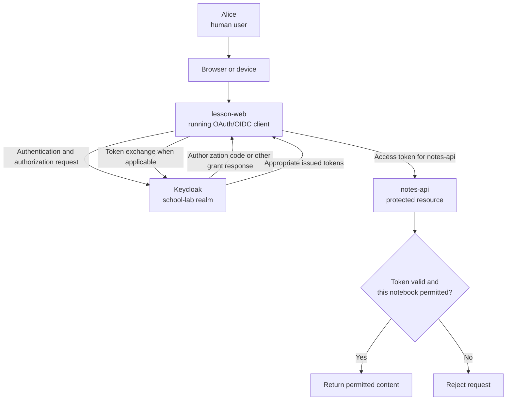
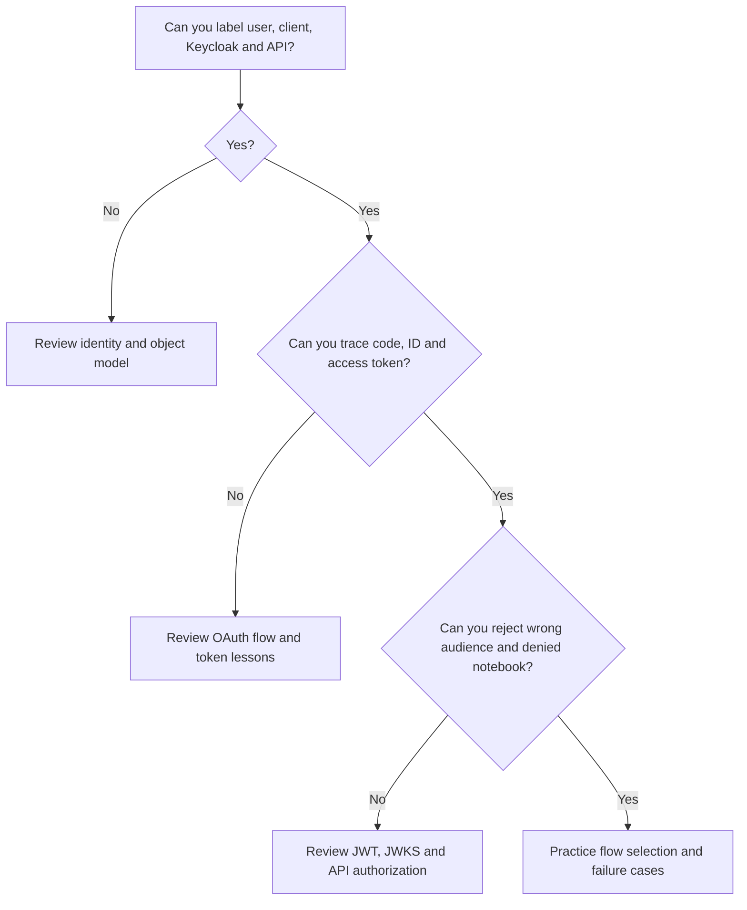

# Learning roadmap: OAuth, OIDC, Keycloak and API security

> **Start here.** Learn the people and application roles first, then follow an authorization request through token issuance and API verification. Finish by selecting appropriate login architectures, testing failures, and explaining why a **valid login does not automatically authorize an API operation**.

This self-paced course is designed for students and practicing software engineers. It uses the same entirely **fictional school example** throughout: Alice is a student, `lesson-web` is an application, `school-lab` is a Keycloak realm, and `notes-api` protects notebooks. All examples are independent of any employer, real deployment, or customer system.

## 1. Five essential questions

| Question | Mechanism to learn | A common misunderstanding |
| --- | --- | --- |
| **Who signed in?** | Authentication, OIDC, session context | OAuth access token automatically proves login to any app |
| **What is allowed?** | OAuth authorization, scopes, roles, API policy | A role claim grants every object |
| **Which application is involved?** | OAuth client, Keycloak registration, public/confidential client | Registering a client deploys its code |
| **Which credential goes where?** | Authorization code, access/ID/refresh tokens | An ID token is an API access token |
| **Why trust a token?** | Issuer, JWKS/signature or introspection, audience, expiry | Base64URL decoding proves authenticity |

Authentication and authorization work together but answer **different questions**. Authentication establishes an identity or session; authorization determines whether an action on a **specific resource** is permitted. OAuth 2.0 defines delegated authorization mechanisms. OpenID Connect (OIDC) layers standardized identity authentication on the OAuth framework. Keycloak is an implementation, not an alternative protocol.

## 2. The complete mental picture

This is a **concept map**, not a literal packet trace for every architecture. For an Authorization Code flow, a browser carries the redirect and code, then the OAuth client exchanges the code. In a Backend-for-Frontend (BFF), OAuth tokens stay on the backend while the browser normally uses an application session cookie. In Device Flow, the user completes authorization on a different device and the client polls the token endpoint.

**Rule to remember:** a Keycloak client registration is configuration for a separately running app; the API is responsible for validating access tokens and enforcing resource permissions.

## 3. Course structure and recommended order

Each row links to the canonical chapter and gives an observable outcome. A learner can move faster through familiar topics, but should be able to answer the self-check before proceeding.

| Module | Chapter | What you should explain after studying |
| --- | --- | --- |
| **A — Foundations** | [01 — Keycloak fundamentals](01-keycloak-fundamentals.md) | Identity provider, user, client, API and role |
| | [09 — OAuth 2.0 vs OIDC vs Keycloak](09-oauth2-oidc-keycloak-relationship.md) | Authorization framework vs identity layer vs server |
| | [08 — Realm, user, client and client scope](08-realm-client-user-client-scope.md) | Which configuration belongs to which Keycloak object |
| **B — Flow selection** | [02 — Choosing authentication/authorization flows](02-authentication-flows.md) | When to use Authorization Code + PKCE, Device or Client Credentials |
| | [11 — Authorization code vs access token](11-authorization-code-vs-access-token.md) | One-time code redemption vs resource access |
| | [10 — PKCE verifier and challenge](10-pkce-generation.md) | S256 challenge sent early, secret verifier sent later |
| **C — Token contents and trust** | [04 — JWT issuance](04-jwt-issuance.md) | Keycloak constructs and signs tokens after a permitted grant |
| | [05 — Claims and protocol mappers](05-claims-and-mappers.md) | `iss`, `aud`, roles, scopes, and how mappers affect claims |
| | [15 — JWT, JWK and JWKS](15-jwt-vs-jwks-verification.md) | Difference between token, verification key and key set |
| **D — Protected APIs** | [07 — Bearer tokens](07-bearer-token.md) | Possession model and why leaked tokens are sensitive |
| | [06 — API access-token validation](06-api-token-validation.md) | Issuer, signature, audience, lifetime and object-level policy |
| **E — Applied flows and browser security** | [03 — Device Authorization Grant](03-device-flow.md) | User/device codes, polling, expiry and cross-device risks |
| | [12 — Keycloak deployment, identity and sessions](12-keycloak-deployment-identity-and-sessions.md) | Persistent identity, hostnames, realm import and sessions |
| | [13 — BFF, Authlib and browser sessions](13-bff-authlib-browser-session-security.md) | Backend-managed tokens vs browser cookie session |
| | [14 — keycloak-js browser adapter](14-keycloak-js-browser-adapter.md) | Browser client adapter, security assumptions and API roles |
| | [16 — CDN, cache and Keycloak assets](16-cdn-vs-cache-keycloak-assets.md) | Public static files vs sensitive session/token boundaries |

The roadmap itself is **Chapter 00**. That is **17 chapters total**: this roadmap plus Chapters 01–16. The order is pedagogical, not a recommendation to enable all Keycloak features simultaneously.

## 4. Four milestones to check your progress

**Milestone 1 — Diagram the actors.** Draw a user, browser, running OAuth client, authorization server and protected API. Label the difference between a running client and a Keycloak client registration.

**Milestone 2 — Follow each credential.** Explain where an authorization code, PKCE challenge, PKCE verifier, access token, ID token and refresh token travel. State the intended recipient of each.

**Milestone 3 — Verify a protected request.** Given a fictional `notes-api` request, explain why an expired token, a token for the wrong audience, an ID-token substitution, or a missing notebook permission must be rejected.

**Milestone 4 — Choose a secure flow.** Given a browser app, a desktop CLI with system-browser access, a constrained TV and a machine-to-machine service, recommend a suitable protocol and explain the threats/limitations.

## 5. Which flow belongs in which application?

| Application scenario | Appropriate starting point | Why / what to check |
| --- | --- | --- |
| Standard web login | **Authorization Code**, normally with PKCE | Browser redirects to identity provider; backend or browser client manages exchange appropriately |
| Browser-based frontend | **Authorization Code + PKCE** and a considered architecture (BFF, token-mediating backend or browser OAuth client) | Token exposure and session controls depend on architecture; see [RFC 10017](https://www.rfc-editor.org/rfc/rfc10017) |
| Native desktop or mobile app | **Authorization Code + PKCE using an external system browser** | Native apps cannot safely ship a shared client secret; follow [RFC 8252](https://www.rfc-editor.org/rfc/rfc8252) |
| Device with no usable browser or input | **Device Authorization Grant**, **only after cross-device risk assessment** | User authorizes on separate device; risk of consent phishing; see [RFC 8628](https://www.rfc-editor.org/rfc/rfc8628) and [RFC 10027](https://www.rfc-editor.org/rfc/rfc10027) |
| Backend service with no end user | **Client Credentials** | Access token represents a service/client identity; it is not Alice's interactive login |
| App asking Alice for username/password to exchange directly | **Do not choose Resource Owner Password Credentials Grant** | OAuth security BCP [RFC 9700](https://www.rfc-editor.org/rfc/rfc9700) says it **MUST NOT** be used |

**Device Flow is not a universal CLI default.** If a desktop CLI can use the system browser and a safe callback, Authorization Code + PKCE is normally the preferable path. Cross-device flows need phishing mitigations, particularly for sensitive or high-value operations.

## 6. Understand the four credentials

| Credential | Recipient | Never confuse with |
| --- | --- | --- |
| **Authorization code** | OAuth client redeems at authorization server token endpoint | Access token presented to API |
| **Access token** | Intended protected API/resource server | Proof of login for arbitrary OIDC clients |
| **ID token** | OIDC relying party/client | API Bearer credential |
| **Refresh token** | Authorization server token endpoint | API access token |

A `device_code` is a further **authorization transaction credential**, not a resource access token. **Bearer** describes how a usable credential can be presented, not whether it uses JWT or opaque serialization.

## 7. Practice without paid tools

Use public standards, the open-source Keycloak distribution and a **disposable local realm** with fictional identities. The course supplies a [Device Flow observation lab](../labs/01-first-jwt-device-flow.md), a [PKCE S256 Python lab](../labs/pkce_generate.py), and [short self-check exercises](../exercises/questions-and-answers.md).

A safe study session:

1. **Read** a chapter and its [detailed teaching-slide outline](../book/slides/README.md).
2. **Draw** the sequence yourself, including where credentials travel.
3. **Predict** a failure response before looking at the explanation.
4. **Experiment** with a disposable local realm or offline sample. Never use real organization accounts, signing keys or live bearer tokens.
5. **Explain back** the core idea in two sentences and answer the chapter self-check.

The lab documentation is a learning path, not a claim that local infrastructure has been deployed or tested.

## 8. Security checklist for every design

- Who is the **user**, **OAuth client**, **authorization server** and **resource API**?
- What is the **grant** and why does that architecture need it?
- Which component holds the **code verifier**, client credential, OAuth tokens or session cookie?
- Is the **issuer trusted**, the signature or introspection valid, and the **audience** correct?
- Are token **purpose, expiry, roles and scopes** checked according to the actual issuer profile?
- Does the API enforce **ownership or tenant/resource permissions** rather than just login?
- Can permissions change between checking a request and executing a delayed action?
- Could a token, session cookie, QR code or device code be **stolen, replayed or phished**?
- Which choices are specific to the installed Keycloak version, browser environment or client type?

## 9. Vocabulary in plain language

| Word | Meaning |
| --- | --- |
| **Authentication** | Establishing an account identity or authentication event |
| **Authorization** | Deciding which action is permitted on which resource |
| **Keycloak realm** | Identity administration and issuer configuration boundary |
| **OAuth client** | Running app that initiates authorization and obtains tokens |
| **Client registration** | Keycloak-side metadata for that running app |
| **Resource server** | API that protects data/actions and evaluates access credentials |
| **OIDC** | Authentication/identity protocol layer built on OAuth 2.0 |
| **PKCE** | Request-specific proof binding authorization-code redemption to its initiator |
| **JWT** | JSON-based token claims representation, often signed |
| **JWK / JWKS** | One cryptographic key description / set of such descriptions |
| **Scope / role** | Authorization context values, not automatic object-level access |
| **BFF** | Backend-for-Frontend: a backend that handles OAuth tokens while browser uses an application session |
| **Bearer** | Credential usable by whoever possesses it, subject to API validation and permission |

## 10. End-of-roadmap self-check

1. **Does OAuth 2.0 itself standardize the user's identity login result?** Not in the way OIDC does; OIDC adds authentication semantics including ID tokens.
2. **Does creating a Keycloak client deploy an application?** No.
3. **Does a correctly signed access token for `billing-api` work at `notes-api`?** No; wrong intended audience.
4. **Where does the PKCE verifier go?** The token endpoint during code exchange.
5. **Can Device Flow issue access tokens before user approval?** No, not through the pending device authorization request.
6. **If the device has a safe external-browser login option, should Device Flow always be chosen?** No; evaluate Authorization Code + PKCE first.
7. **Do client scopes assign user roles?** No.
8. **Does a role such as `notes:read` authorize all students' private notebooks?** No.
9. **Does a BFF make a browser immune to CSRF or XSS?** No; session-cookie security and application defenses remain essential.
10. **Is decoding a JWT the same as validating it?** No.

## Official standards and next steps

- [RFC 6749 — OAuth 2.0](https://www.rfc-editor.org/rfc/rfc6749)
- [RFC 9700 — OAuth Security Best Current Practice](https://www.rfc-editor.org/rfc/rfc9700)
- [RFC 10017 — OAuth 2.0 for Browser-Based Applications](https://www.rfc-editor.org/rfc/rfc10017)
- [RFC 8252 — OAuth 2.0 for Native Apps](https://www.rfc-editor.org/rfc/rfc8252)
- [RFC 8628 — Device Authorization Grant](https://www.rfc-editor.org/rfc/rfc8628)
- [RFC 10027 — Security of Cross-Device Flows](https://www.rfc-editor.org/rfc/rfc10027)
- [OpenID Connect Core](https://openid.net/specs/openid-connect-core-1_0.html)
- [Keycloak Documentation](https://www.keycloak.org/documentation)

Continue with [Keycloak fundamentals](01-keycloak-fundamentals.md), then use the [book index](../book/README.md) to revisit any module.

*Generic technical education only. This chapter deliberately excludes personal study progress, private conversations, operating environments and publication strategy.*
