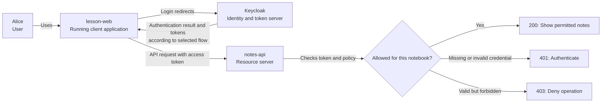
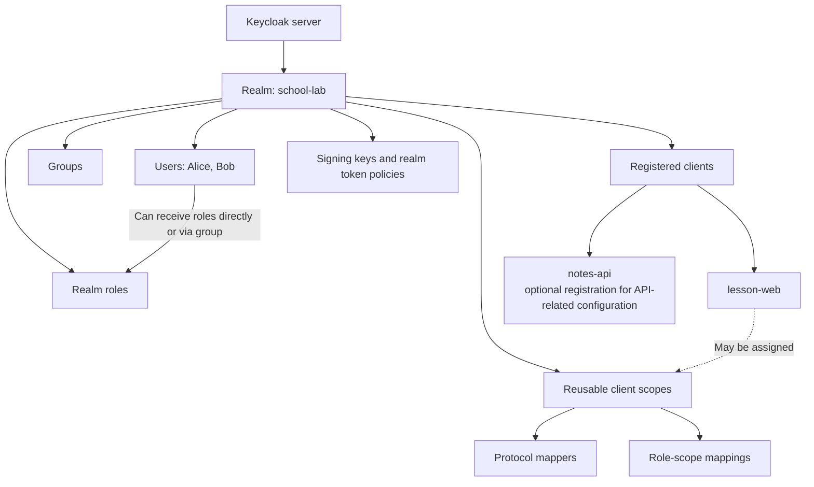
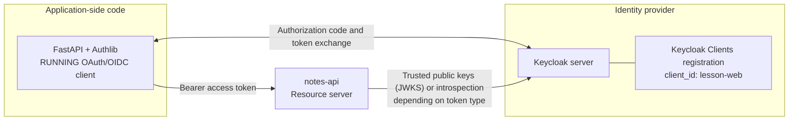
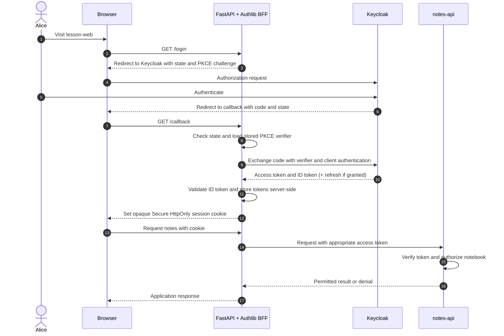
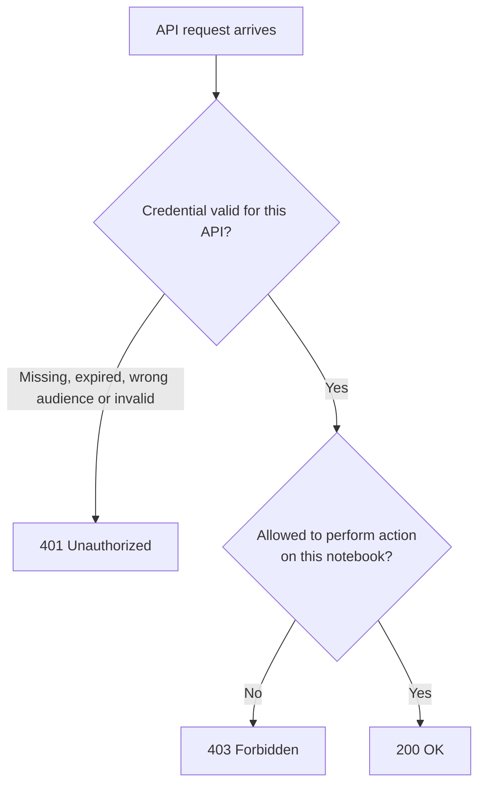
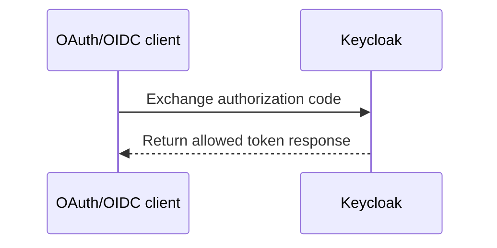

# Keycloak fundamentals: realm, user, client and API

> **In one minute:** Keycloak is the **identity server**. Your application is the **OAuth/OIDC client**. Your API is the **resource server**. They have different jobs, and a successful login does not automatically grant permission to use every API.

All people, addresses and systems below are fictional classroom examples. The technical explanations are for learning, not a turnkey production configuration.

## 1. Understand the four main actors

Imagine a school notebook application:

- **Alice (user)** wants to see her notes.
- **`lesson-web` (running application)** redirects Alice to Keycloak to sign in. It acts as an OAuth/OIDC client.
- **Keycloak (identity provider / authorization server)** verifies Alice's identity under a realm's policies, then issues credentials when the requested flow succeeds.
- **`notes-api` (resource server)** accepts an appropriate access credential and decides whether Alice may read the specific notebook.



*Diagram simplification:* When `lesson-web` uses a Backend-for-Frontend (BFF), its **backend** receives OAuth tokens and calls `notes-api`. The **browser** carries only an application session cookie. A browser-only SPA instead runs OAuth client code in the browser and may handle access tokens directly. We distinguish both architectures below.

**Never confuse:** authentication means checking who someone is; authorization means deciding which resources and actions are permitted.

## 2. Keycloak's object hierarchy

Keycloak can host multiple **realms**. A realm is a security/administrative boundary with its own issuer URL, users, client registrations, roles, settings and signing keys. A realm is not the same thing as a user, an app, or a resource API.



| Keycloak concept | Simple explanation | Classroom example |
| --- | --- | --- |
| **Realm** | Separate identity namespace and policy boundary | `school-lab` |
| **User** | Account whose identity may be authenticated | `alice` |
| **Group** | Collection of users, possibly with inherited roles | `students` |
| **Realm role** | A role defined in a realm | `teacher` |
| **Client role** | A role defined under a particular client | `notes-api:reader` |
| **Client registration** | Keycloak-side record describing an OAuth/OIDC application | `lesson-web` |
| **Client scope** | Reusable mapping/configuration affecting requested scopes and token claims | `profile`, `email`, `roles` |
| **Protocol mapper** | Rule for adding selected values/claims to tokens | Map an attribute to a custom claim |
| **Resource server** | API enforcing protected-resource permissions | `notes-api` |

**Important:** Keycloak's client-scope configuration influences what goes into a token; it does **not** automatically authorize access to every protected API resource.

## 3. Where does the OAuth/OIDC client run?

There are two uses of the word *client* that newcomers often confuse:

1. **Running client application:** code on the application side, such as a React SPA, mobile app, CLI, or Python FastAPI backend using Authlib.
2. **Client registration in Keycloak:** a record on the **identity-provider side**, containing the `client_id`, allowed redirect URIs, authentication methods, flows and scope-related configuration.

The two sides must agree on the `client_id`, but they are not two copies of the same software.



**A Keycloak registration does not deploy your FastAPI application.** The application runs separately. If the browser uses a BFF, the browser itself is not the OAuth client handling tokens in that architecture.

## 4. Is Authlib the client?

**Authlib is a Python library; your running application using Authlib is the OAuth/OIDC client.** In a FastAPI/Starlette integration, the library can help initiate authorization redirects, exchange an authorization code, and validate OIDC results. Authlib can also provide other OAuth roles in other setups, but that does not make it the Keycloak server in this example.

The following is **illustrative configuration**, not a runnable production login app:

```python
import os
from authlib.integrations.starlette_client import OAuth

oauth = OAuth()
oauth.register(
    name="keycloak",  # Local nickname; does NOT register a client with Keycloak
    client_id="lesson-web",  # Must match the existing Keycloak client ID
    client_secret=os.environ["KEYCLOAK_CLIENT_SECRET"],
    server_metadata_url=(
        "https://login.example.test/realms/school-lab/"
        ".well-known/openid-configuration"
    ),
    client_kwargs={
        "scope": "openid profile",
        "code_challenge_method": "S256",
    },
)
```

The server URL `login.example.test` is **not a real service**; supply your own disposable, trusted test issuer. This example assumes a **confidential** client registration, TLS, protected backend secrets, valid callback URIs and appropriate session management.

In a complete application, a login route would call `authorize_redirect(request, redirect_uri)`; the callback would use `authorize_access_token(request)`, validate the OIDC response, and establish an application session. The library's `register()` call only configures the **local application**. You must configure the Keycloak registration separately.

## 5. Browser-only application vs BFF

The OAuth client may run in different places. **Choose a pattern deliberately; do not mix its token handling rules with another pattern.**

| Architecture | OAuth client runs in | Browser handles | Important defense |
| --- | --- | --- | --- |
| **SPA** | Browser JavaScript | OAuth flow and tokens, according to design | Public client + Authorization Code with PKCE; never embed a client secret |
| **Backend-for-Frontend (BFF)** | Backend (e.g., FastAPI + Authlib) | Application session cookie and login redirects | Keep OAuth tokens on server, use an opaque cookie, protect CSRF |
| **Native/CLI** | Installed application | System browser when available | Public client + PKCE or Device Flow when appropriate |
| **Service to service** | Trusted service | No end-user browser required | Client Credentials with protected service credentials |



**A subtle but important warning:** Starlette's standard `SessionMiddleware` uses **signed cookie-based sessions whose contents are readable**, though tamper-detectable. Storing OAuth access/refresh tokens in `request.session` under this default middleware does **not** keep them server-side. For a full BFF, use **server-side token storage** and send the browser only an opaque session identifier in a `Secure`, `HttpOnly`, appropriately `SameSite` cookie. Configure HTTPS, lifecycle/expiration, session rotation, logout, CSRF protection and token refresh carefully.

**Authlib does not automatically guarantee** that all tokens remain on the backend. That depends on the application's storage and session design.

## 6. Public vs confidential OAuth clients

| Client type | Can protect authentication credentials? | Examples | Appropriate approach |
| --- | --- | --- | --- |
| **Public** | Cannot reliably keep a long-lived shared client secret | SPA, installed mobile app, CLI | Authorization Code with PKCE (or Device Flow for input-constrained devices) |
| **Confidential** | Can protect client credentials in a trusted server | Backend web app, server-to-server service | Server-side client authentication; PKCE recommended for interactive code flows |

In typical Keycloak configuration, **Client authentication ON** corresponds to confidential clients and **OFF** to public clients. Exact UI labels vary by version and flow.

**Use RFC 9700 security guidance:** Public clients **MUST use PKCE** in authorization-code flows, while PKCE is **recommended for confidential clients**. Never put a client secret into browser JavaScript or a distributable CLI binary. The resource owner password credentials grant is not a suitable new design.

## 7. Does a client registration make an API call authorized?

No. Registering `lesson-web` merely tells Keycloak about the client. Even a valid token does not confer permission on every notebook.

For an appropriate JWT access token, the API should check signature with trusted keys and allowed algorithms, issuer, intended audience, validity times and applicable token purpose, plus the required scopes/roles and **object-level authorization**.

For example, Alice may have `notes:read` but must still be denied access to Bob's private notebook unless another explicit rule authorizes it.



HTTP status codes illustrate common API behavior; a full application may have additional error-handling constraints. APIs may use token introspection for opaque tokens or other suitable cases.

## 8. Why are some lines dashed in Mermaid diagrams?

Diagrams represent *relationships* and *message flow*, not automatically the strength of security.

| Diagram feature | Conventional interpretation |
| --- | --- |
| `Client->>Keycloak` (sequence, solid arrow) | Request or action |
| `Keycloak-->>Client` (sequence, dotted arrow) | Response or return message |
| Vertical dashed lifeline under a participant | Participant's existence along the timeline; time proceeds downward |
| `A --> B` (flowchart) | Directed relationship |
| `A --- B` (flowchart) | Solid association, no arrowhead |
| `A -.-> B` (flowchart) | Dotted directed relationship, when defined by diagram author |

**A dotted line does not mean an insecure request, optional authentication, or a failed connection.** In a flowchart, three hyphens `---` produce a **solid unheaded line**, not a dashed arrow.



See [Mermaid sequence diagrams](https://mermaid.js.org/syntax/sequenceDiagram.html) and [flowchart link syntax](https://mermaid.js.org/syntax/flowchart.html).

## 9. Find the concepts in Keycloak

In a **disposable local test realm**:

1. **Realm selector:** select or create a `school-lab` realm. Realms maintain separate users, clients and issuer settings.
2. **Users:** create a fictional test account and explore credentials, attributes, groups and role mappings.
3. **Clients:** register `lesson-web` using OpenID Connect; configure `Client ID`, `Client authentication`, valid redirect URIs and permitted flows. Avoid overly broad redirect patterns.
4. **Client scopes:** inspect `profile`, `email` and `roles`; distinguish default vs optional scopes and mappers. The `Client scopes → Evaluate` interface can inspect effective mappings; location varies by version.
5. **Realm settings:** inspect token policy and signing keys; never export private signing material or live tokens for documentation.

The standard discovery endpoint is relative to the realm: `/realms/school-lab/.well-known/openid-configuration`. Read its response to find the current authorization, token and JWKS endpoints rather than guessing them.

A user's identity may come from Keycloak-local storage, LDAP, or a brokered external identity provider. Keycloak can support SAML separately from OIDC; **LDAP and SAML are not token types in an OAuth flow**.

## 10. Test your understanding

1. **Who is the OAuth/OIDC client?** The running application, such as `lesson-web`; its registration exists separately in Keycloak.
2. **Where does Authlib run?** In your Python application process, not inside Keycloak.
3. **Does a `client_id` grant API privileges?** No, it identifies a registered client. The API still checks tokens and policy.
4. **Can a public SPA protect a shared client secret?** No.
5. **Where do tokens live in a secure BFF?** In backend-controlled storage, with an opaque browser session cookie.
6. **Is Starlette's default session cookie server-side storage?** No, signed-cookie session contents are readable by the browser.
7. **What does a dashed lifeline mean in a sequence diagram?** Time/participant presence, not a message.
8. **If Alice is authenticated, can she read Bob's notebook?** Only if the API's object-level authorization explicitly permits it.

**Continue learning:** [Realm, Client, User and Client Scope](08-realm-client-user-client-scope.md), [OAuth vs OIDC vs Keycloak](09-oauth2-oidc-keycloak-relationship.md), [PKCE](10-pkce-generation.md), [BFF](13-bff-authlib-browser-session-security.md) and [API validation](06-api-token-validation.md).

## Official sources

- [Keycloak Server Administration Guide](https://www.keycloak.org/docs/latest/server_admin/) — realms, clients, client scopes, roles and mappers.
- [Keycloak OIDC applications](https://www.keycloak.org/securing-apps/oidc-layers) — provider roles and endpoints.
- [Authlib Web Clients](https://docs.authlib.org/en/latest/oauth2/client/web/) — authorization redirects, code exchange and client integrations.
- [Starlette SessionMiddleware](https://www.starlette.io/middleware/#sessionmiddleware) — signed, readable browser session cookies.
- [OAuth 2.0 Security BCP — RFC 9700](https://www.rfc-editor.org/rfc/rfc9700) — PKCE, secure redirect validation and client classification.
- [OpenID Connect Core 1.0](https://openid.net/specs/openid-connect-core-1_0.html) — OpenID Provider and relying party.
- [Mermaid diagram documentation](https://mermaid.js.org/).

*Only generic educational examples are provided. Check behavior against your installed Keycloak/Authlib versions before implementing production authentication.*
