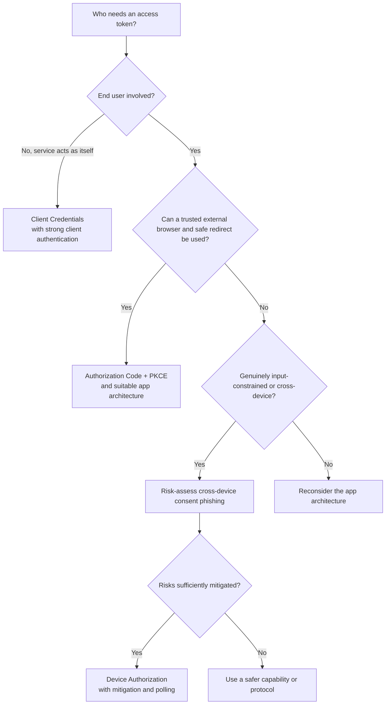
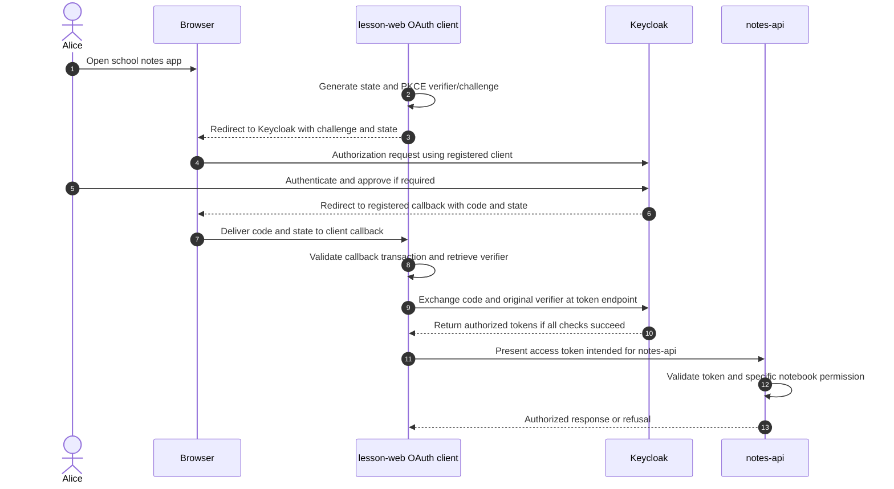
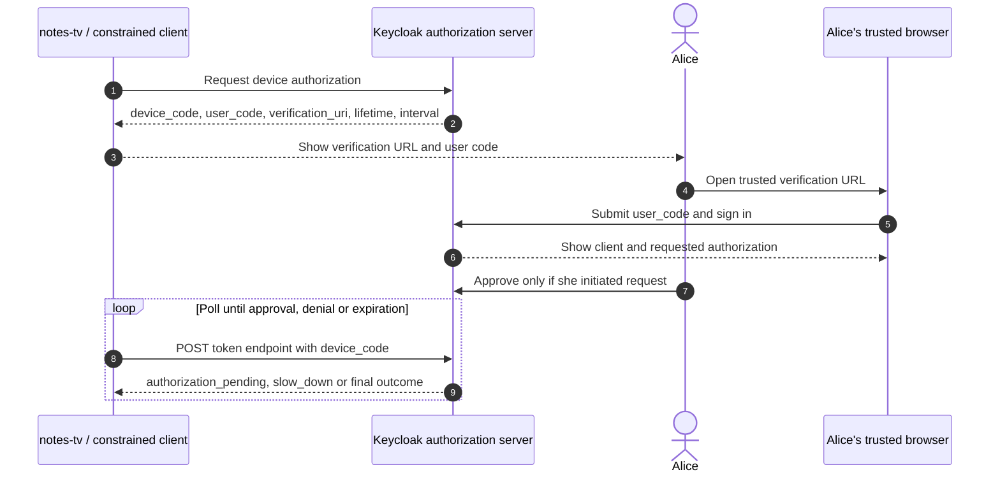
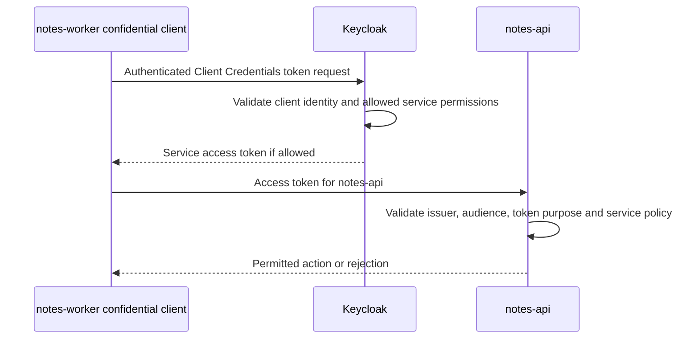

# Choosing OAuth and OIDC flows: which one fits the application?

> **Simple answer:** Select an OAuth grant and application architecture based on **who needs access, where the code runs, and whether a user can use a trusted browser**. For interactive login, **Authorization Code + PKCE** is the usual starting point; Device Authorization is for genuinely constrained or cross-device cases; Client Credentials is for a service acting as itself.

OAuth 2.0 grants are **ways to obtain tokens**, not authorization permissions or substitutes for API policy. OIDC adds standardized user authentication outcomes to compatible OAuth flows. The examples use only a fictional `school-lab` Keycloak realm, user Alice, `lesson-web`, `notes-cli`, `notes-tv`, `notes-worker` and `notes-api`.

## 1. Three questions before selecting a flow

1. **Is an end user signing in?** If yes, the chosen mechanism should support the required authentication experience. If no, a service may use a grant representing itself.
2. **Where does the client code run?** A trusted backend can protect its client-authentication credential; browser JavaScript and distributed native apps cannot safely keep one secret shared across installations.
3. **Can the user use an external browser and a safe redirect?** If yes, an authorization-code design is generally preferable; if not, consider a carefully risk-assessed cross-device pattern.

The flowchart is **teaching guidance, not a normative algorithm**: client authentication, issuer constraints, application sensitivity and deployment requirements must also be considered.

## 2. Compare the principal options

| Grant / method | Suitable for | What happens | Principal risk or condition |
| --- | --- | --- | --- |
| **Authorization Code + PKCE** | Web login, browser apps, native/desktop apps with external browser | Client starts a browser authorization, receives a one-use code, exchanges it with PKCE verifier | Bind transaction, exact redirects, issuer, session and key flow parameters |
| **Device Authorization (RFC 8628)** | Constrained screen/remote, no usable browser or redirect | Client receives device/user codes; user authorizes on another device; client polls token endpoint | Cross-device consent phishing, device-code secrecy and polling limits |
| **Client Credentials** | Backend service acting as itself, not Alice | Authenticated client obtains service access token | Don't confuse client/service principal with a human; protect authentication material |
| **Refresh Token grant** | Existing authorized client renewing token, if granted | Client requests fresh tokens at token endpoint | Refresh-token protection and rotation/reuse policy |
| **Resource Owner Password Credentials (ROPC)** | Historical legacy only — **do not choose** | Client directly collects user password | **RFC 9700: MUST NOT be used** |
| **Implicit grant** | Historical browser-era approach — **do not choose for new browser apps** | Token returned through browser front channel | More exposure and poor compatibility with modern BCP; use code flow instead |

Don't use `grant_type=password` merely because Keycloak offers a **Direct Access Grants** switch for compatibility. A server feature existing does not make that grant secure for a new design.

## 3. Authorization Code + PKCE step by step

**Use case:** Alice opens the `lesson-web` app in her browser.

**Important:** the client sends the **S256-derived challenge** with the authorization request and keeps the **original verifier** until token exchange. Public authorization-code clients **MUST** use PKCE under [RFC 9700](https://www.rfc-editor.org/rfc/rfc9700); it is **recommended for confidential clients**. A confidential backend also authenticates at the token endpoint using its registered method; PKCE does not replace client authentication.

`state`, transaction binding, redirect URI checks and protection against mix-up attacks are important independent defenses. For OIDC, validate the ID token intended for the client and applicable nonce requirements. The protected API expects a suitable **access token**, not the ID token.

Read [Authorization Code vs Access Token](11-authorization-code-vs-access-token.md) and [PKCE generation](10-pkce-generation.md).

## 4. Browser application architectures are not all the same

There are at least three different browser-facing OAuth architectures:

| Architecture | Who is the OAuth client? | Browser sees OAuth tokens? | Key security consideration |
| --- | --- | --- | --- |
| **Backend-for-Frontend (BFF)** | Trusted application backend | Normally **no**: browser has application session cookie | Server-side token handling, cookie security, CSRF and XSS protections |
| **Token-mediating backend** | Backend mediates OAuth and can return tokens to frontend | **Yes**, for API calls under that pattern | Treat browser token access and XSS risks explicitly |
| **Browser-based OAuth client** | Browser JavaScript | **Yes**, client receives tokens | Public client with PKCE; strict browser/script and token handling |

All can use an Authorization Code based design where appropriate. The architecture determines **who exchanges codes, where tokens are kept, and how the browser calls APIs**. Browser login is not synonymous with `keycloak-js` or with tokens kept in JavaScript.

See [RFC 10017 (August 2026)](https://www.rfc-editor.org/rfc/rfc10017) and the [BFF/Authlib lesson](13-bff-authlib-browser-session-security.md). A BFF reduces certain token-exfiltration risks but does **not** eliminate CSRF, XSS or session abuse.

## 5. Native app or CLI with a usable browser

A desktop or mobile application is generally a **public client**: shipping a shared client secret in source code or a binary is not secure client authentication.

The secure starting point is **Authorization Code + PKCE using an external system browser**, as described by [RFC 8252](https://www.rfc-editor.org/rfc/rfc8252). Native apps may receive redirects through supported OS mechanisms. For desktop, an **HTTP loopback-IP redirect** is a specially permitted local exception, and must bind to the loopback interface and validate the exact redirect transaction; it is **not** permission to use insecure HTTP redirects to arbitrary hosts.

**Do not embed a normal browser password screen inside an app-owned WebView as a shortcut.** The external browser separation protects the user-authentication context.

## 6. Device Authorization Grant: user completes login elsewhere

A smart TV with a remote, or a CLI without a usable browser/callback, may start the Device Authorization Grant (RFC 8628).

The client never handles Alice's password. The server **does not push tokens unsolicited to the device**: the result is delivered in response to its **token endpoint polling**. The `user_code` is for the human verification page; the **device code is a sensitive credential**, held by the device for polling.

**Newer security consideration:** [RFC 10027](https://www.rfc-editor.org/rfc/rfc10027) (August 2026) says implementers **MUST assess cross-device risks** and select mitigations. Consent phishing can trick someone into approving an attacker's initiated device login. If a safe same-device browser flow is practical, **do not default to Device Flow**.

See the detailed [Device Flow chapter](03-device-flow.md).

## 7. Client Credentials: the caller is the service

This flow does **not** mean Alice logged in. The token represents the **client/service principal**, subject to the authorization server's account and permission model.

A service token should not be treated as a human-user token. An API must distinguish those identities if it supports both client and user grants, avoiding client-impersonation or claim-context confusion.

## 8. Why direct password exchange is not a good login shortcut

A historical **Resource Owner Password Credentials grant** required the application to collect the human's password and forward it to the authorization server. That broadens password exposure, harms phishing resistance and does not naturally support modern MFA, passkeys and redirected identity-provider authentication.

**RFC 9700 §2.4 explicitly says this grant MUST NOT be used.** It is retained in this course only as a **historical anti-pattern**. There is no lab that asks a beginner to implement or enable it.

The historical **Implicit grant** also does not belong in a new browser application. Use Authorization Code + PKCE in a suitable architecture instead.

## 9. Device Flow versus browser-based login: the important tradeoff

| Consideration | Auth Code + PKCE | Device Authorization |
| --- | --- | --- |
| User authentication interface | Trusted browser on same device, redirect back | Separate authorization device/browser |
| Code exchange | Client redeems one-time authorization code with verifier | Client polls with `device_code` after separate approval |
| Primary anti-interception mechanism | PKCE and redirect/transaction checks | Device-code secrecy, expiry, strict polling plus cross-device safeguards |
| Applicable to normal desktop CLI | **Usually yes**, with external browser + safe callback | Only if constrained or other viable options unavailable |
| Phishing concern | Redirect/consent manipulation and client compromise | **Cross-device consent phishing** and unauthenticated device-to-device context |
| Appropriate for high-risk resources | Requires robust client, issuer and resource security | Extra risk assessment; may need stronger alternative |

**Neither flow grants universal resource permission.** After issuance, `notes-api` checks token validity and whether the caller may perform the exact requested action on the particular notebook.

## 10. Keycloak settings to inspect safely

On a **disposable local realm and fictional clients**, inspect:

- **Standard Flow** for Authorization Code support and registered redirect URIs.
- Public versus confidential client authentication mode, and enforce **S256 PKCE** where appropriate.
- The **OAuth 2.0 Device Authorization Grant** capability and device authorization endpoint if using a constrained test client.
- **Service Accounts** and client-authentication settings if testing Client Credentials.
- **Direct Access Grants** as a **legacy feature to leave disabled** for new designs.
- Client scopes, role mappings and audience mappers so tokens are restricted to the intended API.

The exact Admin Console labels and defaults vary by Keycloak version. Use its [administration guide](https://www.keycloak.org/docs/latest/server_admin/) and [OIDC endpoint documentation](https://www.keycloak.org/securing-apps/oidc-layers), not screenshots from another installation.

## 11. Common selection mistakes

1. **“Every CLI should use Device Flow.”** No; choose external-browser Authorization Code + PKCE when feasible.
2. **“OAuth flow = API permissions.”** No; a grant obtains tokens, and the API later enforces authorization.
3. **“A service token means Alice signed in.”** No; Client Credentials represents the client/service.
4. **“PKCE makes client authentication unnecessary for a confidential backend.”** No.
5. **“The browser has no OAuth tokens in every web application.”** Only some designs, notably a full BFF.
6. **“If Keycloak supports Password Grant it is safe.”** No; current OAuth BCP explicitly prohibits using it.
7. **“QR code login from any source is safe.”** No; cross-device authorization can be phished.
8. **“A token signed by Keycloak works at all applications.”** No; issuer, audience, token kind and resource policy still matter.

## 12. Self-check questions

1. **Web application with a trusted backend?** Start with Authorization Code, often a BFF with PKCE, plus browser session defenses.
2. **Native desktop CLI with an external browser?** Authorization Code + PKCE and a safe native callback.
3. **Constrained television remote?** Consider risk-assessed Device Authorization, with cross-device phishing mitigations.
4. **Backend service accessing a protected API as itself?** Client Credentials.
5. **Is Device Flow's `user_code` an API bearer token?** No.
6. **Does Client Credentials perform end-user authentication?** No.
7. **Should a new app use ROPC for simplicity?** No, it MUST NOT be used per RFC 9700.
8. **What does an Authorization Code callback contain?** A one-time code (and transaction state when sent), not an access token.
9. **Why must the resource API check `aud`?** To verify the token is intended for it.
10. **Can an ID token be used as a Bearer API access token?** No.

## Sources and next chapter

- [RFC 6749 — Authorization Code and Client Credentials](https://www.rfc-editor.org/rfc/rfc6749)
- [RFC 7636 — PKCE](https://www.rfc-editor.org/rfc/rfc7636)
- [RFC 8252 — Native Apps](https://www.rfc-editor.org/rfc/rfc8252)
- [RFC 8628 — Device Authorization Grant](https://www.rfc-editor.org/rfc/rfc8628)
- [RFC 9700 — OAuth 2.0 Security BCP](https://www.rfc-editor.org/rfc/rfc9700)
- [RFC 10017 — Browser-Based Applications](https://www.rfc-editor.org/rfc/rfc10017)
- [RFC 10027 — Security of Cross-Device Flows](https://www.rfc-editor.org/rfc/rfc10027)
- [Keycloak OIDC endpoints](https://www.keycloak.org/securing-apps/oidc-layers)
- [Next: Device Flow details](03-device-flow.md) · [Code vs access token](11-authorization-code-vs-access-token.md) · [BFF/Authlib](13-bff-authlib-browser-session-security.md)

*Independent teaching content. No live application configuration, customer infrastructure or real user credentials are used.*
