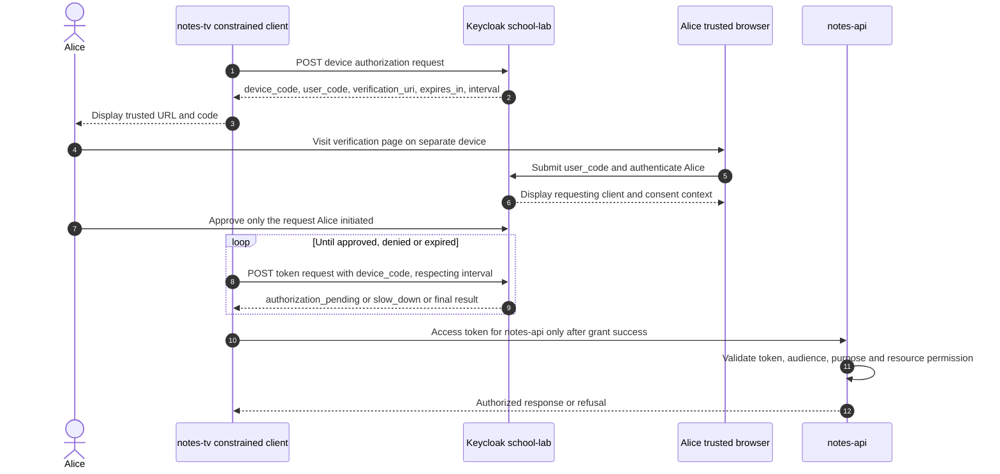
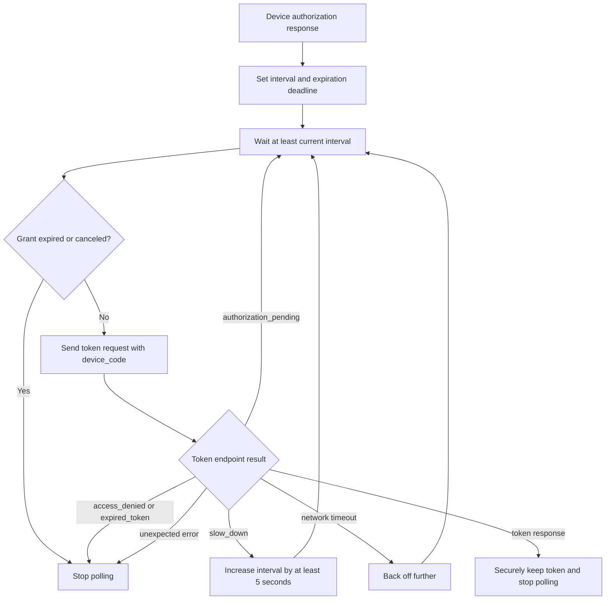
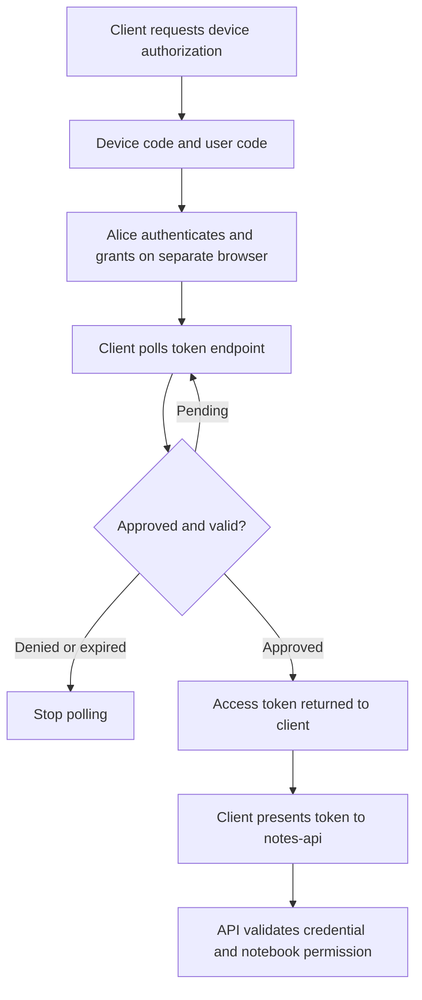

# OAuth Device Authorization Grant: user codes, polling and security

> **Simple explanation:** Device Flow lets a constrained application—such as a smart TV—request authorization **without collecting the user's password**. The user signs in on a **separate trusted browser/device**, while the original application polls the authorization server until the request is approved, denied or expired.

This tutorial follows [RFC 8628](https://www.rfc-editor.org/rfc/rfc8628) and the newer [RFC 10027](https://www.rfc-editor.org/rfc/rfc10027) cross-device security guidance. All actors are fictional: student Alice, `notes-tv`, Keycloak realm `school-lab` and `notes-api`.

**Important selection rule:** Device Flow is **not** the preferred default for a desktop CLI or same-device app that can safely open an external browser and receive a redirect. Review [flow selection](02-authentication-flows.md) before implementing it.

## 1. Why does Device Flow exist?

Suppose Alice wants to open a school learning service on a smart TV. Typing a long password and completing MFA with a remote control is difficult. Instead:

1. The TV obtains a **device code** and a **short user code** from Keycloak.
2. The TV displays a trusted verification URL and the user code.
3. Alice uses her phone or laptop browser to open the verification URL, enter the code and authenticate.
4. The TV waits and polls Keycloak at the prescribed interval.
5. **Only after approval and successful token request** can the TV receive an access token for the intended API.

Alice's password stays in the browser-to-identity-provider authentication context; the TV application does **not** receive her password.

## 2. The complete end-to-end sequence



**Diagram note:** the TV's token comes from a **response to its polling request**. Keycloak does not send an unsolicited token push to the TV. The loop is conceptual; after any terminal outcome (success, denial or expiry) the client stops polling.

## 3. Two codes, two different jobs

| Field in device authorization response | Who handles it? | Purpose / caution |
| --- | --- | --- |
| `device_code` | **Original client only** | A sensitive device grant credential used at the token endpoint; do not display or log it |
| `user_code` | Human user and verification page | Short code pairing the browser approval with this pending request; do not share unexpected login codes |
| `verification_uri` | Human browser | Official issuer verification endpoint; validate origin and context |
| `verification_uri_complete` (optional) | Human browser when provided | Pre-composed verification URL or QR target; still confirm expected request |
| `expires_in` | Device client | Authorization lifetime, counted from response receipt |
| `interval` (optional) | Device client | Minimum seconds between polling requests; **default is five seconds if omitted** |

These are **not** access tokens. In particular, the **user code is intentionally shown to the user** and is not equivalent to the secret device code, but it still must not be solicited by untrusted people or pasted into unexpected third-party approval pages.

Schematic response with fictional values:

```json
{
  "device_code": "SYNTHETIC_DEVICE_CODE_NOT_REAL",
  "user_code": "Q7RT-8K2P",
  "verification_uri": "https://login.example.test/device",
  "expires_in": 600,
  "interval": 5
}
```

Exact Keycloak verification URLs, fields, validation requirements and default settings depend on server configuration/version. Prefer **OIDC discovery metadata** over hardcoded production endpoints.

## 4. How the device starts the request

The device authorizes itself as the registered OAuth client by sending an **application/x-www-form-urlencoded** request to the advertised **device authorization endpoint**. For a public client, the example includes its client ID:

```http
POST /realms/school-lab/protocol/openid-connect/auth/device HTTP/1.1
Host: login.example.test
Content-Type: application/x-www-form-urlencoded

client_id=notes-tv&scope=openid%20profile
```

This is **illustrative**, not a live endpoint or an invitation to automate a real account. When supported, client authentication rules depend on the registered client type; a confidential client must authenticate according to its configured method.

In Keycloak, discovery is normally available at:

```text
https://login.example.test/realms/school-lab/.well-known/openid-configuration
```

Inspect its `device_authorization_endpoint` and `token_endpoint` values. Keycloak exposes a corresponding capability when the device authorization grant is enabled for the client.

## 5. What does Alice do?

Alice should open the **issuer's trusted verification page** and submit the `user_code` from the TV. Keycloak may show client identity, requested access and the need to approve.

**The security issue:** A code or QR image copied from another device is not inherently authenticated. An attacker can start their own device authorization request and trick someone into approving it. Therefore Alice should confirm that she **personally started** the request, that the device and client match the one she is using, and that the permission request makes sense.

The presence of the correct website and a recognizable client name helps but does **not by itself eliminate cross-device consent phishing**. Stronger system-level mitigations may be required, especially for sensitive applications.

## 6. The token endpoint polling request

The device sends the RFC-defined device-code grant to the **token endpoint**, not the device authorization endpoint:

```http
POST /realms/school-lab/protocol/openid-connect/token HTTP/1.1
Host: login.example.test
Content-Type: application/x-www-form-urlencoded

grant_type=urn%3Aietf%3Aparams%3Aoauth%3Agrant-type%3Adevice_code&device_code=SYNTHETIC_DEVICE_CODE_NOT_REAL&client_id=notes-tv
```

The actual grant type is `urn:ietf:params:oauth:grant-type:device_code` (URL-encoded above). The device code binds the pending transaction; the user code is **not** sent as a replacement for it to the token endpoint.

Before approval, a token endpoint may respond with an OAuth error payload such as:

```json
{"error":"authorization_pending"}
```

An error response while waiting does **not** mean a token was issued. After Alice approves and all other checks pass, a later poll may return a token response. The client should protect access/refresh tokens and send only an appropriate **access token** to its intended API.

## 7. Polling rules — an exact table

RFC 8628 §3.5 supplies these client rules:

| Token endpoint outcome | Meaning | Correct client reaction |
| --- | --- | --- |
| `authorization_pending` | User has not completed authorization | Wait at least current `interval`; retry while unexpired |
| `slow_down` | Server asks to poll less often | **Increase the interval by at least 5 seconds** for all subsequent polling |
| `access_denied` | User or server denied authorization | **Stop** polling |
| `expired_token` | Device grant no longer valid | **Stop**; user may initiate a new authorization |
| Successful token response | Grant approved and valid | **Stop** polling; protect tokens and call intended resource |
| Network connection timeout | Server response unavailable | **Reduce polling frequency**, e.g. exponential backoff; respect deadline |
| Unrecognized terminal OAuth error | Not an approved grant | **Do not assume success**; handle or stop safely |

The default polling interval when omitted is **5 seconds**. An example sequence:

```text
Initial interval = 5 seconds
authorization_pending → still 5 seconds minimum
slow_down             → 10 seconds minimum for future polls
another slow_down     → 15 seconds minimum for future polls
access_denied         → STOP; no more polling
```

These are **minimum wait intervals**. The client may wait longer to avoid load, and must obey the device grant's expiry. Never busy-loop or keep polling after a terminal error.



The example's state machine is conceptual; a production client should use a standards-aware library with retries, cancellation and error handling tested against its issuer.

## 8. Why an access token appears only later



The device authorization response `device_code` and `user_code` do **not** authorize `notes-api` requests. Even a token obtained after approval can only be used at a resource server for which it is valid and authorized.

## 9. Newer cross-device security guidance

[RFC 10027 (August 2026)](https://www.rfc-editor.org/rfc/rfc10027) explains that Device Authorization can suffer **cross-device consent phishing** because the code/QR context is transferred over a channel that does not itself prove which physical device initiated the request.

For system designers, the current guidance includes:

- **Risk assessment is mandatory before implementing cross-device flows.** Consider sensitivity, likelihood of consent phishing and alternatives.
- **Avoid cross-device authorization** if its risks cannot be sufficiently mitigated. Do not choose it for same-device cases when a normal authorization-code redirect is suitable.
- Select mitigations matching the threat model; examples include device registration/restriction, short-lived or one-use codes, proximity checks where feasible, a strong approval screen and secure recovery from mistaken consent.
- Reduce reliance on users as the only channel-authentication defense. Clear text and a legitimate-looking QR code alone are **not** sufficient assurances.
- Exercise particular caution for high-value or business-critical resources. Cross-device grants may require stronger controls or a different protocol.

This is a **security lesson**, not an instruction for implementing every mitigation from the RFC. A product must choose and test controls appropriate to its environment.

## 10. Common mistakes and how to correct them

| Mistake | Correction |
| --- | --- |
| Device Flow should always be used for any CLI | Use external-browser Authorization Code + PKCE when practical; see [RFC 8252](https://www.rfc-editor.org/rfc/rfc8252) |
| User code equals access token | No; user code links a browser approval to a pending request |
| Device can show or log `device_code` | No; device code is a sensitive grant credential |
| Keycloak will push access token immediately after Alice approves | No; token response follows the device's polling request |
| `slow_down` means keep polling at same interval | No; **increase by at least 5 seconds** |
| Expired code plus correct details is still redeemable | No; an expired device grant is rejected |
| Official-looking QR means safe authorization | No; verify the source and apply cross-device phishing mitigations |
| API accepts any JWT signed by Keycloak | No; validate intended audience, purpose, expiry, signature and exact resource permission |
| A Device Flow client should collect Alice's password | No; user authenticates on the separate trusted browser |

## 11. Safe learning exercise

Use a disposable local realm with a **fictional account**, never a production user.

1. Identify the issuer and advertised `device_authorization_endpoint` / `token_endpoint` from local OIDC discovery.
2. Confirm your test client has **Device Authorization Grant** support configured.
3. Initiate one authorization request, observe the **field names** from the response, and keep the real `device_code` out of logs/docs.
4. Explain how Alice sees and verifies the trusted `verification_uri` and `user_code` from the test device.
5. Predict the response while Alice has not yet approved: **`authorization_pending`**.
6. Practice interval calculations: initial 5 → `slow_down` 10 → another `slow_down` 15.
7. Explain the difference between denial, expiry and success.
8. Validate that the intended protected API rejects wrong audience or insufficient notebook permissions.

The [local lab outline](../labs/01-first-jwt-device-flow.md) provides additional steps. Its presence is **not proof** the experiment has been run against a live Keycloak instance.

## 12. Test yourself

1. **Why use Device Flow?** For a genuinely constrained application that cannot practically use ordinary browser redirects.
2. **Which application handles Alice's password?** The trusted identity-provider browser session, not the constrained client.
3. **Which value goes in token endpoint polling?** The `device_code`, with the device-code grant type.
4. **What does the person type on the verification page?** `user_code`.
5. **Does the initial device response contain an access token?** No.
6. **What is the default interval if omitted?** 5 seconds.
7. **What happens on `slow_down` with interval 5?** Increase to at least 10 seconds for later polls.
8. **What does `access_denied` mean?** Stop; there is no authorized token.
9. **Can a QR code be used for consent phishing?** Yes; cross-device context can be impersonated.
10. **Is Device Flow always preferable to browser-based code flow for CLI apps?** No.
11. **If a valid access token is for `billing-api`, does it work at `notes-api`?** No.
12. **Does user approval mean every note is available?** No, API authorization remains separate.

## Official sources and related lessons

- [RFC 8628 — OAuth 2.0 Device Authorization Grant](https://www.rfc-editor.org/rfc/rfc8628)
- [RFC 10027 — Best Current Practice for Security of Cross-Device Flows](https://www.rfc-editor.org/rfc/rfc10027)
- [RFC 9700 — OAuth 2.0 Security BCP](https://www.rfc-editor.org/rfc/rfc9700)
- [RFC 8252 — OAuth 2.0 for Native Apps](https://www.rfc-editor.org/rfc/rfc8252)
- [Keycloak OIDC integration / discovery](https://www.keycloak.org/securing-apps/oidc-layers)
- [Keycloak Server Administration Guide](https://www.keycloak.org/docs/latest/server_admin/)
- [Related: Flow selection](02-authentication-flows.md) · [JWT issuance](04-jwt-issuance.md) · [API token validation](06-api-token-validation.md)

*Fictional teaching examples only. Sensitive device codes, live tokens and organization-specific configuration are excluded.*
