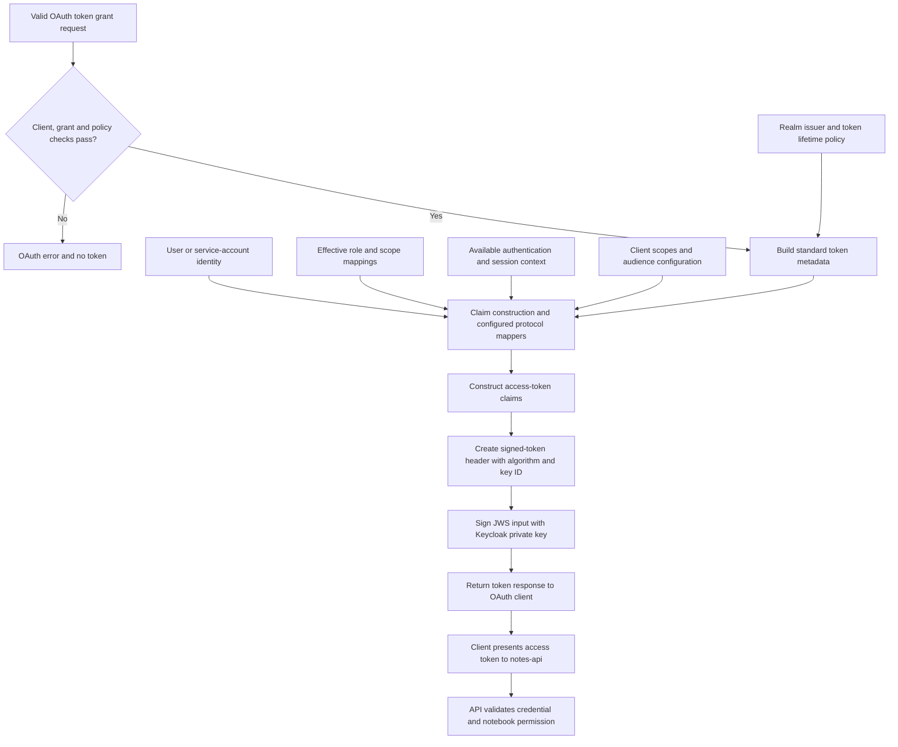
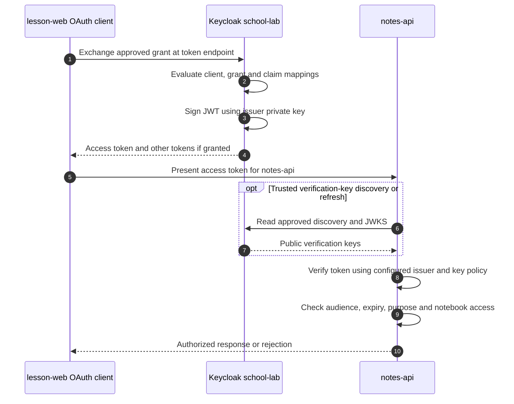
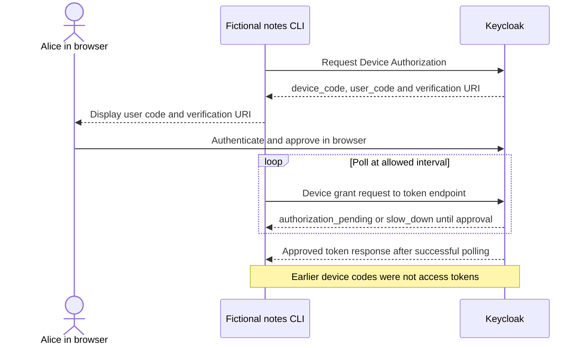
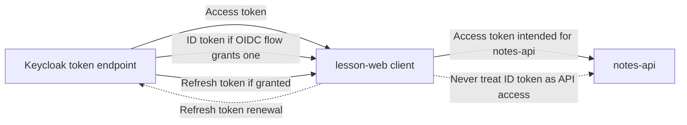

# How Keycloak issues a signed JWT

> **Simple idea:** The application requests tokens through an allowed OAuth/OIDC flow. **Keycloak checks the grant, determines the appropriate claims, and signs the token with its own signing key.** The user or application does not manually sign a Keycloak access token.

This chapter uses a fictional `school-lab` realm, student Alice, `lesson-web` (OAuth client), and `notes-api` (protected API). It explains **signed JWT issuance**, not every possible access-token format. OAuth access tokens need not always be JWTs.

## 1. When is a JWT actually created?

Creating a Keycloak realm does **not** automatically issue Alice an access token. Realm setup creates identity and key configuration, but an **access token is issued as the result of a permitted token grant**.

For example, Authorization Code + PKCE has two steps: the browser receives a short-lived **authorization code**, and the **OAuth client** later exchanges it at the token endpoint. Only then, if all checks pass, does Keycloak return an access token and any other tokens allowed by the flow.

Another example is **Device Authorization Grant**: a CLI receives `device_code`, `user_code`, a verification URI and polling instructions. These are **not access tokens**. After Alice authenticates and approves in a separate browser, the CLI polls the token endpoint. A successful poll can produce the actual token response. Neither the CLI nor Keycloak should ask the CLI to handle Alice's password in this flow.

**Other flows differ:** Client Credentials may issue service-account access tokens without an end-user login, while a refresh-token grant may issue a replacement access token. Do not describe every issued token as a fresh interactive login.

## 2. Who does what?

| Actor | Responsibility | Must not assume |
| --- | --- | --- |
| **Alice** | Authenticates/approves when her flow requires it | She manually generates or signs Keycloak JWTs |
| **`lesson-web` client** | Initiates approved flow, receives and protects credentials | It possesses Keycloak's realm signing private key |
| **Keycloak** | Validates grant, applies policy, assembles claims and signs its JWTs | Every successful request should yield the same claims or token types |
| **`notes-api`** | Validates intended access token and authorizes the exact action | A valid signature grants unlimited notebook access |

Keycloak's *client registration* is server-side configuration for the application. The running client lives outside Keycloak.

## 3. From approved grant to signed JWT



**Important precision:** Keycloak produces some protocol claims (such as `iss`, `iat`, `exp`) through built-in token generation. A **protocol mapper** is not needed for every standard field. Mappers and client scopes influence selected claims, including user attributes, roles and audience. Claims also depend on relevant grants, client permissions and policies.

The diagram is conceptual: a normal token exchange does not call a separate external HTTP service for each claim source.

## 4. Where do the claims originate?

| Claim source | Example value | Keycloak connection |
| --- | --- | --- |
| **Realm settings and token engine** | Issuer, expiry and issued-at time | Determines token metadata |
| **Account or service identity** | Subject identifier | Local user or service account; possibly synchronized/federated identity |
| **User/group role assignments** | `student`, `notes-api:reader` | Evaluated under role-scope policies |
| **Client configuration and scopes** | Audience `notes-api`, role mappers | Applied client scopes and protocol mappers |
| **Authentication/session context** | Login time or method, when available | Session/authentication claims where configured |

**An identity stored in Keycloak does not mean every field appears in every token.** The same user can receive different token claims for different client registrations or requested optional client scopes.

## 5. Anatomy of a signed JWT

A typical signed JWT is a **JWS compact serialization**, with three dot-separated Base64URL components:

```text
BASE64URL(protected-header).BASE64URL(payload).BASE64URL(signature)
```

Illustrative header (not a signed token):

```json
{"alg":"RS256","kid":"school-key-a","typ":"JWT"}
```

Illustrative payload (not a signed token):

```json
{
  "iss": "https://login.example.test/realms/school-lab",
  "sub": "alice-123",
  "aud": ["notes-api"],
  "iat": 1893455700,
  "exp": 1893456000,
  "scope": "notes:read",
  "realm_access": {"roles": ["student"]}
}
```

These claims and numbers are synthetic; the sample is deliberately **not** a working credential. Actual header values and claim shapes depend on the configured Keycloak version, signing algorithm and token profile. For example, **RFC 9068** describes a specific JWT access-token profile using `typ=at+jwt`; do not assume every Keycloak token implements that profile or that `typ=JWT` alone establishes permission.

**Base64URL encoding is not encryption.** People who obtain an ordinary signed JWT can usually decode its claims. A **JWE** may encrypt a token but has a different structure.

## 6. Who signs, and who verifies?

With **asymmetric signature keys**, Keycloak protects the **private signing key** and publishes suitable **public verification keys**, normally via the realm JWKS endpoint. In a common RS256 configuration, the high-level operation is:

```text
signing_input = BASE64URL(header) + "." + BASE64URL(payload)
signature = SIGN_WITH_ISSUER_PRIVATE_KEY(signing_input)
token = signing_input + "." + BASE64URL(signature)
```

The operation above is **conceptual**, not an implementation recipe. Use maintained JOSE libraries instead of writing production signing or verification code.

A protected API obtains trusted verification keys from a **configured issuer**, checks a locally allowed algorithm and signature, and then validates issuer, audience, expiration, token purpose and authorization. Header `kid` is only an **untrusted selector** among known trusted keys; it cannot pick an arbitrary key URL.



## 7. Where are the issuer's endpoints and keys?

For a disposable example realm, OIDC discovery is:

```text
https://login.example.test/realms/school-lab/.well-known/openid-configuration
```

It advertises a **token endpoint** and `jwks_uri`. A typical Keycloak public-key endpoint path is:

```text
/realms/school-lab/protocol/openid-connect/certs
```

The administrative key configuration is found under **Realm settings → Keys** or the corresponding location for your version. **Never export private signing keys or live tokens into teaching documentation.**

An API can cache trusted public JWKS keys and refresh them during rotation. It must not fetch arbitrary token-header `jku` or `x5u` URLs or disable signature verification when the issuer is unreachable. Trust comes from preconfigured issuer policy.

## 8. The first Device Flow reply is not an access token



**Diagram simplification:** Other outcomes include denial, expiry and polling limits; a client must honor the server's instructions, stop appropriately, and never assume approval will occur. The Device Flow does not require Alice to type credentials into the CLI.

For the exact device protocol and safe local experiments, see [Device Flow](03-device-flow.md) and the [disposable learning lab](../labs/01-first-jwt-device-flow.md).

## 9. Which credential goes where?

| Credential | Issued or returned at | Intended use |
| --- | --- | --- |
| Device code / user code | Device authorization response | Pair authorization with a browser; **not** API credentials |
| Authorization code | Authorization callback | Redeem once at token endpoint |
| **Access token** | Token endpoint response | Present to **intended resource API**, where validated |
| **ID token** | OIDC token response when applicable | OIDC client validates the authentication result |
| **Refresh token** | Token endpoint when granted | Client exchanges with authorization server for new tokens |



The dotted “ID token” line is **a forbidden misuse illustration**, not a legitimate request. API token validation and resource policy are explained in [Chapter 06](06-api-token-validation.md).

## 10. Failure cases students should know

- **Invalid grant, expired code or failed PKCE:** token endpoint rejects exchange; no access JWT is issued.
- **Login not approved:** Device Flow continues pending or returns the appropriate error; device code alone is not API authorization.
- **Wrong audience:** a signed token meant for another API must be rejected by `notes-api`.
- **Wrong token kind:** an ID token must not be accepted as an API access token.
- **Missing role:** check role assignment, effective client scopes, role-scope mappings and the relevant protocol mapper. Do not assume all assigned roles are emitted.
- **Expired token or revoked rights:** cryptographically valid old claims can become stale. A sensitive resource may require current authorization checks.

## 11. Self-check questions

1. **Who creates Keycloak's signed JWT?** Keycloak after a permitted token-grant exchange.
2. **Does creating a realm instantly issue Alice's token?** No.
3. **Are device codes access tokens?** No.
4. **Does Alice's CLI need her password for Device Flow?** No.
5. **Where do `iss` and `exp` come from?** Built-in token metadata and realm policy, not necessarily protocol mappers.
6. **Does the client hold the realm's private signing key?** No.
7. **What does the API do with JWKS?** Use trusted public keys to validate a signed JWT's signature.
8. **Can a valid signature replace audience and resource checks?** No.
9. **Is Base64URL encryption?** No.
10. **Which token is meant for an OIDC relying party's login?** ID token, not an API access token.

## Sources and next topics

- [Keycloak OIDC endpoints](https://www.keycloak.org/securing-apps/oidc-layers)
- [Keycloak Server Administration Guide](https://www.keycloak.org/docs/latest/server_admin/)
- [RFC 7519 — JWT](https://www.rfc-editor.org/rfc/rfc7519)
- [RFC 7515 — JWS](https://www.rfc-editor.org/rfc/rfc7515)
- [RFC 9068 — JWT access-token profile](https://www.rfc-editor.org/rfc/rfc9068)
- [RFC 8628 — Device Authorization Grant](https://www.rfc-editor.org/rfc/rfc8628)
- [RFC 9700 — OAuth Security BCP](https://www.rfc-editor.org/rfc/rfc9700)
- [Next: Claims and protocol mappers](05-claims-and-mappers.md) · [JWT vs JWK vs JWKS](15-jwt-vs-jwks-verification.md) · [API validation](06-api-token-validation.md)

*All accounts, URLs and claims are generic classroom examples. This is not an operational Keycloak deployment instruction.*
