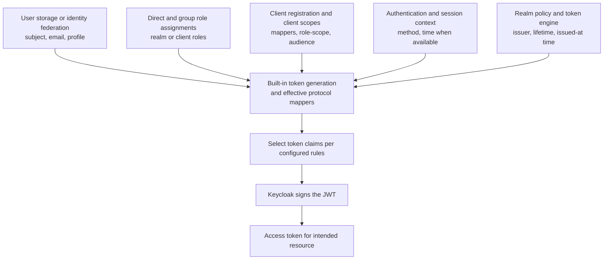
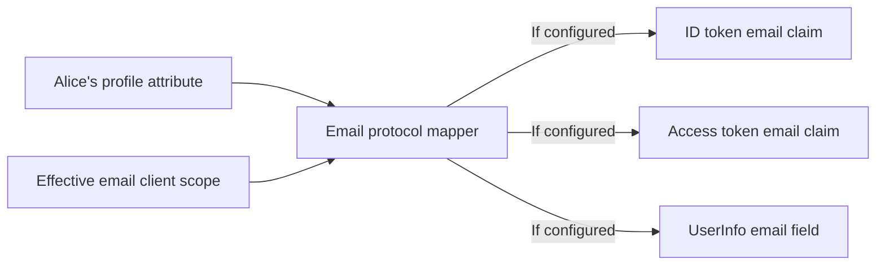
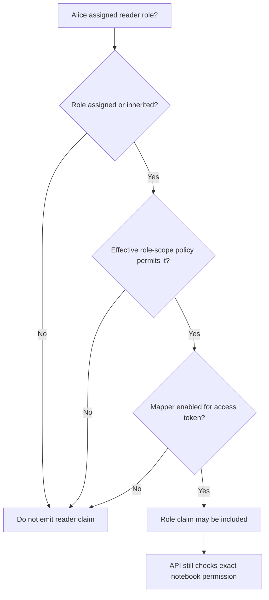

# JWT claims, Keycloak protocol mappers and client scopes

> **Plain language:** A **claim** is a named piece of information inside a token. **Keycloak protocol mappers** and **client scopes** help determine which attributes, roles and audience values are included. A claim is **information**, not an automatic permission to use any resource.

We use only fictional entities: student Alice, `lesson-web`, `notes-api` and the `school-lab` realm. The companion [Keycloak object-model lesson](08-realm-client-user-client-scope.md) introduces realms, users, clients and client scopes.

## 1. Where are claims in a signed JWT?

A typical signed JWT (compact JWS) looks like:

```text
BASE64URL(header).BASE64URL(payload).BASE64URL(signature)
          |                 |                 |
      alg, kid         iss, sub, aud       cryptographic
                     exp, roles...         integrity proof
```

The **payload** contains claims. The **header** contains signing metadata and an optional key ID. The **signature** is checked using a trusted key. **Decoding is not verification**: a readable payload is not yet trustworthy. Signed JWTs are usually not encrypted.

## 2. A practical dictionary of token claims

| Claim | Meaning | Security interpretation |
| --- | --- | --- |
| `iss` | Issuer identifier | Compare with exact trusted issuer |
| `sub` | Subject identifier | Identify principal within trusted issuer context, not necessarily a friendly username |
| `aud` | Intended audience / recipients | The protected API must be an intended audience |
| `exp` | Expiry as numeric date | Reject expired tokens |
| `iat` | Issued-at time | Consider age/consistency when required |
| `nbf` | Not valid before (optional) | Reject if used too early |
| `azp` | Authorized party in OIDC-related profiles | Can identify requesting client in suitable context; **not a substitute for `aud`** |
| `scope` | Granted scope values | May constrain operations; not object-level authorization by itself |
| `auth_time` | Time of user authentication, if available | Can support authentication freshness policy |
| `acr`, `amr` | Authentication context/method information when emitted | Useful only when interpreted under an agreed issuer/profile |
| `email` | Profile attribute, when released | Not proof of authorization or of email ownership by itself |
| `realm_access.roles` | **Keycloak-specific** realm role claim shape, when mapped | Depends on assignment, effective scope and mapper |
| `resource_access` | **Keycloak-specific** client roles, when mapped | Not a universal OIDC/JWT standard |

Claims are **not all mandatory** in every token, and values or structures vary by issuer, protocol flow and token type. For example, the claim `email` may appear in an **ID token** or **UserInfo**, but not necessarily in an **access token**. Different claim destinations need explicit mapping.

## 3. Where does Keycloak obtain claim values?



Five useful categories are:

1. **Identity store / federation:** user IDs and profile attributes from Keycloak, LDAP or trusted external identity providers.
2. **Role assignment:** direct roles and roles inherited through groups.
3. **Client configuration:** protocol mappers, client scopes, role-scope mappings and audience settings.
4. **Authentication/session context:** data about the authentication event when available.
5. **Realm/token generation:** values such as `iss`, `iat`, `exp`, often generated by Keycloak itself.

**Not all token fields require a mapper.** Some standard claims are generated by Keycloak's token engine. Mappers mainly control selected extra or transformed claims, applicable roles and audience contents.

## 4. One fictional example

Alice signs in to the school portal. Assume the configuration permits her to access only her own notes and issues an **illustrative** access token with:

```json
{
  "iss": "https://login.example.test/realms/school-lab",
  "sub": "alice-123",
  "aud": ["notes-api"],
  "azp": "lesson-web",
  "iat": 1893455700,
  "exp": 1893456000,
  "scope": "notes:read",
  "resource_access": {
    "notes-api": {"roles": ["reader"]}
  }
}
```

This **payload fragment is not a working token** and does not claim all Keycloak releases use these exact shapes. A Keycloak realm and client can be configured to emit roles or audiences differently.

What the API learns **after validating** a real access token: it came from a trusted issuer, has an intended audience and claims about possible access. What it **still must decide**: whether Alice is permitted to read this particular notebook right now. The role `reader` cannot replace notebook ownership or other resource policy checks.

## 5. What does a protocol mapper do?

A **protocol mapper** selects, transforms or formats information to a particular protocol claim or UserInfo field.

For example, a user-attribute mapper can read Alice's email attribute and place it in `email`. Its configuration determines whether to emit that field in the **ID token**, **access token** and/or **UserInfo** output, if the effective scope allows.



**A mapper doesn't assign a role to Alice.** Likewise, adding a field to a signed token does **not** independently authorize operations at the API.

## 6. What is a client scope?

A **Keycloak client scope** is a reusable unit of **protocol mappers and role-scope mappings**. A client registration can link such a scope as **default** (automatically effective) or **optional** (applied when requested and permitted). Client-specific mappers also appear in the **dedicated client scope** view in the Admin Console.

| Scope type | When it applies | Key property |
| --- | --- | --- |
| **Default** | Its mappers/mappings apply by default to the linked client | Doesn't need to be named in `scope` request |
| **Optional** | Client requests its name and applicable policy allows it | Request-dependent |
| **Dedicated** | Attached directly to one client's configuration | Admin Console view; not a separately reusable REST/storage scope |

Keycloak's dedicated scope is **not** a realm-level client-scope object that can be linked to another client. To share mapping behavior between applications, create a reusable realm client scope.

### Optional-scope example

Assume `email` is assigned as **optional** to `lesson-web`, and no other effective mapper emits the email claim:

| Authorization request | Does the optional email scope apply? |
| --- | --- |
| `scope=openid` | **No** |
| `scope=openid email` | **Yes, if allowed** |

Even when the scope applies, the claim's actual destination (ID token, access token, UserInfo) and user data still matter. It is incorrect to promise that the email claim will appear in all three outputs.

## 7. Roles, role-scope mappings and mappers: separate jobs

Think of them as three gates:

- **Role assignment:** Does Alice actually have `notes-api:reader` (directly or via a group)?
- **Effective role scope:** Is that role eligible to be represented for this client/token based on its effective scopes, policies and role-scope mappings?
- **Role mapper:** Is there a configured mapper that writes eligible roles into the **relevant token kind** and claim path?



**Keycloak nuance:** The built-in `roles` client scope commonly provides realm/client role mappers and an **Audience Resolve** mapper. Some role and audience claims depend on its effective mappings. Keycloak currently deprecates broad `Full Scope Allowed` and recommends explicit role-scope controls to avoid exposing unnecessary roles.

## 8. Audience mapper: don't confuse `azp` and `aud`

If `lesson-web` obtains an access token, that does **not** automatically mean `aud` includes `notes-api`. Keycloak can populate audiences through:

- A configured **Audience** mapper, including hardcoded audience values.
- The **Audience Resolve** mapper, which uses applicable client roles.
- Other effective claim rules as supported by the installed version.

`azp` may identify the client that requested the token. The `aud` claim identifies its **intended recipients**. **An API must verify its own expected audience**, rather than treating the presence of the requesting client's ID as sufficient.

Example:

```text
azp = "lesson-web"    # who requested under the configured token profile
aud = ["notes-api"]   # which API is an intended recipient
```

The values above are illustrative. Verify actual token contents in a disposable realm before designing validation.

## 9. Safe Keycloak console exploration

In a **disposable local test realm**:

1. Inspect **Users → Alice → Attributes** and **Role mappings / Groups**.
2. Inspect **Clients → lesson-web** for the registered client and **Client scopes**.
3. Open the assigned default, optional and dedicated scope views.
4. Inspect effective **protocol mappers** and **role-scope mappings**, including where a claim is emitted.
5. Use **Client scopes → Evaluate** to simulate a selected test user and optional scope selection; check which claims would be present in ID/access/UserInfo outputs.
6. Compare requests with `openid` and `openid email`, under the *explicit* sample configuration above.
7. Use fictional users, and never paste real tokens into public decoders, documentation or issue trackers.

Console labels and behavior can vary by Keycloak release. Inspect your version's official administration guide.

## 10. Debug a missing role or audience

If Alice has a role but an **access token** lacks the expected `resource_access` or `aud`:

| Diagnostic question | Why |
| --- | --- |
| Is the role actually assigned to Alice or inherited through a group? | Mapping cannot emit an unassigned role as a user role |
| Is the correct client/realm being inspected? | Different clients/scopes can emit different claims |
| Is the relevant scope assigned as default or requested as optional? | Effective mappings may differ |
| Does the effective role-scope policy allow the role? | Prevent overexposure |
| Is the correct role mapper present and enabled for the **access token**? | A mapper targeting ID token only won't fill access token |
| Is an audience mapper or Audience Resolve configured for the intended API? | Client registration alone doesn't guarantee `aud` |
| Was a **new token** issued after changes? | Old signed JWTs retain previous claims |
| Does the API accept only tokens for its configured audience/purpose? | Avoid treating unrelated signed tokens as access credentials |

Never “fix” missing API permission merely by adding every role to every token. Configure the minimum claims the consumer actually needs and enforce object policy on the API side.

## 11. Security pitfalls and common questions

- **Decoding isn't validation:** do not trust a JWT just because you can read `iss`, `email` or `roles`.
- **Privacy/minimization:** user attributes should be emitted only where justified; signed access JWT payloads are ordinarily readable by recipients.
- **Mappers aren't authorization:** emitting `reader` does not give access to all student notebooks.
- **Audience is essential:** a signed token with `aud=billing-api` must be rejected at `notes-api`.
- **Stale roles:** a signed token may retain roles that were later revoked; sensitive or delayed actions may require current policy checks.
- **Token profiles differ:** some shapes such as `resource_access` and `azp` are Keycloak/profile-specific and cannot be assumed for every OIDC provider.
- **ID token ≠ access token:** map claims to the right output, and don't use ID tokens as API authorization credentials.

## 12. Test your understanding

1. **What is a claim?** A named value in a token payload.
2. **Are header `alg` and `kid` user claims?** No, they are header metadata.
3. **Are all Keycloak claims generated by mappers?** No, some are built-in token metadata.
4. **Does a client scope assign a role?** No, it controls mappings/eligibility, not role ownership.
5. **Does an email mapper necessarily add email to an access token?** No, destination settings matter.
6. **Does `azp=lesson-web` prove `notes-api` is the audience?** No.
7. **Do all providers use `resource_access`?** No, it is Keycloak-specific.
8. **Can the API authorize any notebook merely because `reader` appears?** No.
9. **Why can role removal fail to update an old JWT?** Already issued claims are a snapshot.
10. **What should you inspect for a missing role?** Assignment, effective role-scope mappings, protocol mapper and token destination.

## Sources and further learning

- [Keycloak Server Administration Guide — scopes, roles and audience](https://www.keycloak.org/docs/latest/server_admin/)
- [Keycloak OIDC applications](https://www.keycloak.org/securing-apps/oidc-layers)
- [RFC 7519 — JWT claims](https://www.rfc-editor.org/rfc/rfc7519)
- [OpenID Connect Core 1.0](https://openid.net/specs/openid-connect-core-1_0.html)
- [RFC 9068 — specific JWT access-token profile](https://www.rfc-editor.org/rfc/rfc9068)
- [Related: Keycloak scope model](08-realm-client-user-client-scope.md) · [JWT issuance](04-jwt-issuance.md) · [API token validation](06-api-token-validation.md)

*This guide is written independently with fictional tokens and systems. It is not a production configuration checklist.*
