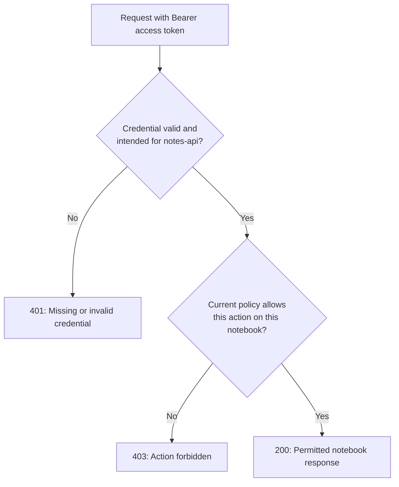
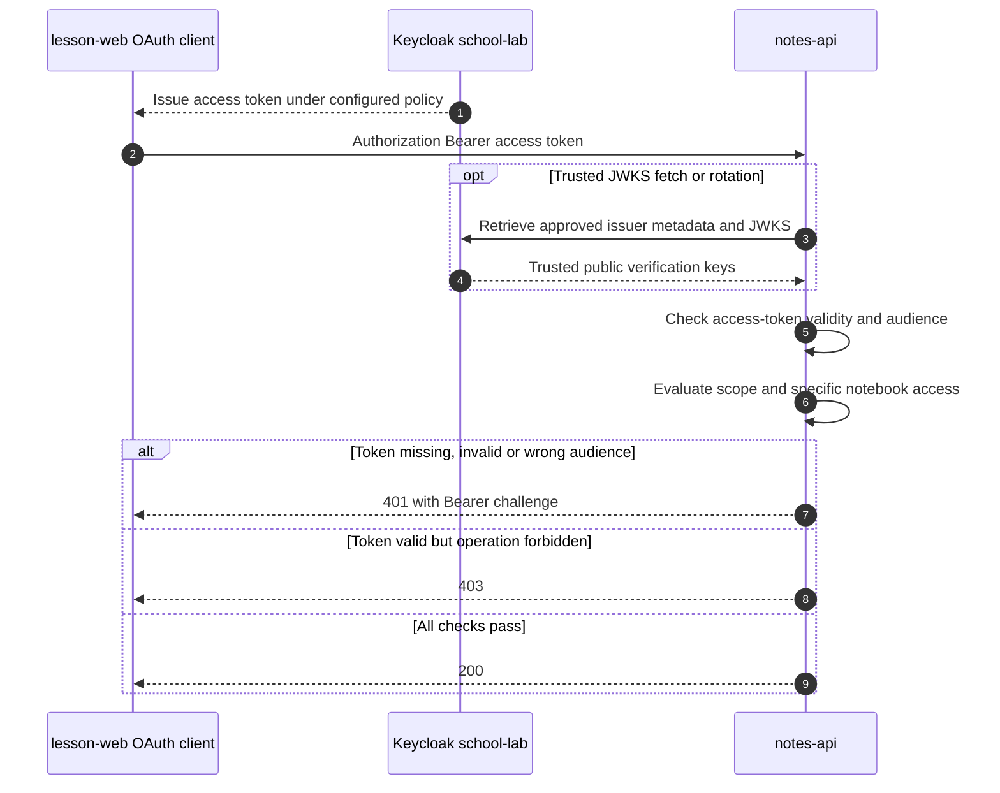
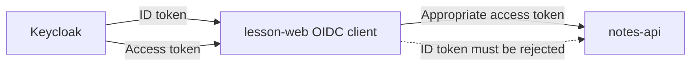
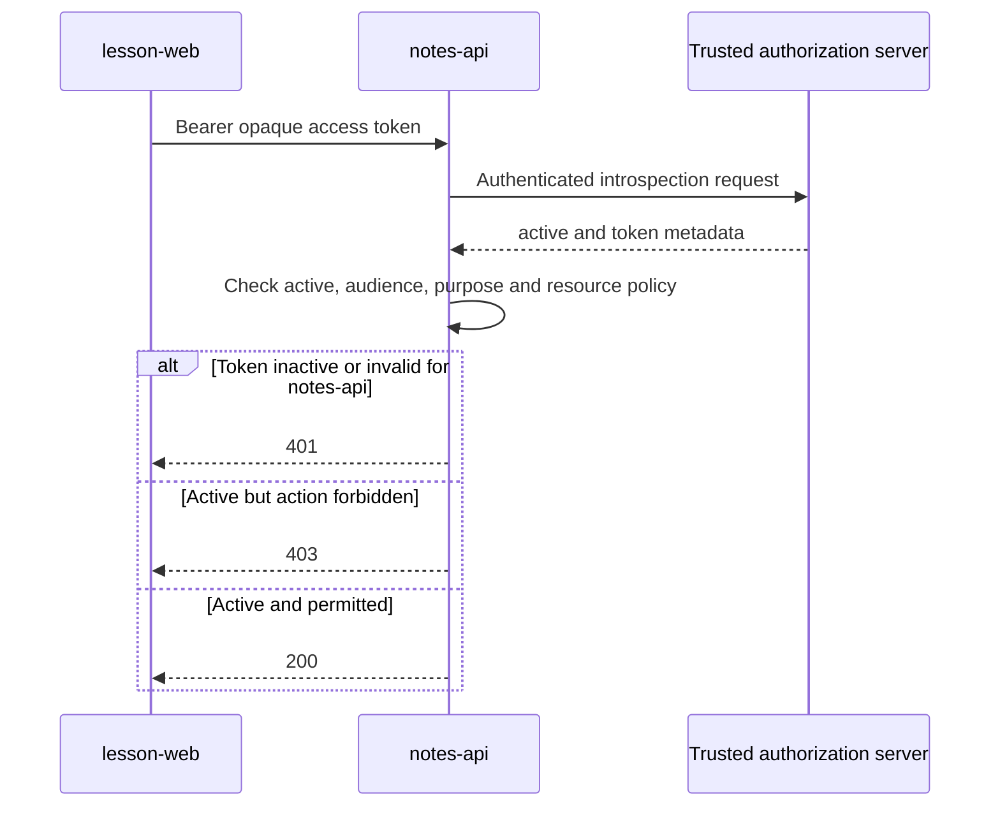
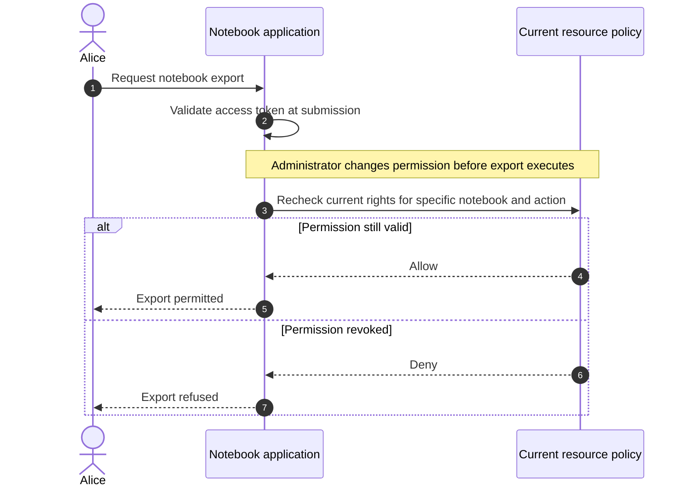

# API access-token validation: verify, then authorize

> **Simple explanation:** The protected API must first verify that the **right access credential** is genuine and intended for **this API**. It must then check whether the caller may perform the **requested action on the requested resource**. A correctly signed JWT or successful login is not universal permission.

This is independent classroom material. All actors are fictional: Keycloak realm `school-lab`, Alice, `lesson-web` and `notes-api`.

## 1. Two different security questions

**Authentication / credential validity:** Is this a valid access token issued by a configured trusted server for this resource API?

**Authorization:** Even if the access token is valid, may Alice read **Bob's private notebook**?



A role or scope such as `notes:read` may grant some reading capabilities, but it does **not** mean permission to read every other user's notebook.

## 2. Which component verifies what?

A running OAuth client presents an **access token** to a protected resource. Keycloak, when used as authorization server, can issue signed JWT access tokens. OAuth also permits **opaque** access tokens.



The optional JWKS request applies when **local validation of signed JWTs** is configured; an opaque token normally requires some other issuer-approved validation mechanism, such as token introspection.

## 3. The signed JWT access-token checklist

Use a maintained JWT/OAuth-aware validator configured with a **trusted issuer, accepted signature algorithms, trusted verification keys, expected API audience, token profile and time checks**.

| Check | Why | Reject when |
| --- | --- | --- |
| Credential **purpose** | An ID token, authorization code or refresh token is not a resource API access token | Wrong token kind for the agreed issuer/API profile |
| **Issuer `iss`** | Identify who issued the token | Not the **exact trusted issuer** |
| **Allowed algorithm** | Prevent algorithm substitution / `none` | Unsupported `alg`, unexpected key type or signature method |
| **Signature** | Establish token integrity under a trusted key | No valid signature with allowed key/algorithm |
| **Audience `aud`** | Limit token to intended resource(s) | Does not identify **notes-api** |
| **Expiration `exp`** | Bound validity | Expired or absent where the agreed profile requires it |
| **`nbf` / `iat`** | Constrain not-before / issued-at times when applicable | Invalid or inconsistent under agreed policy |
| **Type / profile** | Prevent cross-JWT confusion | Does not meet the issuer's agreed access-token profile |
| **Scope / roles / subject** | Determine who can attempt which operation | Required claim or eligible principal missing |
| **Object-level policy** | Enforce actual resource ownership and current conditions | Alice lacks permission for the target notebook |

**Do not trust claims merely because Base64URL decoding succeeded.** Signature verification is also not a substitute for audience, purpose or authorization checks. Small clock-skew tolerance should be explicitly bounded.

## 4. A valid signature with the wrong audience is still wrong

Imagine an otherwise valid signed token with these illustrative **unverified** claims:

```json
{
  "iss": "https://login.example.test/realms/school-lab",
  "sub": "alice-id",
  "aud": ["billing-api"],
  "exp": 2524608000,
  "scope": "notes:read"
}
```

Even if a real signed token containing these values passed signature checks, `notes-api` must **reject it**. Its audience is `billing-api`, not `notes-api`. The example has no signature and is **not** a functioning token.

**Keycloak caveat:** Registering `notes-api` as a Keycloak client does not guarantee it appears in every access token's `aud`. The actual audience depends on issuer settings, client scopes, role mappings and applicable protocol mappers. Configure and test audience explicitly instead of assuming that any token from the same realm works for every API.

## 5. An ID token is not an API access token

An **OIDC ID token** tells an OIDC client about a user's authentication. An **access token** is the credential intended for the protected resource. Both may be JWTs and both may be signed by trusted issuer keys, yet their **recipients and purposes differ**.



Do not accept an ID token as an API bearer credential just because its signature is valid.

**Profile distinction:** RFC 9068 specifies a particular **JWT access-token profile**. A resource server implementing that profile must require `typ=at+jwt` or `application/at+jwt`. Other deployed token formats, including provider-specific Keycloak configurations, must be validated according to the **actual agreed profile**. Never assume all Keycloak tokens conform to RFC 9068 or that every JWT marked `typ=JWT` is an access token.

## 6. Trust JWKS only from the approved issuer

When the API validates a signed JWT offline, it may obtain the issuer's **public verification keys** through configured discovery and JWKS:

- Preconfigure the intended issuer and trusted discovery or key source.
- Compare the metadata issuer to the expected value; use HTTPS and approved key locations.
- Constrain accepted algorithms and key types, and use `kid` only as a **hint** among those trusted keys.
- Do not follow arbitrary `jku` or `x5u` URLs from token headers. Such URLs can introduce key substitution or server-side request forgery risks.
- Cache and rotate trusted JWKS with bounded refresh; if a necessary trusted key cannot be established, **fail closed**, not “skip verification.”

The companion [JWT/JWK/JWKS chapter](15-jwt-vs-jwks-verification.md) explains how a token's signature is checked against trusted public keys.

## 7. How do opaque tokens work?

An opaque token is not necessarily decodable as a JWT. One supported approach is **OAuth token introspection** (RFC 7662), where the resource server sends the token through an authenticated HTTPS request to a **trusted** authorization server introspection endpoint.



The response can include `active`, `aud`, `iss`, `scope`, `sub`, expiry and other metadata. **`active=true` is not universal authorization**: the API must still validate the intended resource and requested operation. Introspection results can be cached, but the cache may grow stale; protect the endpoint and its credentials.

A signed JWT can also be introspected when current issuer-side state is required by an application, although this is not universally necessary for every JWT request.

## 8. HTTP 401, 403 and Bearer challenges

| Situation | Typical result | Bearer detail |
| --- | --- | --- |
| No suitable credential | **401** | `WWW-Authenticate: Bearer realm="notes"` |
| Expired, invalid, untrusted or wrong-audience token | **401** | `error="invalid_token"` where appropriate |
| An ID token substituted for an access token | **401** | Invalid credential for this API |
| Access token valid but lacks required scope | **403** | `error="insufficient_scope"` where appropriate |
| Token valid but notebook-level permission denied | **403** | No permission for that specific resource |
| Valid and authorized read request | **200** | Return only allowed resource data |

RFC 6750 requires the applicable **`WWW-Authenticate: Bearer` challenge** for unacceptable bearer credentials and defines the `invalid_token` and `insufficient_scope` error values. Other malformed or unsupported requests may have additional status handling. Never reveal live credentials or sensitive policy internals in errors.

## 9. What if a permission changes after a token is issued?

An offline-validated JWT can still be validly signed even after Alice's role has been removed. Consider a **fictional notebook-export action** submitted at one moment and executed later.



This is a **time-of-check / time-of-use (TOCTOU)** problem. For delayed or high-impact operations, verify authorization **at execution time**, not only when the request first arrives. Depending on the risk and architecture, use current policy lookups, short token lifetimes, authoritative account state, session revocation, authenticated introspection, operation-bound approval and audit logs. Each approach has freshness, performance and reliability tradeoffs.

No real operational workflow or organization is represented in this teaching example.

## 10. A compact test matrix

| Scenario | Expected API behavior |
| --- | --- |
| Missing token | Reject, usually 401 + Bearer challenge |
| Invalid JWT signature | Reject |
| Untrusted issuer | Reject |
| Correct issuer, wrong API audience | Reject |
| Expired or not-yet-valid token | Reject |
| OIDC ID token instead of an access token | Reject |
| JWT with unsupported algorithm or untrusted `kid` | Reject |
| Valid access token but missing required scope | Deny, normally 403 |
| Valid access token but notebook owner mismatch | Deny, normally 403 |
| Valid token and authorized resource action | Permit |
| Old token after permission revocation | Enforce required current authorization/freshness policy |
| JWKS cache miss and unknown untrusted host | Do not disable verification or fetch arbitrary token-supplied URL |

Use **synthetic test fixtures** for these scenarios. Do not publish real tokens or personal data.

## 11. Implementation principles (illustrative pseudocode)

```text
request -> extract bearer credential
if missing/malformed: return 401 with Bearer challenge

if trusted JWT access-token format:
    validate with maintained library:
        expected issuer, expected API audience,
        approved signature algorithms and trusted JWKS,
        required token profile and time validity
else if trusted opaque access-token format:
    authenticated token introspection at configured issuer
    require active and intended resource
else:
    reject credential

if credential validation failed: return 401

principal = validated issuer-and-subject context
if not current policy allows(principal, action, resource): return 403
perform authorized operation
```

This is **not runnable production code**. Maintained OAuth-aware libraries and framework middleware should implement the cryptographic checks. Always bind real authorization to server-controlled policy and reliable resource identity, not arbitrary claims sent by the caller.

## 12. Test yourself

1. **Does decoding JWT claims verify them?** No.
2. **Why does `aud` matter?** The API must be a permitted recipient.
3. **Can a signed ID token be accepted as an API Bearer token?** No.
4. **Does `notes:read` permit reading Bob's notebook?** Not without appropriate object-level authorization.
5. **What does `kid` prove?** Nothing alone; it identifies a candidate key from trusted JWKS.
6. **Can opaque access tokens be introspected?** Yes, with the issuer's trusted authenticated endpoint if supported.
7. **What are common roles of 401 and 403?** Invalid/missing credential vs valid credential with insufficient permission.
8. **Can an already-issued JWT remain signature-valid after permissions change?** Yes.
9. **Where should critical delayed operations recheck permission?** At execution time.
10. **Should the API follow `jku` from arbitrary token headers?** No.

## Sources and related lessons

- [RFC 6750 — Bearer Token Usage](https://www.rfc-editor.org/rfc/rfc6750)
- [RFC 7662 — OAuth 2.0 Token Introspection](https://www.rfc-editor.org/rfc/rfc7662)
- [RFC 9068 — JWT Profile for OAuth Access Tokens](https://www.rfc-editor.org/rfc/rfc9068)
- [RFC 8725 — JWT Security BCP](https://www.rfc-editor.org/rfc/rfc8725)
- [RFC 9700 — OAuth Security Best Current Practice](https://www.rfc-editor.org/rfc/rfc9700)
- [RFC 7519 — JWT](https://www.rfc-editor.org/rfc/rfc7519)
- [Keycloak OIDC applications](https://www.keycloak.org/securing-apps/oidc-layers)
- [Keycloak Server Administration Guide](https://www.keycloak.org/docs/latest/server_admin/)
- [Related: JWT vs JWK vs JWKS](15-jwt-vs-jwks-verification.md) · [Bearer tokens](07-bearer-token.md) · [Client scopes](08-realm-client-user-client-scope.md)

*General education with fictional names, no working credentials and no production-specific deployment details.*
