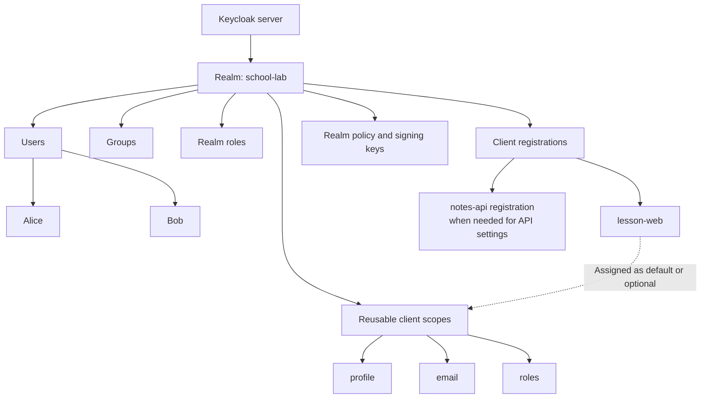
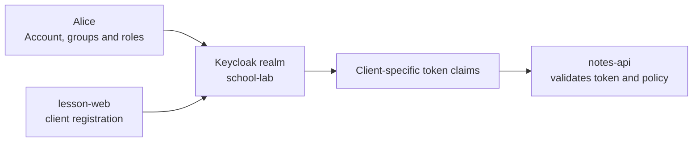
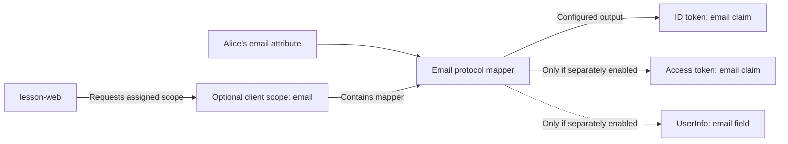
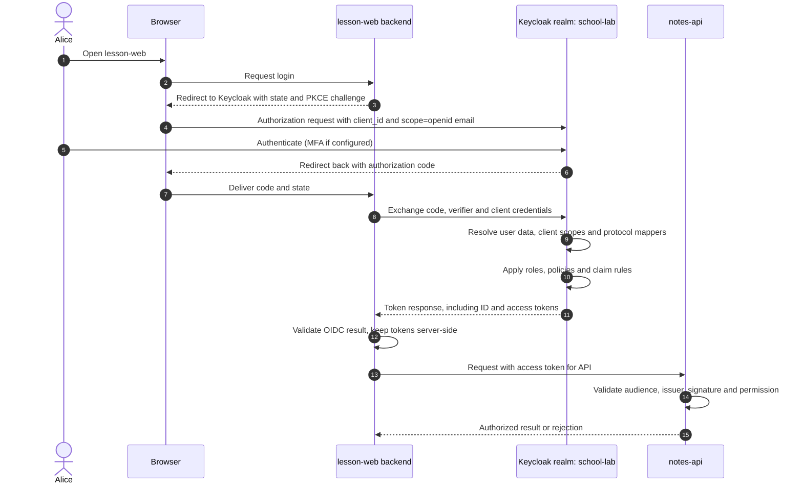

# Keycloak realm, user, client and client scope

> **Simple explanation:** A **realm** organizes an identity environment. A **user** is an account. A **client** is an application registered to use Keycloak. A **client scope** is reusable configuration that helps shape the information and role mappings used when tokens are issued.

This is independent classroom material using only fictional identities. The [Keycloak fundamentals chapter](01-keycloak-fundamentals.md) introduces the actors. Here we focus on Keycloak's **object model and client-scope behavior**.

## 1. One story, four different objects

Imagine a fictional school application:

| Concept | School analogy | Keycloak example | Technical role |
| --- | --- | --- | --- |
| **Realm** | The school's separate identity system | `school-lab` | Security and administration boundary |
| **User** | The student Alice | `alice` | Account with credentials, attributes and roles |
| **Client** | The school portal's registration | `lesson-web` | Keycloak-side configuration of the running application |
| **Client scope** | Reusable rules for which information may be sent | `profile`, `email` | Protocol mappers and role-scope mappings applied at issuance |

The separately running `lesson-web` application is the **OAuth/OIDC client implementation**. The `lesson-web` entry in Keycloak's **Clients** screen is its **registration**, not a copy of the application. A separate fictional `notes-api` receives an appropriate access token and enforces notebook permissions.

**Do not mix them up:** a user is not a client; a client scope is not a user role; a realm is not the application code.

## 2. Where everything belongs

A **realm** typically has a distinct issuer URL, users, clients, realm roles, token policy and signing keys. Its clients can have client-specific roles. Group membership may convey attributes and role assignments.

The resource API is a **running service outside Keycloak**. A Keycloak registration for that API may help configure role namespaces or expected token audiences, but registration alone grants no resource access.

## 3. Realm and user are not application settings

A realm separates identity administration. Alice may authenticate to more than one application in the same realm. Each application can receive different token information depending on its client configuration and requested scopes.

A **user** can have credentials, attributes, group memberships, realm roles and client roles. What Keycloak knows about Alice is not necessarily what it should put into a particular token.

This is a **relationship diagram**, not a claim that Alice's whole account record is transmitted to an API. Claim release depends on protocol mappers and other configuration.

## 4. What a Keycloak client actually represents

In Keycloak, a **client registration** can include:

- A `client_id` identifying the application to the authorization server.
- Allowed redirect URIs, flow settings and authentication options.
- Assigned default and optional client scopes and client-specific mappers.
- Client roles and other role-scope mappings relevant to token issuance.

For example, a Python backend using Authlib may use the same `client_id=lesson-web` configured in Keycloak. Authlib is **application-side library code**. Registering a client in Keycloak does not deploy the Python service.

A public browser or installed application cannot safely hold a shared client secret; a trusted confidential backend can protect client authentication credentials. For interactive public-client authorization-code flows, use PKCE. See [Keycloak fundamentals](01-keycloak-fundamentals.md) for the full comparison.

## 5. Scope has several meanings — separate them

| Term | What it describes | Example |
| --- | --- | --- |
| OAuth `scope` parameter | The requested authorization/identity scope values in a protocol request | `scope=openid email` |
| OIDC `openid` scope | Marks an OpenID Connect authentication request | `openid` |
| Keycloak **client scope** | Reusable grouping of protocol mappers and role-scope mappings, associated with clients | `email`, `profile`, `roles` |
| User or client **role** | An assigned role that may be relevant to authorization | `teacher`, `notes-api:reader` |
| API permission | Whether a concrete resource action is allowed | Alice may view *her* notebook |

The same word `scope` appears at several layers. A Keycloak client scope may influence the `scope` value and claims in an issued token, but that does not mean it is an API permission. **Having the `email` client scope never grants Alice authority to read another student's data.**

## 6. Default, optional and dedicated client scopes

Keycloak distinguishes three associations for a client.

| Type | When it applies | What makes it special |
| --- | --- | --- |
| **Default** | Its configured mappers/role-scope mappings are normally applied to tokens for that client, independent of a matching value in the authorization request's `scope` parameter | Automatically linked for that client |
| **Optional** | Applied when the client requests the scope by name and applicable policy permits | Must be requested explicitly |
| **Dedicated** | Client-specific mappers and role-scope mappings | Belongs to one client, not a reusable realm-level scope |

**Nuance:** The dedicated client scope shown in the Admin Console is a **view of mappers and role-scope mappings attached directly to that client**. It is *not* a separate reusable scope object in the Admin REST API/storage model. It cannot be unlinked or shared with another client.

### Worked example: when will email appear?

Assume the `lesson-web` client has `profile` as a **default** scope, `email` as an **optional** scope, and **the only mapper that could emit an email claim** is in that optional `email` scope.

| Login request | What the request asks | Can the optional email mapper run? |
| --- | --- | --- |
| `scope=openid` | OIDC login only, plus effective default mappings | **No**, because optional `email` was not requested |
| `scope=openid email` | OIDC login plus optional `email` | **Yes, if the scope is assigned and policy permits** |

Even when the mapper runs, the claim's presence still depends on the mapper's settings (ID token, access token, UserInfo), available user data and applicable policies. If a **different** mapper also emits the email claim, the first row would no longer guarantee its absence. The example isolates the specific optional-scope behavior.

## 7. Protocol mapper: what it changes and what it does not

A **protocol mapper** is a rule that extracts or transforms selected information into token or UserInfo claims. For example, a mapper may place Alice's email into an **ID token**. Whether it also appears in an **access token** or **UserInfo** depends on that mapper's options.

**Two important limits:** mappers don't automatically give a user a role, and they don't make the API authorize an operation. They determine **what claims are emitted**, subject to scope rules and applicable policy.

## 8. Roles and role-scope mappings are different from client scopes

- **Realm role:** defined within the realm, such as `teacher`.
- **Client role:** defined in a particular client's role namespace, such as `notes-api:reader`.
- **Role-scope mapping:** helps constrain which role mappings are eligible to appear for a client/token.
- **Protocol mapper:** chooses how eligible roles or attributes are represented as claims.

For a client to receive a role claim, role assignment, effective scope settings and relevant mappers must align. **Assigning a reusable client scope does not assign that role to Alice.**

Keycloak's **Full Scope Allowed** setting has historically permitted broad exposure of user roles in issued access tokens. Current Keycloak documentation marks that switch **deprecated** and recommends turning it off in favor of explicit role-scope mappings. This narrows token privileges and reduces unnecessary role disclosure.

The API still has the final decision about the exact operation and resource.

## 9. Login and token creation: how the objects interact

This is a simplified **authorization-code + OIDC** example. Internal Keycloak scope resolution is shown as conceptual work, not as a separate network API.

In a **BFF**, the browser gets a secure application session cookie rather than the backend's OAuth tokens. For other client architectures, token storage and message paths differ.

**When teaching a real application:** distinguish ID token validation by the OIDC client from access-token validation and object-level authorization at the API.

## 10. Explore scopes safely in Keycloak

Using a **disposable local realm** (not a production login):

1. Select the example `school-lab` realm, or create one for the exercise.
2. Inspect **Users** and the fictional Alice's attributes, groups and role mappings.
3. Open **Clients → lesson-web** and inspect the client ID, flows, authentication and redirect settings.
4. On the client's **Client scopes** tab, inspect linked **Default** and **Optional** scopes and its **Dedicated** scope/mappers.
5. Use the **Evaluate** view to simulate a selected test user and requested optional scopes. Compare `openid` with `openid email` and inspect the effective mappers/claims.
6. Observe that claims in a simulated token depend on actual configuration. **Never paste real access or ID tokens into public issue trackers, online decoders, screenshots or source files.**
7. Under **Realm settings**, explore token policies/signing-key metadata without exporting signing material.

Exact menu labels change between Keycloak releases. Verify your installed version against its administration guide. This is an inspection exercise, not a production deployment guide.

## 11. Practical security warnings

- **Data minimization:** Avoid adding personal data or unnecessary roles to tokens; tokens can reach clients and resource servers.
- **Audience matters:** An access token for another API must not be accepted merely because it is signed by the same trusted issuer.
- **Authorization is not a claim-mapper setting:** Scope and role claims do not replace object-level access checks.
- **Least privilege:** Prefer explicit role-scope mappings over broad role disclosure.
- **Correct client type:** Never embed confidential-client secrets in browser-delivered code or installed CLIs.
- **Boundary isolation:** A realm is an administrative identity boundary; application-level tenant isolation may require additional policies and must not be assumed from a realm name alone.

## 12. Check yourself

1. **What is a realm?** An identity and administration boundary containing users, clients and related settings.
2. **What is a client in Keycloak's Admin Console?** An application registration, not its running source code.
3. **What does a client scope store?** Protocol mappers and role-scope mappings.
4. **Why is a dedicated client scope different?** It's the Admin Console view of per-client mappers/mappings, not a separately shareable scope object.
5. **Will an optional `email` mapper be used when the client requests only `openid`?** No, assuming the optional `email` scope was not requested and no other effective mapper emits the claim.
6. **Can a default scope apply without its name in the `scope` request?** Yes, according to its assigned/default configuration.
7. **Does a client scope give Alice a new role?** No; it does not assign a user role.
8. **Does a valid `reader` claim allow access to every student's notebook?** No; the API must enforce resource-specific policy.

## 13. Official references and related lessons

- [Keycloak Server Administration Guide — current](https://www.keycloak.org/docs/latest/server_admin/) (client scopes, dedicated scopes, Evaluate, role-scope mapping, Full Scope Allowed).
- [Keycloak OIDC application integration](https://www.keycloak.org/securing-apps/oidc-layers).
- [OpenID Connect Core 1.0](https://openid.net/specs/openid-connect-core-1_0.html).
- [OAuth 2.0 — RFC 6749](https://www.rfc-editor.org/rfc/rfc6749).
- [Related: Keycloak fundamentals](01-keycloak-fundamentals.md).
- [Related: JWT claims and mappers](05-claims-and-mappers.md).
- [Related: Access-token validation](06-api-token-validation.md).

*Keycloak configuration is version-dependent. All examples here are synthetic. Original private study progression and sensitive source provenance are intentionally excluded from the public-ready teaching material.*
