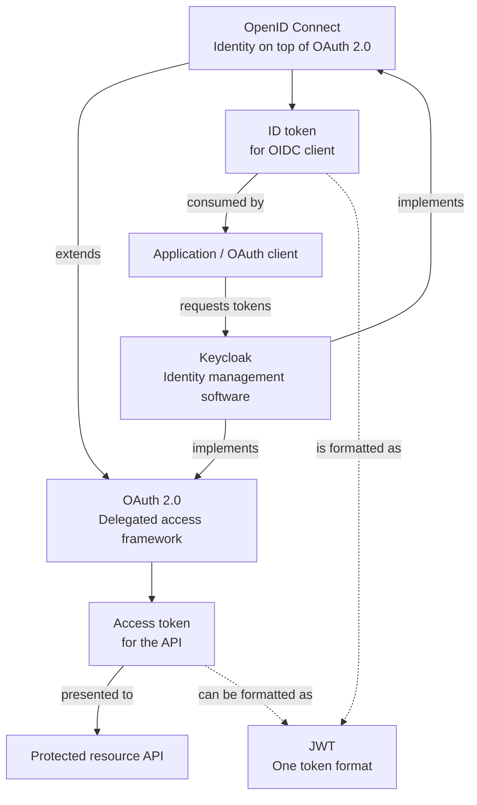
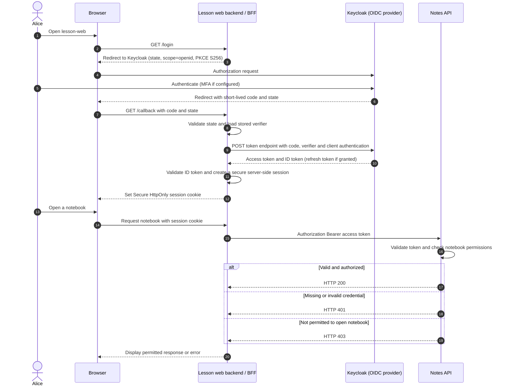
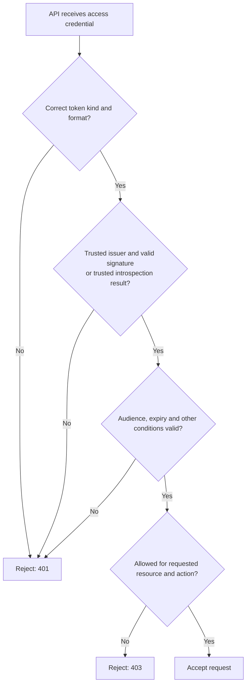

# OAuth 2.0 vs OpenID Connect (OIDC) vs Keycloak

> **One-minute explanation:** **OAuth 2.0** gives applications a framework for delegated access. **OpenID Connect** adds a standard way to learn who authenticated. **Keycloak** is software that implements these protocols.

This chapter starts with a simple analogy, then follows real credentials between a browser, application, identity provider, and API. All names and hosts are fictional.

## 1. The plain-language version

Imagine a student using a school application:

- **Authentication:** The school checks *who you are*.
- **Authorization:** The school checks *whether you may read a particular notebook*.
- **OAuth 2.0:** The application obtains permission to call a protected resource without handling the student's password itself.
- **OIDC:** On top of OAuth 2.0, the application obtains standardized information about the student's authentication.
- **Keycloak:** An identity management system that can implement the OAuth authorization server and OIDC provider roles.

**Important:** A successful login is **not** blanket permission to use every API or access every student's data.

## 2. Three different things, not competing protocols

| Name | Category | Main purpose | What it is *not* |
| --- | --- | --- | --- |
| OAuth 2.0 | Authorization framework | Issue and use delegated access credentials | By itself, a standardized user-login identity protocol |
| OpenID Connect (OIDC) | Authentication/identity protocol **built on OAuth 2.0** | Help a client verify a user's authentication and obtain identity claims | A substitute for API access-control checks |
| Keycloak | Identity and access management product | Provide identities, login, OAuth/OIDC endpoints and policy/configuration | Another token or protocol competing with OAuth |
| JWT | Token format | Carry claims; often signed | Automatically encrypted or automatically trustworthy |
| Bearer | Token presentation/usage model | Permit token holders to present a credential | The same thing as a JWT |
| SAML | Federation/SSO protocol | Exchange authentication information in a different ecosystem | An OAuth grant type |

An OAuth access token may be a JWT or an opaque value, depending on the authorization server and deployment. An OIDC ID token is a JWT. Do not decode a JWT and trust its claims without verifying the appropriate security properties.

## 3. Who is who in a Keycloak example?

Our fictional environment is:

| Component | Fictional name | What it does |
| --- | --- | --- |
| Person | Alice | Student signing in |
| Realm | `school-lab` | Keycloak identity boundary |
| Web application | `lesson-web` | Running application on the **app side**, using OAuth/OIDC client code |
| Client registration | `lesson-web` | Keycloak record describing the client ID, redirect URIs, allowed flows and scopes |
| Resource server | `notes-api` | API enforcing access to notebooks |
| Identity provider | Keycloak | Authenticates the user, issues tokens, publishes discovery information |

**The running OAuth client and its Keycloak registration are not the same object.** Keycloak knows which app is registered, but it does not run that app's frontend or backend for it.

A realm contains users, client registrations and configuration. Protocol mappers, client scopes and role mappings influence token claims. They do **not** replace the API's authorization logic.

## 4. Authorization code vs three token types

| Credential | Normally goes to | What it means | Do not use it for |
| --- | --- | --- | --- |
| **Authorization code** | Client callback, then token endpoint | Short-lived, one-use artifact exchanged for tokens | Calling an API |
| **Access token** | Intended resource API | Authorization evidence for an action, resource and audience | Proving login to the OIDC client by itself |
| **ID token** | OIDC relying party (client) | Signed claims about a user's authentication | API bearer authorization |
| **Refresh token** | Authorization server's token endpoint | May obtain a new access token, subject to policy | Calling the API or identifying a user to the browser |

**The key rule:** A signed ID token is **not** a valid replacement for an API access token. The client validates the ID token for its own authentication purposes; the API validates the access token intended for it.

## 5. See the login flow: Browser + backend + Keycloak + API

This example uses a **Backend-for-Frontend (BFF)** with a confidential OAuth client. The browser receives an application session cookie. The backend holds OAuth tokens securely; the separate resource API receives access tokens.

**Follow the trust boundaries:** The **browser** handles redirects and its own session cookie. The **application backend** handles the authorization-code exchange and server-side tokens. **Keycloak** authenticates and issues credentials. The **API** makes its own access decision.

**Security requirements:** Use HTTPS and exact registered redirects, protect session cookies against cross-site request forgery (CSRF), use transaction-specific login state and PKCE, verify OIDC `nonce` when sent, and ensure server-side session contents remain protected. In this BFF example, OAuth tokens are never returned to browser JavaScript.

An SPA using a browser-side OAuth library can have a different token path. This BFF diagram is **one design**, not a claim that every OAuth app has a backend.

## 6. Why is OIDC built on OAuth 2.0?

OAuth already has the infrastructure for an authorization request, an authorization server, client registration and token responses. OIDC builds on this flow:

1. The client requests the `openid` scope to signal an OIDC authentication request.
2. The identity provider authenticates the user as needed.
3. The OIDC client receives and validates an **ID token**, whose claims describe the authentication.
4. The client may use the UserInfo endpoint to obtain additional claims when appropriate.
5. The resource API still separately decides whether an access token permits a specific operation.

There is **no universal rule** that authentication must happen in a distinct network step before authorization. The protocols can carry out multiple checks in the same interaction. The distinction is in their **purpose**: *identity* versus *permission*.

## 7. OAuth scope, Keycloak client scope, and role are different

| Term | Plain meaning | Neutral example |
| --- | --- | --- |
| OAuth scope | Delegated access requested for the client | `notes:read` |
| OIDC scope | Standard identity claims/request semantics | `openid profile email` |
| Keycloak Client Scope | Reusable configuration of mappers and role-scope mappings | `profile` or a custom client scope |
| Keycloak role | Role assigned to a user or client | `teacher` |
| API resource authorization | Permission for this specific operation and object | Alice can read her notebook but not Bob's |

Even if the token includes `notes:read`, the API may need to check **ownership, tenant, object identity and current policy**. A scope is not a substitute for per-resource authorization.

## 8. Which OAuth/OIDC flow should I choose?

| Scenario | Common secure approach |
| --- | --- |
| Backend-managed interactive website | Authorization Code with confidential-client authentication; PKCE recommended |
| Browser-only SPA, native app, or redirect-capable CLI | Authorization Code **with PKCE S256** |
| TV or input-constrained device | Device Authorization Grant with user approval and rate-respecting polling |
| Machine-to-machine service, no user | Client Credentials (no end-user login) |
| Application collects the user's password for a token exchange | **Do not use the Resource Owner Password Credentials grant** |
| Browser receives access token in implicit authorization response | Avoid the Implicit grant; prefer code exchange |

Per **RFC 9700**, public clients **MUST use PKCE**; PKCE is **recommended for confidential clients**. The password grant **MUST NOT be used**. Clients should not use the implicit grant unless specific stringent mitigations are satisfied. Use exact registered redirect URI matching except the specified native-app localhost port exception.

**PKCE in one sentence:** The client sends a hash-derived `code_challenge` during authorization and later proves possession of the original `code_verifier` at the token endpoint.

## 9. What should the API validate?

For a JWT-based access-token deployment, verify the trusted signature and allowed algorithm, expected issuer (`iss`), intended audience (`aud`), expiry (`exp`) and other applicable time constraints; confirm it is the **correct kind of credential** and enforce scopes, roles and resource-level policy. When the API receives opaque tokens, use the configured validation/introspection approach instead of assuming a JWT.

An HTTP `401` response commonly indicates that authentication credentials are missing or invalid. `403` commonly means the request was authenticated but is not permitted. Applications may have additional error-handling requirements.

## 10. Find the pieces in Keycloak

For a **local disposable** Keycloak demonstration, replace `school-lab` with your test realm.

| Service | Relative endpoint |
| --- | --- |
| OIDC discovery | `/realms/school-lab/.well-known/openid-configuration` |
| Authorization | `/realms/school-lab/protocol/openid-connect/auth` |
| Token exchange / refresh | `/realms/school-lab/protocol/openid-connect/token` |
| UserInfo | `/realms/school-lab/protocol/openid-connect/userinfo` |
| Public verification keys (JWKS) | `/realms/school-lab/protocol/openid-connect/certs` |

Discovery is the safest starting point; do not hardcode assumptions about optional endpoints. The Keycloak Admin Console exposes **Clients**, **Users**, **Client scopes**, and **Realm settings**, though navigation can change between versions.

Keycloak can also integrate with **LDAP user stores**, broker external identity providers, and support **SAML**, which is a separate federation protocol. MFA, session lifecycle, logout, key rotation and token revocation policies are additional important concerns; they are **not** guaranteed by the mere presence of OIDC.

## 11. Common misconceptions

- **“OAuth is login.”** OAuth is an authorization framework. OIDC standardizes authentication information.
- **“Keycloak is the OAuth client.”** For a registered application, Keycloak generally acts as authorization server/identity provider; the application code acts as client.
- **“A signed JWT gives API permission.”** Signature validity is only part of token validation and authorization.
- **“ID token and access token are interchangeable.”** They have different audiences and purposes.
- **“Every OAuth access token is a JWT.”** Access tokens can be opaque.
- **“A role claim is enough to authorize any object.”** Object-level policy must still be enforced.
- **“Refresh tokens go to APIs.”** They are used at the authorization server's token endpoint, subject to policy.
- **“JWT expiration instantly reflects all user revocations.”** Offline validation of a still-valid access token may not see immediate role or session changes; choose a suitable revocation/expiry policy.
- **“Bearer means encrypted.”** Bearer refers to token possession; protect credentials against theft and replay.

## 12. Check your understanding

1. Alice logged into `lesson-web`. Does that authorize her to read Bob's notebook? **No.** The API must check the operation and object policy.
2. Which token tells the **OIDC client** about authentication? **ID token** (properly validated).
3. Which credential is presented to `notes-api`? **An access token intended for and accepted by that API**, not an ID token.
4. What does `scope=openid` indicate? **An OIDC authentication request**.
5. Is a Keycloak client registration where the application runs? **No.** It is identity-provider configuration for the separately running client.
6. What should happen to an expired or wrong-audience access token? **Reject it**, even if it has a valid signature.
7. Does Keycloak Client Scope equal an API permission? **No.** Token-claim mapping and resource authorization are separate.

Continue with [Authorization Code vs Access Token](11-authorization-code-vs-access-token.md), [PKCE](10-pkce-generation.md), [Token validation](06-api-token-validation.md), [JWT vs JWKS](15-jwt-vs-jwks-verification.md), and [BFF architecture](13-bff-authlib-browser-session-security.md).

## Standards and further reading

- [OAuth 2.0 Authorization Framework — RFC 6749](https://www.rfc-editor.org/rfc/rfc6749)
- [OAuth 2.0 Security Best Current Practice — RFC 9700](https://www.rfc-editor.org/rfc/rfc9700)
- [OpenID Connect Core 1.0](https://openid.net/specs/openid-connect-core-1_0.html)
- [PKCE — RFC 7636](https://www.rfc-editor.org/rfc/rfc7636)
- [OAuth 2.0 Device Authorization Grant — RFC 8628](https://www.rfc-editor.org/rfc/rfc8628)
- [Keycloak: securing applications with OIDC](https://www.keycloak.org/securing-apps/oidc-layers)
- [Keycloak Server Administration Guide](https://www.keycloak.org/docs/latest/server_admin/)

*Version-sensitive administration steps and implementation details should always be checked against current official documentation. This is educational material, not a production security sign-off.*
