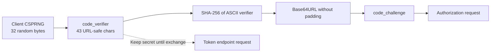
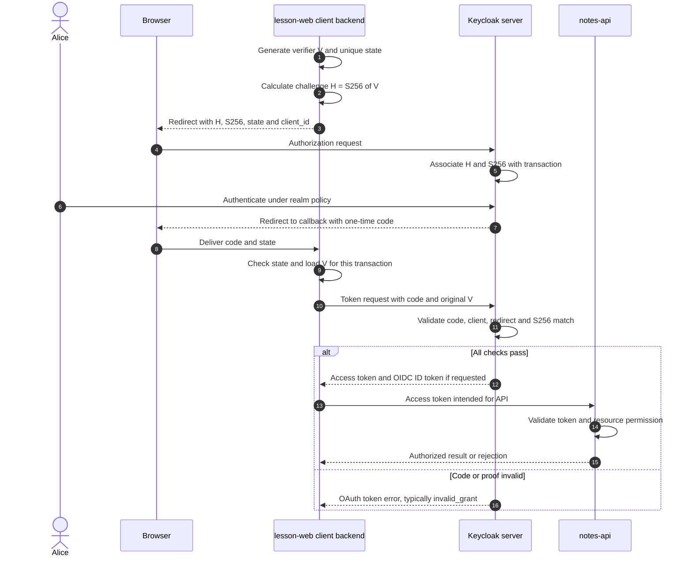
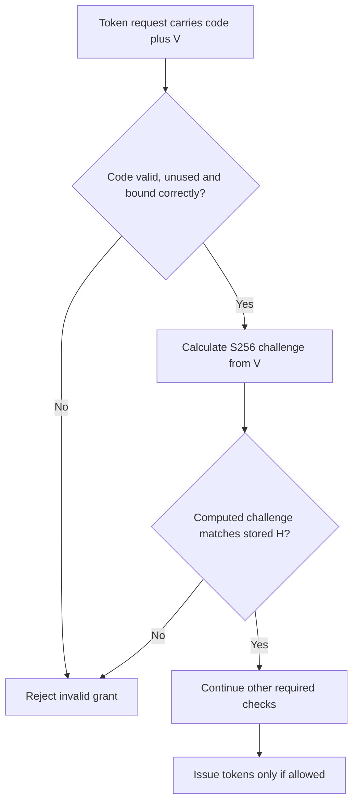
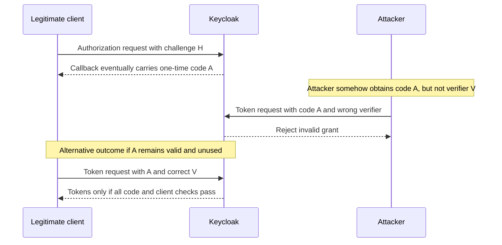

# PKCE in OAuth 2.0: code verifier, challenge and proof

> **In one sentence:** **PKCE** (*Proof Key for Code Exchange*) binds an authorization-code exchange to the client instance that initiated it. The client sends a **derived challenge first** and the **original secret verifier later**. Keycloak checks that they match before issuing tokens.

This guide uses a fictional `school-lab` realm, `lesson-web` application and `notes-api`. The code examples are for a disposable learning environment only.

## 1. Why does PKCE exist?

An OAuth application can receive a short-lived **authorization code** through a browser redirect. Suppose an attacker obtains that code before the legitimate application redeems it. Without appropriate protection, the attacker might try exchanging it at the authorization server's token endpoint.

PKCE adds a **per-login secret** that the legitimate client generates and retains. The attacker who sees **only the code** should not be able to use it because they do not possess the matching verifier.

**Analogy:** The authorization code resembles a collection ticket; PKCE adds a unique secret proof that belongs to the collector. **Limit:** PKCE is not the user's password, user authentication, or a complete defense if both code and verifier are stolen.

## 2. Five related values — not interchangeable

| Value | Who creates it? | Where does it travel? | Main job |
| --- | --- | --- | --- |
| `code_verifier` | **Client instance**, once per authorization request | **Token endpoint only** | Prove possession of the per-request secret |
| `code_challenge` | Client derives it from verifier | **Authorization endpoint** | Public challenge bound to later code |
| `code_challenge_method` | Client sets `S256` | Authorization endpoint | Tell server how to verify the proof |
| `authorization_code` | **Keycloak** after successful authorization | Browser callback, then token endpoint | Single-use grant for token exchange |
| `state` | Client, unique per request | Authorization request and callback | Correlate transaction and protect against login CSRF, when checked |

When OIDC is used, `nonce` may additionally bind the authentication result to a particular client transaction. Client authentication for a confidential backend is a **separate** protection.

## 3. The exact S256 formula

```text
code_verifier  = BASE64URL(32 cryptographically random bytes) without "=" padding
code_challenge = BASE64URL(SHA256(ASCII(code_verifier))) without "=" padding
code_challenge_method = S256
```

RFC 7636 requires the verifier to be **43–128 characters** selected from `A–Z a–z 0–9 - . _ ~`. Base64URL encoding a **32-byte** random value produces a **43-character** verifier with approximately **256 bits of entropy**.

**Base64URL is encoding, not encryption.** The S256 challenge is a SHA-256 digest encoded using URL-safe Base64 without `=` padding. An attacker seeing the challenge should not be able to derive a sufficiently random verifier.



The verifier must not be embedded in the initial authorization URL or exposed to the browser in a confidential BFF design.

## 4. Generate a verifier and challenge with Python

Use the dependency-free public-ready lesson lab, stored in the **private** repository until you choose to synchronize:

```sh
python3 labs/pkce_generate.py
python3 labs/pkce_generate.py --self-test
```

The default mode prints the **challenge** but deliberately does **not** print the generated verifier. The `--self-test` mode uses the **public RFC 7636 Appendix B test vector** and additional format assertions. For learning purposes, you can explicitly request `--show-verifier`, but **never use that flag with real authentication values or in scripts that are logged**.

The underlying functions are:

```python
import base64
import hashlib
import secrets

verifier = secrets.token_urlsafe(32)    # 43-char verifier, 32 random bytes
digest = hashlib.sha256(verifier.encode("ascii")).digest()
challenge = base64.urlsafe_b64encode(digest).decode("ascii").rstrip("=")
```

No online JWT decoder or third-party hashing website is required.

### Public RFC test vector

The **published test vector** is not a real credential and is safe to reproduce for verification:

```text
verifier:  dBjftJeZ4CVP-mB92K27uhbUJU1p1r_wW1gFWFOEjXk
challenge: E9Melhoa2OwvFrEMTJguCHaoeK1t8URWbuGJSstw-cM
```

If an independent S256 implementation computes a different challenge for that verifier, it is incorrect.

## 5. Step by step: first request and second request

**Step A — Authorization endpoint:** The client generates verifier `V`, derives challenge `H` and remembers `V` securely for this login. The browser goes to Keycloak with **H, not V**:

```text
GET https://login.example.test/realms/school-lab/protocol/openid-connect/auth
    ?response_type=code
    &client_id=lesson-web
    &redirect_uri=REGISTERED_CALLBACK
    &scope=openid
    &state=PER_REQUEST_RANDOM_STATE
    &code_challenge=S256_CHALLENGE_H
    &code_challenge_method=S256
```

Keycloak validates the authorization request and **associates H and the S256 method with the authorization transaction and eventual code**. Alice authenticates, and Keycloak redirects to the registered callback with a **short-lived authorization code** and state.

**Step B — Token endpoint:** The actual client retrieves saved `V`, verifies its transaction state, then directly sends **code + V** to Keycloak:

```http
POST /realms/school-lab/protocol/openid-connect/token HTTP/1.1
Host: login.example.test
Content-Type: application/x-www-form-urlencoded

grant_type=authorization_code&client_id=lesson-web&code=ONE_USE_CODE&redirect_uri=REGISTERED_CALLBACK&code_verifier=ORIGINAL_V
```

A **confidential** client additionally authenticates as configured. The example `.test` hostname is fictitious; form-encode real parameter values in an actual implementation.

The token endpoint verifies the code and `BASE64URL(SHA256(ASCII(V))) == stored H`. Tokens are returned **only when all required checks succeed**.

## 6. The complete protocol sequence



A browser-only SPA uses a different storage architecture; a **full BFF** keeps OAuth tokens on its backend and gives the browser an opaque session cookie. The essential PKCE challenge/verifier order remains the same.

## 7. How does Keycloak actually verify PKCE?

Keycloak does not compare **verifier directly to challenge**. For S256 it:

1. Locates the authorization code's associated challenge and method.
2. Confirms that the code, client, redirect and transaction remain valid.
3. Computes `BASE64URL(SHA256(ASCII(received_verifier)))`.
4. Compares that computed result with the **stored challenge** using a suitable secure comparison implementation.
5. Proceeds with token issuance only if all relevant conditions are satisfied.



**A matching verifier does not revive an expired or reused authorization code.** These are independent checks.

## 8. What about an attacker stealing only the code?



The second exchange is **not guaranteed** after an attack attempt. Codes may expire, become invalid or be marked used. PKCE defends against a **specific class of intercepted-code redemption**, not an attacker who already controls the client, steals both values, or can exploit another weakness.

## 9. PKCE vs state vs nonce vs client secret

| Protection | Purpose | Does it replace the others? |
| --- | --- | --- |
| **PKCE** | Bind a token exchange to the client instance/authorization request | No |
| OAuth `state` | Correlate callback to initiating transaction and help protect against login CSRF | No; validate when used |
| OIDC `nonce` | Bind an ID token's authentication result to the relevant request when required/used | No |
| **Confidential client authentication** | Authenticate a trusted backend client at the token endpoint | No |
| HTTPS / redirect validation | Protect transport and destination | No |
| API access-token validation | Verify token audience/issuer/expiry and required permissions | No |

RFC 9700 requires **public authorization-code clients** to use PKCE and **recommends it for confidential clients**; the authorization server **must support PKCE**. When a client sends a valid challenge, the server must enforce the corresponding verifier. **Use S256** to prevent disclosure of the verifier through the initial challenge; do not downgrade to `plain`.

Modern client security also includes protecting against authorization-server mix-up and injected codes; successful PKCE does not by itself excuse omitting transaction binding or issuer validation.

## 10. Enabling PKCE in Keycloak and Authlib

For a disposable local Keycloak realm and `lesson-web` registration:

- Use **Standard Flow** (Authorization Code) and exact allowed redirect URIs.
- Configure the client to require **S256** in the applicable PKCE method setting when available. Keycloak Admin Console menu paths differ by version. A blank PKCE requirement setting may allow PKCE but **not require** it.
- For a **public** SPA or native app, do not configure a client secret. Use PKCE and appropriate login state protection.
- For a trusted **FastAPI + Authlib BFF**, use an appropriately authenticated confidential client and configure the code challenge method where supported:
  
  ```python
  client_kwargs={"scope": "openid", "code_challenge_method": "S256"}
  ```
  
  The OAuth library/application must safely bind the verifier and transaction state to the initiating session. Authlib configuration alone does **not** establish secure server-side token storage; browser session implementations vary.

Explore [Keycloak's current administration guide](https://www.keycloak.org/docs/latest/server_admin/) and [Authlib web-client documentation](https://docs.authlib.org/en/latest/oauth2/client/web/) for your installed version. The user interface is not a substitute for observing the actual authorization/token requests.

## 11. Small failure matrix

| Situation | Expected decision |
| --- | --- |
| Correct code, valid client and redirect, correct verifier, all checks pass | Tokens may be issued |
| Correct code but wrong verifier | Reject |
| Correct verifier but **expired** code | Reject |
| Correct verifier but **reused** code | Reject |
| Missing verifier when a challenge was bound | Reject |
| Attempted PKCE downgrade | Reject under RFC 9700-compliant handling |
| Valid access token presented to the **wrong API audience** | API rejects |
| Valid login, user lacks notebook permission | API denies resource operation |

**Do not confuse:** the token endpoint enforces grant/PKCE checks; the protected API enforces access-token and object-level authorization.

## 12. Questions to practice

1. **Who creates the verifier?** The OAuth client, not Keycloak.
2. **Where is the verifier sent first?** Only in the subsequent **token request**; not the authorization request.
3. **What is sent at the authorization endpoint?** The S256 challenge and method.
4. **If an attacker intercepts the code only, what is missing?** The original verifier.
5. **If PKCE matches but the code expired, may Keycloak issue tokens?** No.
6. **Is PKCE equivalent to a confidential client secret?** No.
7. **Is `state` the same as the verifier?** No; they protect different protocol properties.
8. **Can the resource API validate the PKCE verifier instead of an access token?** No.
9. **Should a verifier be reused for several sign-ins?** No, use a fresh verifier per authorization request.
10. **Can an OIDC ID token be used as the API access token?** No.

## Sources

- [RFC 7636 §§4.1–4.6 — PKCE verifier, challenge, exchange and validation](https://www.rfc-editor.org/rfc/rfc7636)
- [RFC 7636 Appendix B — standard test vector](https://www.rfc-editor.org/rfc/rfc7636#appendix-B)
- [RFC 9700 — OAuth 2.0 Security BCP](https://www.rfc-editor.org/rfc/rfc9700)
- [RFC 6749 §4.1 — Authorization Code Grant](https://www.rfc-editor.org/rfc/rfc6749.html#section-4.1)
- [Keycloak Administration Guide](https://www.keycloak.org/docs/latest/server_admin/)
- [Authlib OAuth Web Clients](https://docs.authlib.org/en/latest/oauth2/client/web/)
- [Previous: Authorization code vs access token](11-authorization-code-vs-access-token.md) · [Keycloak fundamentals](01-keycloak-fundamentals.md)

*This chapter teaches general standards. It does not contain live service tokens, customer infrastructure or deployment secrets.*
