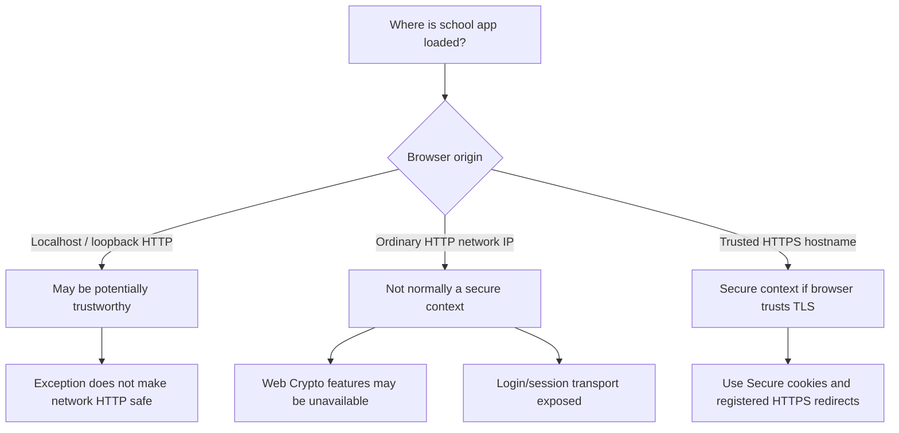
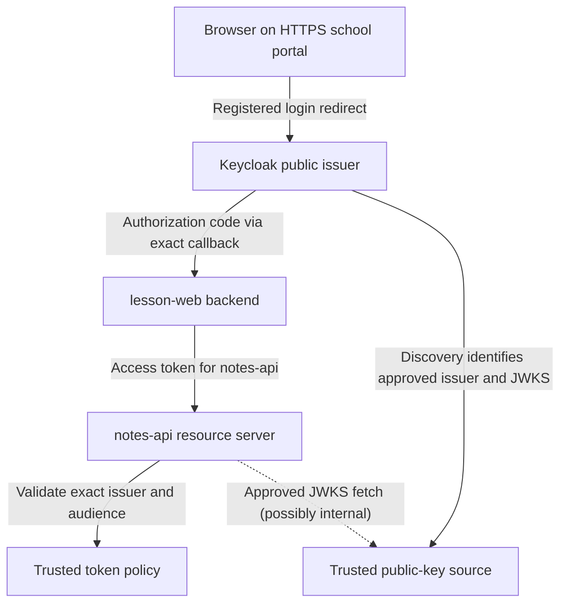
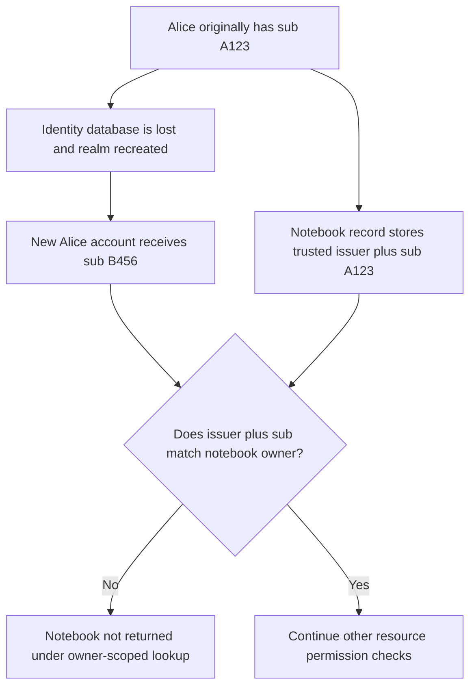
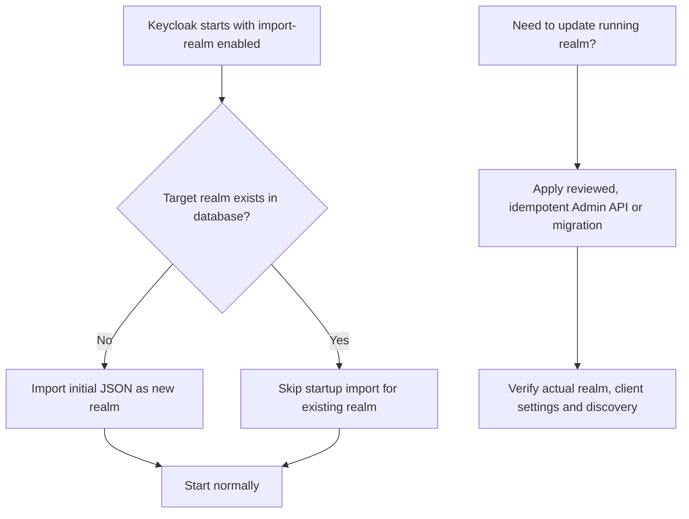

# Keycloak deployment: HTTPS, stable identity, issuer URLs and sessions

> **Core lesson:** Correct OAuth/OIDC code is not enough. A Keycloak deployment must preserve its **identity state**, advertise a **trusted, stable issuer**, enforce **HTTPS and exact redirects**, protect administration, and test session/token behavior across restarts, recreations and outages.

All examples are fictional: `school-lab` realm, Alice (`sub=student-A123`), browser app `lesson-web` and protected `notes-api`. This chapter is a **learning guide**, not a verified installation or step-by-step production deployment.

## 1. Five independent deployment concerns

| Concern | Why it matters | What to verify |
| --- | --- | --- |
| **HTTPS and secure browser context** | Login cookies, code redirects and browser APIs depend on transport and origin trust | Browser uses valid HTTPS outside loopback |
| **Stable issuer and hostname** | JWT `iss`, discovery and redirects must agree | Configured issuer exactly matches token and discovery |
| **Persistent identity database** | Subject identifiers, credentials, group assignments and sessions must survive permitted restarts | Identity continuity across recreate and restore |
| **Controlled realm configuration** | Startup import differs from live updates | Existing realm changes follow deliberate migration |
| **API authorization and session lifecycle** | Token validity and resource ownership are separate | Correct 401/403/404 behavior, refresh and logout |

A successful login on a developer laptop proves only a limited function. It is not evidence that Keycloak configuration or session data will survive a deployment change.

## 2. Why localhost HTTPS rules differ from a VM HTTP IP

Many browsers treat `http://localhost` and supported loopback origins as **potentially trustworthy**, even without TLS. An ordinary `http://192.0.2.10`-style or private-network HTTP page is generally **not a secure context** and can lack APIs such as `crypto.subtle`. The browser can report:

```javascript
// Inspect only in a disposable local browser console.
window.isSecureContext
Boolean(globalThis.crypto?.subtle)
```

This difference can make an OAuth browser client work in localhost tests yet fail at a remote HTTP origin. Moving PKCE hashing into Python/Authlib eliminates *that specific browser crypto requirement*, **not** the need for TLS. On non-loopback networks, use trusted HTTPS for the application and Keycloak, especially wherever passwords, authorization codes, cookies and Bearer tokens travel.



Do not turn off PKCE or embed a public-client secret merely to bypass a secure-context check. Consult [MDN Secure Contexts](https://developer.mozilla.org/en-US/docs/Web/Security/Defenses/Secure_Contexts).

## 3. Public issuer, discovery, token audience and JWKS

A Keycloak realm has an issuer identity, e.g.:

```text
https://login.example.test/realms/school-lab
```

Its OIDC discovery document is available at a corresponding `/.well-known/openid-configuration` path. The resource API must configure the **exact expected issuer** and the appropriate **audience**. JWT verification keys can be obtained from a **trusted, approved `jwks_uri`**—a private network route can be used under a carefully configured trust model, but must not silently replace the expected public issuer with an internal-only hostname.

| Setting or URL | Role | Safety condition |
| --- | --- | --- |
| Keycloak hostname / frontend URL | Public login, issuer and links | Stable HTTPS hostname, not arbitrary untrusted Host header |
| OIDC issuer | Identity of JWT issuer | Compare exactly with trusted configuration |
| `jwks_uri` | Public verification keys for signed JWTs | Retrieved only from approved metadata/source |
| Client redirect URIs | Allowed callback addresses | Explicit, minimal schemes, hosts, paths and ports |
| Web origins | Browser origin permissions | Least privilege; do not use wildcard credentials CORS |
| Post-logout redirect URIs | Permitted browser landing locations | Explicit allowlist |
| Reverse proxy headers | Indicate original scheme/host where trusted | Overwrite untrusted incoming `Forwarded` / `X-Forwarded-*` |

[Keycloak hostname v2](https://www.keycloak.org/server/hostname) recommends explicit hostname configuration and explains when reverse-proxy headers are necessary. A key mistake is to trust forwarded host headers from an untrusted client: this can turn generated links or issuer context into attacker-controlled values. A different public versus backchannel route must be intentional and validated.



A client registration's existence does **not** automatically make `notes-api` the `aud` claim; Keycloak scope/mappers and the actual issued token profile matter.

## 4. A deployment address is not a local browser address

`localhost` is relative to **the machine performing the request**. If a browser runs on Alice's laptop but the application runs on a separate server, a redirect to `http://localhost:.../callback` normally means Alice's laptop, not that remote server.

For a remote web app, the registered redirect URI must point to the correct **public application callback**, use HTTPS and match the OAuth transaction. Native apps with local loopback callbacks are a different architecture described by [RFC 8252](https://www.rfc-editor.org/rfc/rfc8252).

Similarly, environment-variable interpolation in a deployment manifest does not necessarily rewrite unrelated mounted realm JSON. If deploying configuration from templates, confirm the **resolved final files**, actual Keycloak realm state and discovery endpoints; do not assume every config source is live-updated.

## 5. User `sub` and durable resource ownership

OIDC `sub` identifies a subject within an issuer's identity context. It is generally a safer durable owner reference than a mutable display name or email, but its continuity depends on **preserving the identity store and issuer context**.

Suppose Alice creates a private notebook and the application stores `owner_iss` and `owner_sub=student-A123`. After accidental deletion and recreation of the identity database, another Alice account could receive `sub=student-B456` despite having the same display name. Ownership lookup then fails, even though the notebook still exists.



Never automatically grant ownership to a newly recreated account solely because its username or email matches. Plan identity migrations and restore procedures explicitly; document binding of `iss` and `sub`, and review how federated users and identity linking can affect continuity.

## 6. Restart vs recreate vs destructive reset

| Event | Typical risk | What to test |
| --- | --- | --- |
| Restart Keycloak process with intact persistent DB | Lower risk to stored user IDs | Same `iss`, `sub`, roles and session expectations |
| Recreate container with persistent external database retained | Normally preserves identity data | Same users and subject identifiers after recreation |
| Recreate with ephemeral in-container data | May lose users/realm/config | Old notebook owner mapping must not silently change |
| Remove database volume or restore wrong snapshot | Potentially severe identity loss | Recovery exercise with subject/realm comparison |
| Restore database and keys from verified backup | Potential way to recover identity continuity | Revalidate issuer, subjects, signing keys, sessions and security events |

A development-only file database stored in a durable volume can teach persistence, but a real Keycloak deployment should use a **supported persistent database**, protected backup/restore procedures and deliberate availability design. Commands that remove volumes are **destructive** and must not be used casually to force configuration changes.

**Important:** identity exports are not interchangeable with consistent database backups. The official Keycloak [import/export guide](https://www.keycloak.org/server/importExport) warns that exports can omit event, session, workflow and revocation state and should not be assumed sufficient for complete disaster recovery.

## 7. Startup realm import is not a live migration

Keycloak's `--import-realm` startup behavior imports realm JSON from a configured import directory **only when the realm does not already exist**. With a persistent database, later restarts usually skip importing existing realms. Editing a JSON file and restarting does **not** necessarily change callbacks, mappers, users or roles in the existing realm.



The separate offline `import` command has **different overwrite behavior and risks**; consult the official guide rather than confusing it with startup import. Exporting a realm does not prove all sessions, events and user state are backed up. A safe migration includes rollback planning, revision control of nonsecret configuration and validation after applying changes.

## 8. Why 401, 403 and 404 can all be legitimate

| HTTP outcome | Typical scenario | What it tells you |
| --- | --- | --- |
| **401 Unauthorized** | Missing, invalid or expired credential | Valid authentication to this protected API is absent |
| **403 Forbidden** | Valid credential, but resource action or tenant permission denied | Current caller lacks permission |
| **404 Not Found** | Requested notebook does not exist **or is hidden by authorization** | Avoid leaking existence if policy requires concealment |

If Alice's new subject no longer matches a notebook's original owner, an owner-scoped query might return **404** even while a notebook row still exists. A different API may use 403 after an explicit authorization check. [RFC 9110](https://www.rfc-editor.org/rfc/rfc9110.html#section-15.5.4) allows returning 404 to hide the existence of a forbidden resource. Determine whether the root cause is **identity continuity, token validation or authorization logic** before treating a response as a protocol bug.

## 9. Identity, session and refresh lifecycle

The app's **browser session** is distinct from Keycloak's **SSO session**, the **OAuth access token**, and any **refresh token**.

- An interactive login may create an app-specific session cookie and issuer-side SSO state.
- Keycloak can issue access JWTs with finite expiry. Their signatures can remain valid until expiry even after a server-side permission change.
- A BFF may renew tokens by using a refresh grant. Concurrent refresh must coordinate token rotation and persist results safely.
- **Local logout** invalidates the app session and clears its cookie; **issuer logout** affects Keycloak's SSO session via appropriate OIDC protocol. An unexpired access JWT might still be accepted under a local-validation model.
- Identity database persistence and application session storage are distinct; preserving one does not guarantee preserving the other.

See [the full BFF security lesson](13-bff-authlib-browser-session-security.md) for the complete backend-managed token lifecycle.

## 10. Protect administrative and internal surfaces

- Keep Keycloak Admin Console and Admin REST API reachable only by intended administrators through appropriate authenticated reverse-proxy/network restrictions. A separate admin hostname by itself does **not** automatically block administration paths at the frontend origin.
- Use protected secret handling for bootstrap/admin credentials, DB passwords and signing materials. **Never commit them to the teaching repository**.
- Prevent public access to databases, token/session stores, management ports and unnecessary internal services.
- Configure reverse proxies to **overwrite** untrusted forwarded headers and ensure TLS end-to-end where required by risk model.
- Use least-privilege clients, roles, callback/origin allowlists, logging redaction, audit and security update processes.

A successful localhost login or a refused default password is useful evidence about one test; neither proves production security. References: [Keycloak hostname guidance](https://www.keycloak.org/server/hostname), [reverse proxy](https://www.keycloak.org/server/reverseproxy), and [production setup](https://www.keycloak.org/server/configuration-production).

## 11. A safe test matrix for learning

| Question | Disposable test expectation |
| --- | --- |
| Does browser `isSecureContext` differ on loopback vs remote HTTP? | Observe without sending credentials over the unsafe origin |
| Is issuer identical across discovery and JWT `iss`? | Compare exact configured value |
| Does a wrong JWKS/issuer URL trigger signature-validation bypass? | **No**; API rejects |
| Do public app callbacks use exact HTTPS address? | Yes, except documented native loopback exceptions |
| Does Alice retain the same `iss` and `sub` after a safe recreate? | Yes when the identity DB is preserved and issuer stable |
| Does an initial realm JSON update change an existing realm automatically on restart? | **No**, verify intentional migration instead |
| Does restored backup preserve expected identity state? | Validate with a controlled recovery test |
| Are role changes and session expiry reflected according to application risk? | Check token lifetime, refresh and live policy |
| Can a forbidden notebook be hidden using 404? | Yes, by deliberate API disclosure policy |
| Are admin and database endpoints isolated? | Verify with configuration and permitted local tests |

Do not claim these tests have been run. These are learning requirements for a **future disposable local lab**, not actual production verification.

## 12. Self-check and sources

1. **Is ordinary HTTP on a remote network automatically a secure browser context?** No.
2. **Does moving PKCE to Python remove HTTPS requirements?** No.
3. **Can internal JWKS use another network route?** Only under explicit trusted issuer/key-source policy; **`iss` still must match**.
4. **Does creating an Alice account with the same email guarantee the same `sub`?** No.
5. **Does `--import-realm` overwrite an already existing realm at every start?** No.
6. **Does exporting realm JSON equal complete backup of sessions and users?** No.
7. **Does 404 always mean the row is absent?** No, it can hide denied resources.
8. **Is issuer-side SSO logout identical to local app cookie removal?** No.
9. **Can a correctly signed access JWT hold stale permissions?** Yes.
10. **Does a separate admin hostname automatically block Admin REST exposure on frontend?** No.
11. **Can a password grant remain a new app default?** No; [RFC 9700](https://www.rfc-editor.org/rfc/rfc9700) says it MUST NOT be used.
12. **What must survive a safe identity migration?** Trusted issuer, subject continuity, identity records and applicable security state.

**Authoritative references:** [Keycloak hostname](https://www.keycloak.org/server/hostname) · [Realm import/export](https://www.keycloak.org/server/importExport) · [Keycloak database guide](https://www.keycloak.org/server/db) · [MDN Secure Contexts](https://developer.mozilla.org/en-US/docs/Web/Security/Defenses/Secure_Contexts) · [RFC 9110 HTTP semantics](https://www.rfc-editor.org/rfc/rfc9110) · [RFC 9700 OAuth BCP](https://www.rfc-editor.org/rfc/rfc9700).

**Related:** [BFF and Authlib](13-bff-authlib-browser-session-security.md) · [API validation](06-api-token-validation.md) · [keycloak-js](14-keycloak-js-browser-adapter.md).

*Fictional, generic educational content. No real infrastructure, credentials, user records or deployment verification is represented.*
