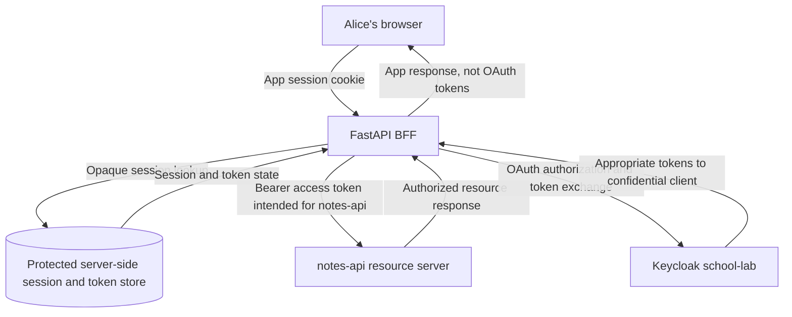
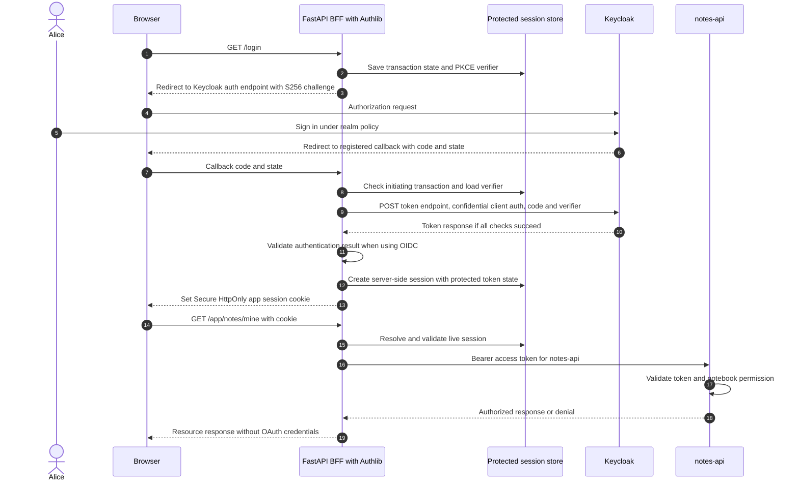
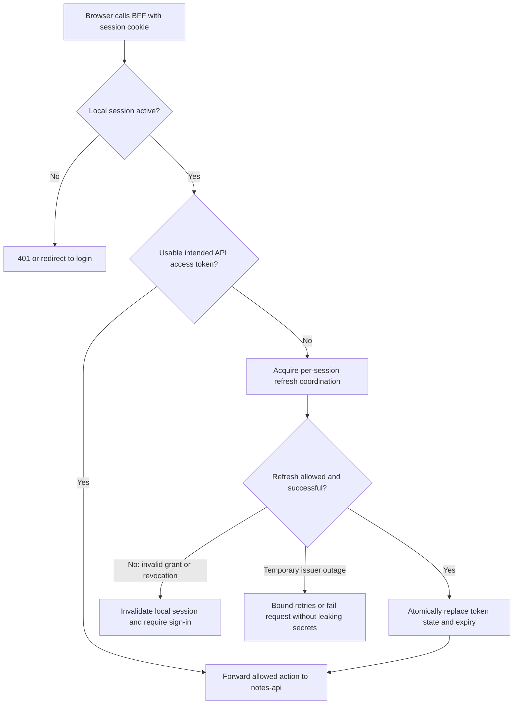

# OAuth Backend-for-Frontend with FastAPI, Authlib and Keycloak

> **Short answer:** A **full OAuth BFF** is the application's trusted backend acting as a confidential OAuth client, managing OAuth tokens, and mediating protected API requests. The browser authenticates to the BFF with a **separate application session**, not by reading Keycloak access or refresh tokens. Adding Authlib to a Python service **does not by itself make that service a full BFF**.

This classroom tutorial uses Alice, fictional Keycloak realm `school-lab`, a FastAPI app named `lesson-web`, and protected `notes-api`. The patterns are based on [RFC 10017 §6.1](https://www.rfc-editor.org/rfc/rfc10017.html#section-6.1) (August 2026). The reference design below deliberately uses **opaque cookies and server-side sessions**; RFC 10017 also discusses other session representations, so opaque server-side storage is a selected design, **not the universal definition of every BFF**.

## 1. What is a BFF, in plain language?

A browser frontend needs to sign Alice in and read her permitted notes. Instead of giving the browser an OAuth access token, the **BFF handles the OAuth protocol and holds tokens**, while the browser sends a session cookie to the application's own backend.

| Actor | Holds or does | Should not do |
| --- | --- | --- |
| **Alice and browser** | Navigate login, store app-session cookie, ask for notes | Store Keycloak refresh/access tokens in a full BFF |
| **FastAPI BFF with Authlib** | Confidential OAuth client, callback, tokens, session, downstream mediation | Return refresh/access tokens to frontend JavaScript |
| **Keycloak** | Authorization server / OIDC provider; authenticates Alice and issues tokens | Treat an application cookie as its API access token |
| **Protected session store** | Associates high-entropy opaque session ID with Alice, token state, expiry | Act as a public CDN, or leave raw tokens in logs |
| **`notes-api`** | Validate intended access token and apply resource permissions | Accept a session cookie or ID token in place of an access token |

**Analogy:** The receptionist holds a limited visitor credential and uses it to visit a records room on Alice's behalf. Alice's numbered queue ticket is meaningful **only to that receptionist**. A ticket cannot be used directly at the records room.

## 2. BFF vs token-mediating backend vs browser OAuth client

| Property | **Full BFF** | **Token-mediating backend** | **Browser OAuth client (`keycloak-js` example)** |
| --- | --- | --- | --- |
| OAuth client code | Trusted backend | Trusted backend | Browser JavaScript |
| Access tokens reachable by frontend JS? | **No**, by design | **Yes**, typically delivered to JS | **Yes**, obtained in browser |
| Refresh tokens reachable by frontend JS? | No | Normally kept backend-side | May be held in JS memory by adapter |
| Browser calls `notes-api` directly with Bearer? | Normally **no**; BFF mediates | May, using browser-held access token | May, using browser-held access token |
| Browser-to-backend credential | App session cookie | Often app session cookie | Not necessarily app BFF cookie |
| Key risk | Session abuse, CSRF and proxy misuse | Access-token exposure in browser | Browser token exposure and script compromise |

**Not a full BFF:** A Python callback exchanging an authorization code, then returning `access_token` in JSON for frontend scripts to call the API. That resembles a **token-mediating backend** even if the backend uses Authlib. An isolated login demonstration without a downstream API and protected session design also is **not proof** of a production-ready BFF.

## 3. Trust boundaries and the two credentials



The browser's `__Host-Http-lesson_session` cookie contains **only a random session identifier**, not a JWT, refresh token or client secret. The BFF resolves that identifier in a protected storage system, enforces app session policy and uses the corresponding access token for the downstream request. The API independently checks issuer, audience, token validity and the **specific notebook permission**.

This is a **logical flowchart**, not a declaration that a token or cookie can never be stolen or that all BFFs must use the same database.

## 4. Complete Authorization Code + PKCE login



**Exact responsibilities:** the BFF starts login and generates request-specific `state` and PKCE `code_verifier`; it sends only `code_challenge=S256(verifier)` in the browser authorization request. It verifies the callback is bound to the initiating session before redeeming the code. A confidential backend **also authenticates as a registered OAuth client**, and OIDC ID-token verification and `nonce` handling apply when the flow requires them.

PKCE does **not** make an expired code valid or replace confidential-client authentication. The application should reject unrecognized callback state, unsolicited callbacks, issuer mix-up, wrong redirect, expired code, or mismatched verifier.

## 5. What Authlib helps with — and what it does not do automatically

[Authlib's OAuth web-client documentation](https://docs.authlib.org/en/latest/oauth2/client/web/) describes `authorize_redirect()` and `authorize_access_token()` for framework integrations. The library can implement OAuth/OIDC protocol operations including state and token exchange. **You must still design the application session, protected token storage, access control and downstream forwarding**.

Conceptual integration outline, **not deployable code**:

```python
# Educational pseudocode only: omits storage, validation, error handling
# and trusted framework configuration. DO NOT deploy as-is.
#
# login:
#   transaction = new_secure_state_and_pkce_verifier()
#   secure_server_store.save(transaction)
#   redirect = authlib_client.authorize_redirect(callback_url, ...)
#   return redirect
#
# callback:
#   require_matching_transaction_and_state()
#   tokens = authlib_client.authorize_access_token(...)
#   verify_required_oidc_result_and_client_policy(tokens)
#   session_id = create_opaque_random_session_id()
#   protected_server_store.save(session_id, tokens, user, expiry)
#   return Set-Cookie(opaque_session_id, Secure, HttpOnly, SameSite)
#
# api_proxy:
#   session = validate_session_cookie_and_get_server_record()
#   enforce_csrf_and_application_authorization(session, request)
#   access_token = get_or_safely_refresh_valid_api_token(session)
#   enforce_outbound_host_path_method_allowlist(request)  # RFC 10017 MUST
  response = call_allowed_notes_api(access_token, request)
#   return response_without_oauth_tokens_or_sensitive_headers(response)
```

**Important Starlette trap:** Its [`SessionMiddleware`](https://www.starlette.io/middleware/#sessionmiddleware) implements **signed cookie-based sessions**. Their session contents are **readable** by the browser even though tampering is detectable. Placing an access token, refresh token or client secret into `request.session` **can send it to the browser**. For this lesson's full-BFF architecture, store secrets **server-side**, with the cookie holding only a high-entropy opaque identifier; do not assume `SessionMiddleware` is an encrypted vault.

Framework versions, `Authlib` session handling and callback transaction storage must be tested together. Do not blindly combine two incompatible session assumptions.

## 6. Cookie security is essential

A production app's session cookie should use a carefully selected policy:

```http
Set-Cookie: __Host-Http-lesson_session=OPAQUE_RANDOM_ID; Path=/; Secure; HttpOnly; SameSite=Strict
```

This is **schematic only**. `__Host-Http-` requires `Secure`, `HttpOnly`, `Path=/`, and **no `Domain` attribute**; supporting browsers enforce host-only scope and prevent creation through JavaScript. The simpler `__Host-` prefix does not itself require `HttpOnly`. **RFC 10017 §6.1.3.2 requires `Secure` and `HttpOnly`, and recommends `SameSite=Strict`, `Path=/`, no `Domain`, and a prefix such as `__Host-Http-`.** The example follows that preference. A documented, risk-assessed exception using `SameSite=Lax` may be needed for certain login-return flows, but relaxes one cross-site boundary and requires appropriate CSRF controls. `SameSite=None` requires `Secure` and a more careful cross-site threat model.

- **Secure:** browser transmits the cookie only over HTTPS, subject to browser handling of local exceptions.
- **HttpOnly:** frontend JavaScript cannot read the cookie value, but malicious scripts may still send authenticated requests from the app origin.
- **SameSite:** influences cross-site cookie sending; **not a universal CSRF fix**.
- **Expiration:** enforce idle and absolute server-side session expiry, not only the browser cookie's `Max-Age`.
- **Rotation:** replace the session identifier after login and other significant privilege changes to prevent session fixation.
- **Logout:** invalidate server-side state and expire the cookie; clearing a cookie alone cannot invalidate already-issued bearer tokens.

Use HSTS and trusted HTTPS termination for non-loopback deployments; avoid unnecessarily broad cookie domains and leaked `Set-Cookie` headers.

## 7. CSRF, CORS and XSS: different boundaries

| Threat / control | Why it matters in a BFF | What is **not** sufficient |
| --- | --- | --- |
| **CSRF** | Cookie-bearing browser requests may trigger protected side effects without the user's intent | `HttpOnly` alone; unconditional wildcard CORS |
| **Origin/Referer checks** | Can help reject cross-origin state-changing requests | Treating an arbitrary origin header as proof of user identity |
| **CSRF token / custom request header** | Complements SameSite and origin policy for unsafe operations | Only validating a token at login, not actions |
| **CORS** | Controls which browser origins may read cross-origin responses and use certain credentials | Treating CORS as a general authorization or CSRF guarantee |
| **XSS** | Same-origin malicious JS can invoke the BFF with the user's cookie and observe allowed responses | Assuming `HttpOnly` blocks authenticated request abuse |
| **Session fixation** | Attacker tries to force/reuse an existing session identifier | Reusing pre-login ID after authentication |

[RFC 10017 §6.1.3.3](https://www.rfc-editor.org/rfc/rfc10017.html#section-6.1.3.3) **requires a proper CSRF defense** for a BFF. Use a context-appropriate combination: secure cookies, accurate allowed origins, CSRF tokens or equivalent robust controls for state-changing endpoints, and a sound Content Security Policy plus output encoding to reduce XSS. Carefully design OAuth callback exemptions—OAuth `state` protects the **authorization transaction**, not every unrelated application API request.

### Mandatory outbound proxy controls (RFC 10017 §6.1.3.6)

A BFF receives a browser request authenticated by an app session cookie and may attach an OAuth access token when forwarding it to a protected API. The browser **must not be able to choose an arbitrary outbound URL, host, redirect target, path or HTTP method** and have the BFF attach that token. Otherwise a malicious request might steer a trusted credential to an unintended host.

**RFC 10017 §6.1.3.6 requires strict outbound destination restrictions:**

- Maintain an **explicit allowlist of authorized resource-server hosts** and backend paths. Map each browser-facing BFF endpoint to its permitted upstream destination.
- Validate **host, path and HTTP method** against the allowlist before sending any bearer token; if routing must be dynamic, validate the final resolved destination using a robust policy.
- Prevent redirects or alternate DNS/URL resolution from silently sending credentials outside approved destinations; treat SSRF and token-exfiltration defenses as part of proxy implementation.
- Reject any user-controlled forwarding target, including a crafted URL in query parameters or a host inherited from an untrusted request header.
- Apply resource-level authorization independently. Proxy allowlisting does not replace CSRF protections, input validation, upstream API token checks or rate limiting.

**Safe expected test:** A request trying to convince the BFF to forward its access token to an unapproved hostname, path or method must be **rejected before any token-bearing outbound request**. This is an acceptance criterion, not a statement that an implementation has passed it.

**Reference:** [RFC 10017 §6.1.3.6 — Proxy Restrictions](https://www.rfc-editor.org/rfc/rfc10017.html#section-6.1.3.6).

## 8. Refresh, concurrency, revocation and logout

A BFF may receive a refresh token if permitted. It should protect that credential with encrypted/permission-restricted server storage, narrow lifetime, restricted logging, and refresh-token rotation/reuse detection as configured by the issuer.



- **Concurrent refresh:** multiple browser requests can all notice an expired token. Coordinate refresh per session and commit rotated credentials **atomically**, or a stale refresh token can fail after another request has already rotated it.
- **Refresh failure:** distinguish invalid/revoked grant from temporary network outage; do not invent a successful session or spin in a refresh loop.
- **Logout scopes:** (1) app session ends locally; (2) issuer/browser SSO session may end through OIDC logout; (3) existing access JWTs may remain cryptographically valid until expiry unless the API uses an appropriate revocation/freshness policy.
- **Identity context:** local sessions must bind to the trusted issuer and stable subject identifier, not merely an unverified display name or email.

## 9. An HTTPS/secure-context distinction

A normal browser may treat `http://localhost` or loopback as a **potentially trustworthy origin**, while an HTTP page on an ordinary private-network VM IP generally **is not a secure context**. Browser `crypto.subtle` and other features needed by some client-side OAuth implementations can therefore work on localhost but fail on a raw HTTP VM IP.

Moving PKCE operations to Python with Authlib can remove **that specific browser Web Crypto dependency**. It **does not make HTTP secure**: authorization codes, application cookies, session IDs and user data can still be exposed on an unencrypted real network. Use HTTPS and a trusted hostname, with correctly configured reverse-proxy headers and redirect URLs. Do **not** disable PKCE to work around a secure-context failure.

Refer to [deployment identity and sessions](12-keycloak-deployment-identity-and-sessions.md) and [browser adapter](14-keycloak-js-browser-adapter.md).

## 10. A deployment and verification matrix

| Scenario | Expected evidence |
| --- | --- |
| Successful login | Callback validates transaction, creates *fresh* opaque session, no OAuth tokens in browser response |
| Browser inspect cookies | Cookie has Secure, HttpOnly and intended SameSite/path attributes; no raw tokens in cookie contents |
| API request | Browser sends cookie to BFF; **BFF** sends access token to protected API; API authorizes notebook |
| Missing/expired session | Request rejected or login required; no downstream access token used |
| Forged CSRF action | State-changing action rejected without valid CSRF context |
| Stolen/mismatched callback | `state`, issuer or PKCE mismatch rejected |
| Concurrent refresh | One logical refresh transition, atomic state update, correct replacement token |
| Refresh token rejected | App session invalidated or sign-in required under policy |
| Keycloak temporarily unavailable | Bounded failure, no secret leakage, no bypass of API/token validation |
| Local logout | Opaque cookie expired **and** server session invalidated |
| IdP logout | OIDC logout protocol tested separately; recognize outstanding access-token validity |
| Wrong audience or notebook owner | `notes-api` rejects even when BFF session is active |
| Browser-supplied proxy URL or disallowed host/path/method | BFF rejects before any bearer token is forwarded; outbound destination allowlist enforced |

These are **test specifications**, not recorded pass results. A separate proof-of-concept container may demonstrate selected flows; it does **not** establish that the actual FastAPI service integrates all security behavior or that its tests have passed.

## 11. Four common misunderstandings

1. **“Authlib installed means BFF implemented.”** No. Backend token storage, session security, resource mediation, refresh and logout are application features.
2. **“A signed Starlette session cookie encrypts my refresh token.”** No. Signed data is readable and should not contain bearer credentials.
3. **“The browser never sends a token in a full BFF.”** The browser sends an **application session cookie**, a sensitive credential; it just should not receive the **OAuth access/refresh tokens**.
4. **“BFF eliminates all XSS and CSRF risks.”** No. XSS can abuse the user's authenticated BFF endpoint, and cookie-driven side effects need CSRF protection.

## 12. Self-check

1. Which component is the **confidential OAuth client** in a full BFF? **FastAPI backend**.
2. Does the browser store OAuth refresh tokens in this reference design? **No**.
3. Can a **signed** Starlette session cookie hide refresh tokens? **No, contents are readable**.
4. Is `HttpOnly` enough to prevent CSRF? **No**.
5. If the backend returns access tokens for browser JS to call the API, is it a full BFF? **No, it is closer to a token-mediating backend**.
6. Who checks Alice's permission for Bob's notebook? **notes-api**, using validated access token and resource policy.
7. Can refreshing multiple concurrent requests cause race conditions? **Yes**, coordinate/atomic update.
8. Is `localhost` HTTP equivalent to ordinary VM IP HTTP? **No** for secure-context treatment.
9. Does installing Authlib make the refresh token server-side by default? **No; the application's storage must be verified**.
10. Does local cookie deletion revoke an unexpired access JWT everywhere? **Not necessarily**.
11. Is a working separate PoC proof of integrated backend security? **No**.
12. What must be protected separately? **OAuth transaction, session cookie, OAuth tokens, API policy and lifecycle**.

## Authoritative references and adjacent chapters

- [RFC 10017 §6.1 — BFF application architecture](https://www.rfc-editor.org/rfc/rfc10017.html#section-6.1)
- [RFC 9700 — OAuth 2.0 Security Best Current Practice](https://www.rfc-editor.org/rfc/rfc9700)
- [Authlib — OAuth Web Clients](https://docs.authlib.org/en/latest/oauth2/client/web/)
- [Starlette SessionMiddleware — signed readable sessions](https://www.starlette.io/middleware/#sessionmiddleware)
- [Keycloak OIDC integration](https://www.keycloak.org/securing-apps/oidc-layers)
- [MDN — Secure Contexts](https://developer.mozilla.org/en-US/docs/Web/Security/Defenses/Secure_Contexts)
- [Related: Keycloak deployment](12-keycloak-deployment-identity-and-sessions.md) · [keycloak-js](14-keycloak-js-browser-adapter.md) · [API validation](06-api-token-validation.md) · [Caching and sessions](16-cdn-vs-cache-keycloak-assets.md)

*This document teaches a generic, deliberately fictitious architecture. No real PoC source, internal systems, credentials or deployment status were verified.*
