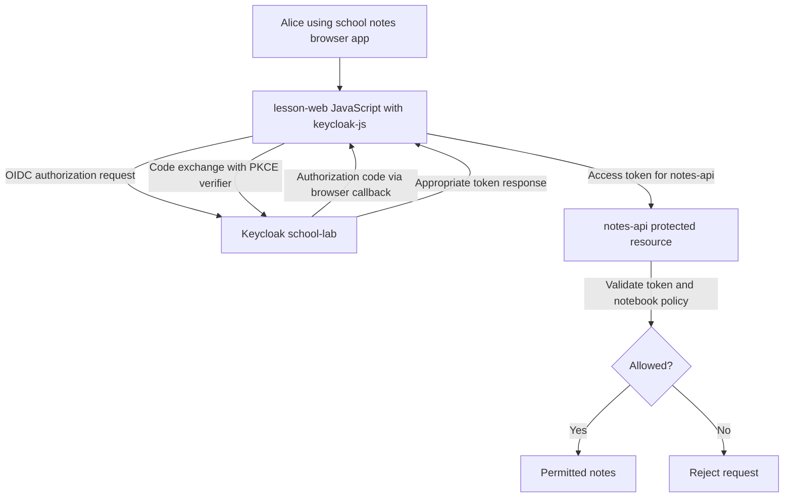
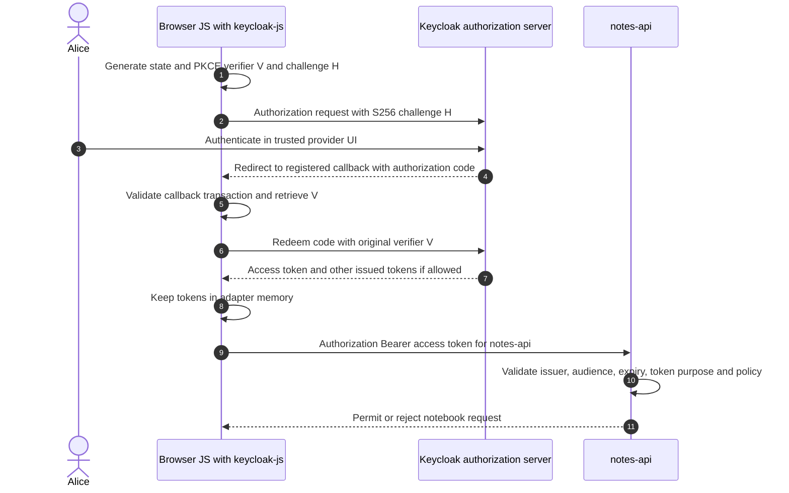
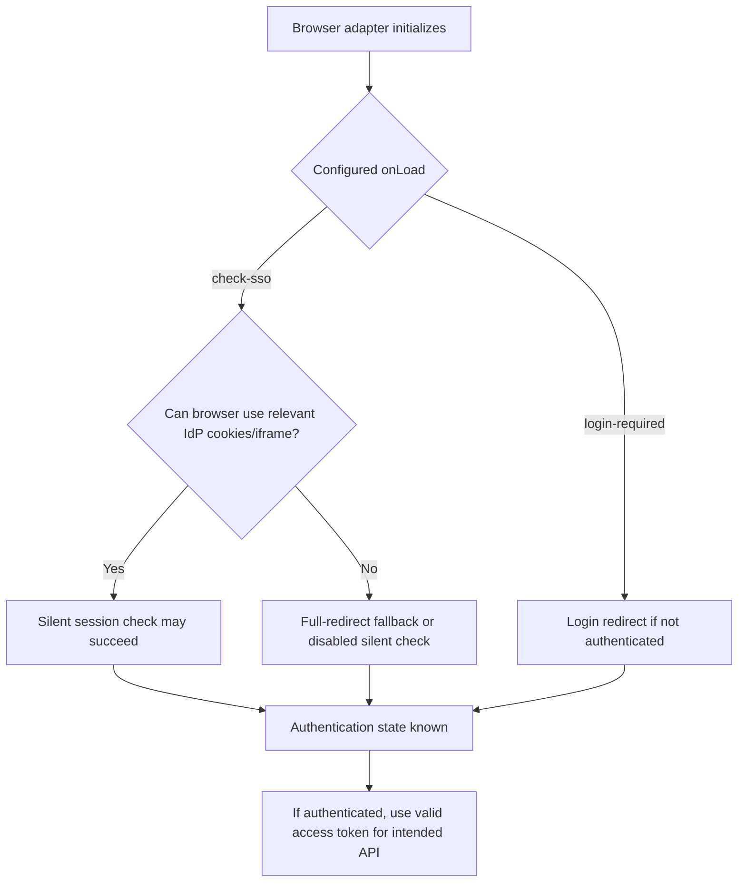

# keycloak-js: Keycloak's browser OAuth/OIDC adapter

> **Short explanation:** `keycloak-js` is Keycloak's **JavaScript library for browser-side applications**. It helps a running browser app initiate OIDC login, perform an Authorization Code exchange with PKCE, manage token state and refresh it as needed. It is **not** the Keycloak server, not a client registration, and not a full Backend-for-Frontend (BFF).

All examples are fictional: Alice, `lesson-web` (browser app), `school-lab` Keycloak realm and `notes-api` (resource API). This chapter describes a **browser OAuth client** architecture. Its security properties differ from a trusted FastAPI/Authlib BFF.

## 1. Five names that must not be confused

| Name | What it is | Where it runs |
| --- | --- | --- |
| **OAuth 2.0** | Delegated authorization protocol framework | Communication standard |
| **OIDC** | Authentication/identity layer using OAuth 2.0 | Communication standard |
| **Keycloak** | Authorization server / OpenID Provider | Trusted identity service |
| **`keycloak-js`** | Client-side adapter library for browser OAuth/OIDC | In the website's JavaScript |
| **Keycloak client registration** | Server-stored settings for permitted app URLs and policies | In Keycloak configuration |
| **Authlib** | Python OAuth/OIDC client library (alternative implementation) | Backend Python when used in a BFF |

A **running OAuth client** is the application code using a library. Keycloak's Clients page configures its registration, but **does not host or run** that browser code.

## 2. In this architecture, the browser is the OAuth client



In a typical **browser-only Keycloak adapter design**, JavaScript manages the access-token state and may call the protected API with the access token. This is why the client must be registered as a **public client**—a secret embedded in JavaScript or a downloadable website would not stay secret.

**Comparison:** In a full BFF, the OAuth client is the **backend**, access/refresh tokens remain backend-controlled, and the browser sends an **application session cookie** to the BFF instead of using an API access token directly.

## 3. A small illustrative adapter configuration

For a *disposable* browser-side learning app, the essential shape resembles:

```javascript
// Illustrative only. A real app must validate its own version,
// HTTPS origin, redirect allowlist, error behavior and API authorization.
import Keycloak from "keycloak-js";

const keycloak = new Keycloak({
  url: "https://login.example.test",
  realm: "school-lab",
  clientId: "lesson-web"
});

await keycloak.init({
  onLoad: "check-sso",
  pkceMethod: "S256"
});

if (!keycloak.authenticated) {
  // Show a login button or offer an allowed unauthenticated view.
}
```

Here `clientId` is a **public identifier**, not a password. **Never embed a client secret** or admin password in the browser bundle. For current releases, the adapter uses **Authorization Code** by default and `S256` PKCE is the default method, but explicitly showing `pkceMethod: "S256"` makes the teaching intent clear. Verify behavior against your installed Keycloak/keycloak-js version.

Two loading modes commonly matter: `login-required` redirects to login if needed, while `check-sso` checks whether an existing SSO session can authenticate the browser app without forcing login.

## 4. How Authorization Code + PKCE works in the browser



Keycloak does **not** send the access token in the initial authorization response of the code flow. The browser adapter redeems a **one-time code** using a **per-request verifier**, then receives the token response. PKCE protects against certain authorization-code interception attacks; it does **not** prevent XSS or make all browser token storage secure.

Use exact registered redirect URIs and permitted web origins. `state` transaction checks and issuer/nonce handling address other threats. See [PKCE](10-pkce-generation.md) and [code vs access token](11-authorization-code-vs-access-token.md).

## 5. Token lifetime and refresh in JavaScript

The official adapter exposes token state, authentication state and an asynchronous refresh mechanism. A conceptual protected API call can look like:

```javascript
// This is a classroom example, not a complete production API client.
async function loadMyNotes(keycloak) {
  await keycloak.updateToken(30); // ask to refresh if nearly expired
  const result = await fetch("https://notes-api.example.test/notes/mine", {
    headers: { Authorization: `Bearer ${keycloak.token}` }
  });
  if (!result.ok) throw new Error("Notes request refused");
  return await result.json();
}
```

A real app must handle a failed refresh by clearing unusable credentials or reauthenticating, must avoid leaking the token through logs/errors, and must ensure the API enforces **resource-specific authorization**. The token returned by `keycloak-js` is not automatically intended for every protected API; check the **actual audience and scope** configuration.

Current Keycloak guidance says the adapter **keeps access and refresh tokens in memory by default** and recommends not persisting them. Browser JavaScript can still be compromised by XSS or malicious dependencies; in-memory storage **reduces persistence exposure**, but is not proof that tokens are safe from script execution.

## 6. `login-required`, `check-sso` and browser-cookie restrictions

| Adapter behavior | What it tries to do | Limitation |
| --- | --- | --- |
| `onLoad: "login-required"` | Authenticate or navigate to identity-provider login | Can create a login redirect when no existing session |
| `onLoad: "check-sso"` | Check existing Keycloak SSO state | Behavior depends on browser and login cookies |
| **Silent `check-sso`** | Use a hidden iframe to avoid full-page redirects | Can fail or fall back when third-party cookies are blocked |
| **Session-status iframe** | Detect SSO session changes without polling in supported browsers | Third-party cookie restrictions can disable it |
| **`updateToken()`** | Request a newer token when permitted and necessary | Refresh may fail on expiry/revocation/outage |



Some modern browsers block **third-party cookies**, preventing the Keycloak session-status iframe and silent `check-sso` features from working reliably. This affects **SSO detection**, not the fundamental ability to perform an ordinary top-level login redirect under correct application setup. An app may discover logout later when a token refresh fails instead of immediately through the iframe.

**Do not rely on undocumented Keycloak iframe cookie values**: they are provider implementation details.

## 7. `localhost` versus `http://VM-IP`: secure contexts

Browser `crypto.subtle` is generally available only in **secure contexts**. An `http://localhost` or loopback page is often treated as potentially trustworthy; an ordinary HTTP page on a remote VM IP generally is not. A local browser diagnostic on a disposable site:

```javascript
console.log(window.isSecureContext);
console.log(Boolean(globalThis.crypto?.subtle));
```

This explains why browser PKCE/S256 or optional DPoP features requiring Web Crypto may work on localhost and fail when the same HTML is served over ordinary remote HTTP. **The correct network deployment is trusted HTTPS**, not turning off PKCE or adding a browser client secret. Replacing a CDN with locally hosted JavaScript does **not** change the secure-context status of the page origin.

[MDN Secure Contexts](https://developer.mozilla.org/en-US/docs/Web/Security/Defenses/Secure_Contexts) and [Keycloak adapter docs](https://www.keycloak.org/securing-apps/javascript-adapter) explain these boundaries.

## 8. How browser tokens differ from a full BFF

| Question | Browser app with `keycloak-js` | Full FastAPI/Authlib BFF |
| --- | --- | --- |
| Which component is OAuth client? | Browser JS application | Confidential backend |
| Who redeems authorization code? | Browser adapter | FastAPI OAuth client |
| Where is access token? | Browser-managed memory | Backend-protected token state |
| What does browser send to get notes? | API Bearer token | App session cookie to BFF |
| Who calls `notes-api`? | Browser app | BFF mediating request |
| Does using a CDN determine architecture? | No | No |
| Does using Authlib alone prove full BFF? | Not applicable | No; session, proxy and lifecycle required |

A backend that redeems the code and **returns access tokens to frontend JavaScript** is closer to a **token-mediating backend**. It must be assessed separately rather than falsely labeled a full BFF. See [RFC 10017](https://www.rfc-editor.org/rfc/rfc10017) and the [BFF chapter](13-bff-authlib-browser-session-security.md).

## 9. What a CDN does—and does not do

The JavaScript adapter may be loaded from a local bundle, a local static route or a remote CDN. All deliver **JavaScript code**. The **identity provider** still performs authentication and issues tokens, and `notes-api` still decides resource authorization.

A remote runtime CDN adds an **external availability and supply-chain trust dependency**. Bundling a pinned package locally or serving audited static assets can reduce that dependency. Browser HTTP caching may reuse assets regardless of source. None of these choices automatically protects refresh tokens or replaces HTTPS.

See [CDN, caches and sessions](16-cdn-vs-cache-keycloak-assets.md).

## 10. Browser security checklist

- Use **Authorization Code + PKCE S256**; do not use Implicit flow for new apps or disable PKCE to make a test page load.
- Register narrow **redirect URI** and **web-origin** allowlists; use trusted HTTPS outside local loopback.
- Keep browser apps **public clients**; no downloadable client secret.
- Prefer current supported adapter versions and pinned/verified dependencies.
- Reduce XSS risks with output encoding, review of scripts, strict CSP where practicable, and least-privilege application APIs.
- Do not persist browser OAuth tokens in `localStorage` or expose them in logs, query parameters, analytics or public debugging sites.
- Handle `updateToken()` failures and session state transitions without infinite refresh/redirect loops.
- Never treat a decoded ID token as a resource API access credential; validate the **actual access token audience**.
- Treat silent SSO/session-status iframe behavior as **browser dependent**; test blocked third-party cookie modes.

## 11. Safe test cases for a disposable browser client

| Test | Expected observation |
| --- | --- |
| `login-required` without session | Browser navigates toward Keycloak login |
| `check-sso` with no existing SSO session | App can remain unauthenticated under configured fallback |
| Authorization Code + PKCE | Auth endpoint request carries challenge; token request uses verifier |
| Wrong PKCE verifier or code reuse | Token exchange fails |
| Expired access token with valid refresh | Adapter can obtain replacement token, if issuer permits |
| Revoked refresh/session | Refresh fails and app handles reauthentication |
| Third-party cookies blocked | Silent SSO/status iframe behavior changes |
| Remote HTTP origin | Browser secure-context features may fail; do not deploy this way |
| Incorrect API audience | `notes-api` rejects the access token |
| Logout in another browser | Cross-tab/SSO awareness may be delayed under browser restrictions |

These are **test expectations**, not claims of executed browser tests or verified deployed code.

## 12. Quick check and references

1. Is `keycloak-js` the identity provider? **No**, it is a client-side adapter.
2. Does Keycloak's client registration execute JavaScript? **No**.
3. Is a browser SPA normally a confidential OAuth client? **No**.
4. Does code flow return an access token in the first browser callback? **No**, it returns an authorization code.
5. What does `updateToken()` do? **Request refresh as needed**.
6. Are tokens persisted by the adapter by default? **The current adapter primarily keeps them in memory**.
7. Does `check-sso` always work silently? **No**, browser third-party cookie restrictions matter.
8. Can `localhost` secure-context behavior be assumed on a remote HTTP IP? **No**.
9. Does serving the JS locally fix HTTP transport? **No**.
10. If the backend handles OAuth but exposes access tokens to JS, is that a full BFF? **No**.
11. Can a signed ID token be presented to `notes-api` as access token? **No**.
12. What protects the actual notebook? **API access-token validation plus resource-level authorization**.

**Official sources:** [Keycloak JavaScript adapter](https://www.keycloak.org/securing-apps/javascript-adapter) · [Keycloak OIDC integration](https://www.keycloak.org/securing-apps/oidc-layers) · [RFC 10017 Browser Apps](https://www.rfc-editor.org/rfc/rfc10017) · [RFC 9700 OAuth Security BCP](https://www.rfc-editor.org/rfc/rfc9700) · [MDN Secure Contexts](https://developer.mozilla.org/en-US/docs/Web/Security/Defenses/Secure_Contexts).

**Related:** [BFF/Authlib](13-bff-authlib-browser-session-security.md) · [PKCE](10-pkce-generation.md) · [CDN vs caching](16-cdn-vs-cache-keycloak-assets.md).

*Generic independent lesson. No real application assets, production auth tokens, customer information or actual test outcomes are included.*
