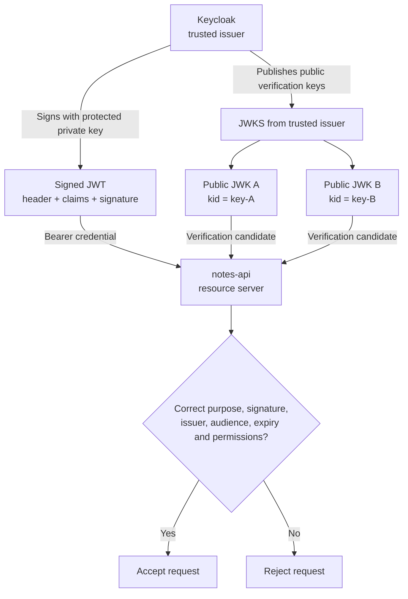
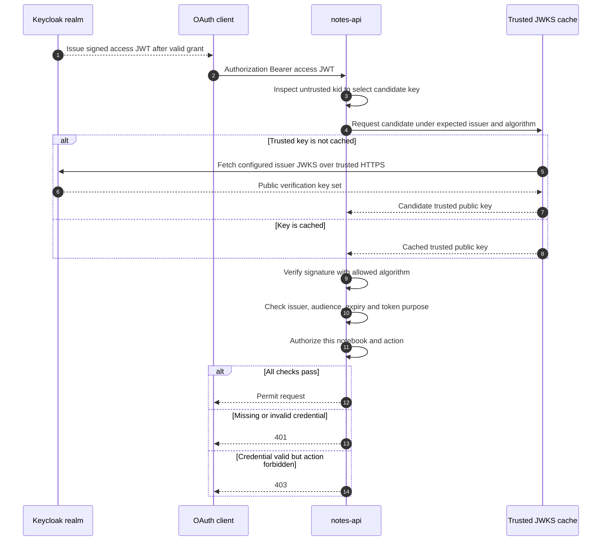
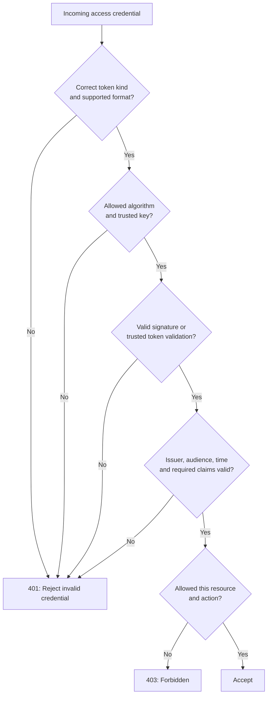
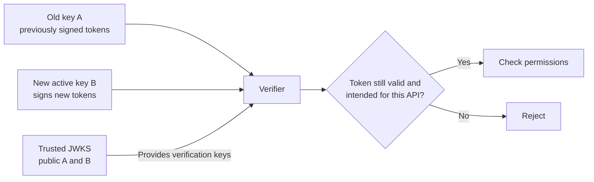

# JWT vs JWK vs JWKS: how APIs verify tokens

> **Simple explanation:** A **JWT** carries claims, a **JWK** represents one cryptographic key in JSON, and a **JWKS** holds a collection of keys. An API can use a *trusted* public verification key to verify a signed JWT, but must still check issuer, audience, lifetime, token purpose and resource permission.

This is independent technical teaching content. All users, hosts, keys and tokens below are fictional. Read [JWT issuance](04-jwt-issuance.md) and [API token validation](06-api-token-validation.md) for neighboring concepts.

## 1. Think of a signed letter and a trusted key directory

Alice gets a signed permission letter. The letter is like a **signed JWT**. A verification key can confirm that the letter was signed using the matching signing key. A trusted directory containing several current public verification keys is like a **JWKS**. Finally, the notebook service checks whether the letter is *intended for it* and *allows this particular action*.

**Analogy limit:** A valid signature does not by itself establish that the issuer is trusted, that the letter was meant for this API, or that Alice may read Bob's private notebook.

## 2. Compare six related terms

| Term | Definition | Not the same as |
| --- | --- | --- |
| **JWT** | JSON Web Token, a format representing claims in JWS/JWE form | An API permission by itself |
| **JWS** | JSON Web Signature, a signed or MAC-protected structure | Encryption |
| **JWE** | JSON Web Encryption, an encrypted structure | A signature alone |
| **JWK** | JSON Web Key, a JSON representation of one key | The token |
| **JWKS** | JSON Web Key Set, a JSON object with a `keys` array of JWKs | A token endpoint |
| **`kid`** | Optional key ID that helps select a candidate key | Proof of signature validity |

**Important:** JWKs and JWKSs are general key representations and can contain private or symmetric key material. **Keycloak's public OIDC certificate endpoint publishes public verification keys only**, not its signing private keys.

## 3. JWT encoding is not signature validation

The common **signed JWT as compact JWS** has three Base64URL components:

```text
BASE64URL(header).BASE64URL(payload).BASE64URL(signature)
```

Anyone can usually decode the header and claims. This is **not encryption** and **not verification**. A forged JWT can be perfectly readable. A compact **JWE** commonly has five dot-separated parts and is encrypted; nested signed/encrypted JWTs are possible. The word JWT does **not** guarantee three parts, confidentiality or trust.

Never put secrets or unnecessarily sensitive personal data in an ordinary readable signed JWT.

## 4. The relationship between token and keys



This diagram assumes **asymmetric signatures**, where a private key signs and a public key verifies. Symmetric MAC algorithms (such as `HS256`) instead use a shared secret; they do **not** distribute a public verification key through JWKS.

## 5. Understand the untrusted JWT header

This is only sample JSON, **not** a real token:

```json
{"alg":"RS256","typ":"JWT","kid":"key-A"}
```

- `alg` declares an algorithm. The API must independently **allowlist** acceptable algorithms and compatible keys; never trust arbitrary `alg` values such as `none`.
- `kid` is an **untrusted lookup hint** until the signature is successfully verified. An attacker can write any key ID into a forged header.
- `typ` expresses a token type when required by its profile. Do not conflate a JWT's general format with an OAuth access-token-specific type.

## 6. Understand a JWKS without copying real credentials

This **illustrates the JSON structure only**; neither RSA modulus below is a valid key:

```json
{
  "keys": [
    {"kty":"RSA","kid":"key-A","use":"sig","alg":"RS256",
     "n":"NOT_A_REAL_RSA_MODULUS","e":"AQAB"},
    {"kty":"RSA","kid":"key-B","use":"sig","alg":"RS256",
     "n":"ANOTHER_FAKE_MODULUS","e":"AQAB"}
  ]
}
```

The `keys` array is the JWK Set. For RSA, `kty` identifies key type, `n` the public modulus, and `e` the public exponent. A real provider may publish multiple keys and different approved key types. `kid` is useful during key rotation, but it is **not itself trusted authentication data**.

## 7. Find the trusted Keycloak JWKS

A **local disposable lab** may expose the realm discovery document and public certs endpoint at:

```text
http://localhost:8080/realms/school-lab/.well-known/openid-configuration
http://localhost:8080/realms/school-lab/protocol/openid-connect/certs
```

The OIDC discovery document advertises `jwks_uri`. The API must use a **configured, trusted issuer**, verify the authenticity of its discovery/JWKS endpoint, and use HTTPS in production. Do not let the incoming JWT choose an arbitrary key source.

In particular, **never blindly follow `jku` or `x5u` URLs from an unverified JWT**. Those attacker-controlled URLs can enable SSRF or signature-key substitution.

## 8. Full verification sequence



A real validator normally **caches JWKS**. When a new `kid` appears, it may refresh its *trusted* cache according to policy, but should not let arbitrary attacker traffic create unlimited remote key-fetch requests.

## 9. Signature verification is necessary but insufficient



For **JWT access tokens**, the resource API validates the issuer `iss`, expected audience `aud`, expiration `exp`, required time/purpose constraints and permissions, *in addition to* the allowed signature. A JWT for another API must be rejected even when correctly signed. **An OIDC ID token is for its OIDC client, not a bearer access token for your API.**

**RFC 9068 nuance:** When an issuer and resource server implement the **RFC 9068 JWT access token profile**, the required header type is `at+jwt` (or `application/at+jwt`); a conforming API must check it. **Do not assume every Keycloak JWT access token uses this profile**. Configure token-type checks appropriate to the actual issuer/profile. An opaque access token instead needs trusted introspection or another suitable validation mechanism.

## 10. What happens during key rotation?



A common safe rotation pattern is to create a new active signing key, publish its public verification key, and retain older public verification keys during a grace period based on **real token, cookie, offline-token and refresh lifetimes**. Keycloak supports active/passive key providers. Validators should refresh trusted key caches without trusting JWT-supplied URLs.

**Rotation is not revocation.** Signature verification of a still-valid JWT does not necessarily detect immediate user/session revocation or role changes; applications needing that guarantee must design additional state checks and appropriate expiry/revocation policy.

## 11. Explore public keys in a disposable lab

With your own *local, temporary* Keycloak server running and a realm named `school-lab`:

```sh
curl --fail --silent http://localhost:8080/realms/school-lab/.well-known/openid-configuration
curl --fail --silent http://localhost:8080/realms/school-lab/protocol/openid-connect/certs
```

Inspect `jwks_uri`, `keys`, `kid`, `kty`, `use` and `alg` when present. The first response is metadata; the second is the public key set. Do **not** upload real access tokens to online decoders or check them into Git.

## 12. Frequent mistakes and self-check

| Mistake | Correction |
| --- | --- |
| “I decoded the JWT, so it is valid.” | Decoding does not verify the signature. |
| “JWKS is a JWT.” | JWKS is a key set; JWT is a token. |
| “All JWKs are public.” | JWKs may contain private/symmetric material; the OIDC certs endpoint exposes public verification keys. |
| “`kid` proves the issuer.” | It is a key-selection hint only. |
| “Fetch whatever `jku` the token names.” | Only preconfigured, trusted issuer key sources. |
| “Any `alg` is fine.” | Explicit algorithm/key policy; reject unexpected values. |
| “A valid signed ID token is an access token.” | ID and access tokens are different credential types and recipients. |
| “A valid signature grants every action.” | Still verify audience, token purpose and resource permission. |

**Questions:** What are JWT/JWK/JWKS? Which one is sent to the API? What does `kid` do? Why does a new signing key not immediately invalidate every old token? What should the API do with a signed JWT for another audience? Answers appear in §§2, 5, 9 and 10.

**Legacy study Q16:** A trusted API should select the candidate key from the *configured issuer's* JWKS, then validate signature, issuer, audience, lifetime, purpose and permission. Presence of `kid` alone or an arbitrary token-provided URL is never sufficient.

## Official references

- [RFC 7517 — JSON Web Key / JWK Set](https://www.rfc-editor.org/rfc/rfc7517)
- [RFC 7519 — JWT](https://www.rfc-editor.org/rfc/rfc7519)
- [RFC 7515 — JWS](https://www.rfc-editor.org/rfc/rfc7515)
- [RFC 7516 — JWE](https://www.rfc-editor.org/rfc/rfc7516)
- [RFC 8725 — JWT Security Best Current Practices](https://www.rfc-editor.org/rfc/rfc8725)
- [RFC 9068 — JWT Profile for OAuth 2.0 Access Tokens](https://www.rfc-editor.org/rfc/rfc9068)
- [Keycloak OIDC endpoints](https://www.keycloak.org/securing-apps/oidc-layers)
- [Keycloak Administration Guide: realm key rotation](https://www.keycloak.org/docs/latest/server_admin/)

**Continue:** [JWT issuance](04-jwt-issuance.md), [API token validation](06-api-token-validation.md), [OIDC vs OAuth](09-oauth2-oidc-keycloak-relationship.md).

*General education with fake values, not production configuration. Check your provider version and token profile.*