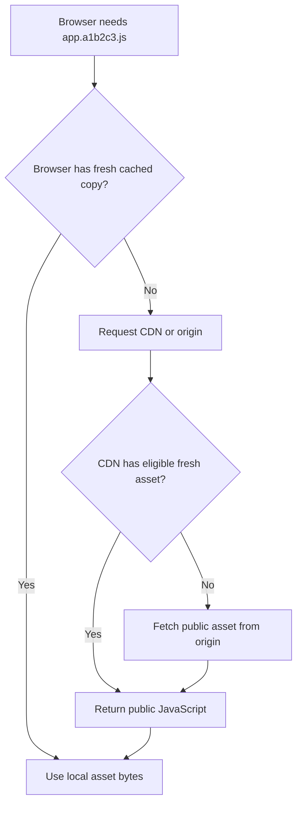
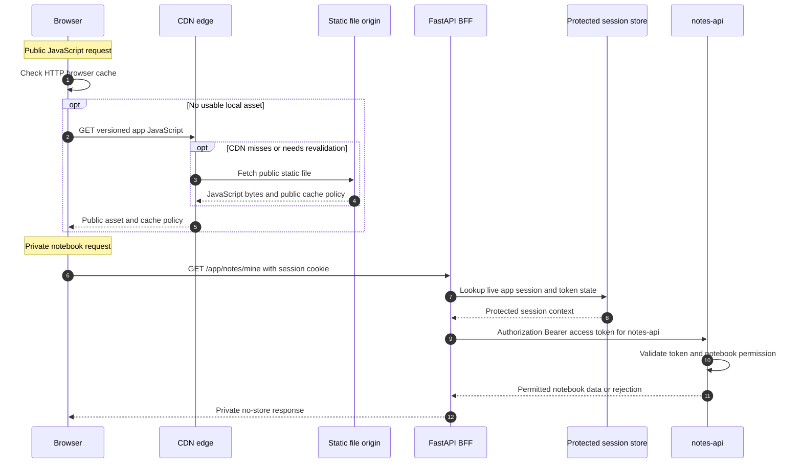
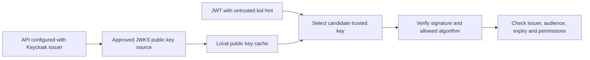

# CDN vs HTTP cache vs session store in an OAuth application

> **In one sentence:** A **CDN** can deliver and cache public JavaScript; a **browser HTTP cache** may reuse downloaded files; a **protected backend session store** keeps application login state. These systems have different trust rules. **None of them is the Keycloak authorization server.**

This tutorial uses a fictional `lesson-web` website, Keycloak `school-lab` realm, Alice and protected `notes-api`. The main example contrasts two HTTP requests: **a public versioned JavaScript asset** and **a cookie-authenticated private notebook request**.

## 1. Three concepts that sound similar but are not

| System | What it stores or delivers | Main function | Security concern |
| --- | --- | --- | --- |
| **CDN** (Content Delivery Network) | Public static assets, eligible cacheable responses | Deliver content efficiently from geographically distributed locations | Supply-chain trust, outages, accidental shared caching |
| **Browser HTTP cache** | Responses reused according to HTTP caching rules | Avoid re-downloading unchanged files | Freshness, incorrect caching of private responses |
| **BFF session store** | Protected session records and token state | Map app session IDs to authenticated server-side state | Session hijack, token theft, expiry/revocation |
| **Browser cookie store** | Cookies sent to matching origins/paths | Carry application session identifiers | Credential replay, CSRF, missing Secure/HttpOnly |
| **API JWKS cache** | Trusted issuer public verification keys | Verify JWTs without network fetch on every request | Key rotation and trust-source poisoning |

**Do not confuse a software product's name with its security role.** A general-purpose key-value database may operate as a session store, a cache, or something else. What matters is **who can reach it, what it stores, how it expires and what the application trusts**.

## 2. What happens when a browser loads JavaScript?

Suppose Alice opens `https://app.example.test` and the webpage needs a versioned `/static/app.a1b2c3.js` file. The browser checks whether it already has a **fresh** cached copy. If not, it requests the asset from the configured origin or CDN. A CDN edge may in turn return a fresh cached file or fetch from the static asset origin.



The CDN delivers **code**, not Alice's OAuth access token. Once loaded, browser code using `keycloak-js` can initiate a login with **Keycloak itself**. Serving JavaScript from a CDN does not make the CDN an identity provider or the resource API.

## 3. CDN versus browser cache: where is a copy?

A CDN is an **infrastructure layer** that can have its own shared edge caches. A browser cache is **local to a user's browser context**, subject to modern browser cache partitioning and HTTP policy.

The same asset might be copied in **both** locations. Loading a script from a CDN does not mean it downloads afresh on every reload, and serving it locally does not prevent browser caching. A cache miss can lead to network fetch from the origin; a stored but stale entry may be **revalidated** instead of fully downloaded again.

Inspect the browser's developer tools Network tab for the request URL, response headers and whether bytes came from memory/disk cache or a `304 Not Modified` response. Browsers and CDN products expose different cache-status indicators. Do not share screenshots containing cookies, authorization headers or session identifiers.

## 4. Four `Cache-Control` policies explained correctly

| Header | What it means | Appropriate example |
| --- | --- | --- |
| `Cache-Control: public, max-age=31536000, immutable` | A versioned public response may remain fresh for a year and should not need revalidation while fresh | Fingerprinted JavaScript file whose filename changes with content |
| `Cache-Control: no-cache` | A response **may be stored** but **must be revalidated** before reuse | Frequently updated public HTML |
| `Cache-Control: private` | Shared caches must not store the response; a private browser cache may | User-specific content that may be private-cached under carefully chosen policy |
| `Cache-Control: no-store` | Caches should not store the response | Token responses and particularly sensitive personalized responses |

**The critical distinction:** `no-cache` does **not** mean "do not store". It means **revalidate before reuse**. `private` is **not** synonymous with `no-store`. A response marked `no-store` does not retroactively delete an already-stored response for the same URL. See [MDN HTTP caching](https://developer.mozilla.org/en-US/docs/Web/HTTP/Guides/Caching) and the [Cache-Control reference](https://developer.mozilla.org/en-US/docs/Web/HTTP/Reference/Headers/Cache-Control).

Use `public, immutable` only for genuinely public versioned content. Avoid year-long caching of a mutable `app.js` URL, or users can run outdated code.

## 5. One public request vs one private request

Public static asset, suitable for long-lived caching **when its name is content-versioned**:

```http
GET /static/app.a1b2c3.js HTTP/1.1
Host: app.example.test

HTTP/1.1 200 OK
Cache-Control: public, max-age=31536000, immutable
Content-Type: text/javascript
```

Sensitive personalized response from a hypothetical full BFF:

```http
GET /app/notes/mine HTTP/1.1
Host: app.example.test
Cookie: __Host-lesson_session=OPAQUE_SAMPLE_ID

HTTP/1.1 200 OK
Cache-Control: no-store
Content-Type: application/json
```

The second response must **not** be stored in a shared public CDN cache. The browser sends a sensitive application cookie to its own BFF; the BFF resolves protected session state and fetches Alice's permitted notebooks. It does not return access/refresh tokens in its response.

These are schematic HTTP excerpts with deliberately unusable placeholder values—not packet captures.

## 6. The two paths have different trust boundaries



**Key security invariant:** a browser cookie is **not** a browser HTTP cache entry; a protected session store is **not** a public CDN; and a Keycloak-issued JWT is **not** the same credential as a BFF session ID.

## 7. Public JWKS can be cached too—but only from a trusted issuer

A resource API using signed JWT access tokens can cache **public verification keys** obtained from a trusted issuer's JWKS. This is an application-side trust cache, not user-session storage. The API must bind the key origin to its configured Keycloak issuer, honor an appropriate cache/rotation strategy and **never turn an arbitrary token-supplied URL into a trusted key source**.



An unknown key ID may justify a **bounded refresh of approved keys**, but not a fetch from an arbitrary `jku` or `x5u` token header. Rotation, outages and key compromises need different policies from CDN static asset freshness.

## 8. Browser session storage versus cookie versus access token

| Object | Example | Location in a full BFF | Lifetime / revocation |
| --- | --- | --- | --- |
| **Browser application cookie** | Random opaque ID | Browser cookie jar | Browser expiry plus server invalidation |
| **BFF session record** | Session ID → trusted user + protected token state | Restricted backend store | Idle/absolute TTL, session rotation, logout |
| **OAuth access token** | Bearer token for `notes-api` | Protected backend in a full BFF | Issuer expiry and API policy; may be refreshed |
| **OAuth refresh token** | Credential to renew access | Protected backend if issued | Issuer grant policy, rotation/revocation |
| **Public JavaScript asset** | Fingerprinted app bundle | Browser HTTP cache / CDN edge if allowed | HTTP freshness and versioned asset change |

Some backend session stores use databases or key-value technology also popular as caching systems. A protected session record must nonetheless have strong access controls, encryption and backup policies as appropriate, safe TTL and revocation design, and no public access. Never put token material into a **signed but readable** Starlette session cookie: it is not an encrypted server-side vault. See [BFF/Authlib security](13-bff-authlib-browser-session-security.md).

## 9. Does removing the CDN fix browser PKCE failures?

**No.** Two independent mechanisms are involved:

- **Static asset delivery:** External CDN versus bundled/local scripts changes network dependency, software supply-chain exposure and caching behavior.
- **Browser secure context:** `window.isSecureContext` and availability of `crypto.subtle` depend on the **page's origin and browser trust rules**, not merely where the JavaScript source file was downloaded.

A local `http://localhost` page may be a potentially trustworthy context. An ordinary `http://<remote-network-IP>` page generally is not. Bundling the `keycloak-js` module locally avoids a third-party CDN fetch but **does not make remote HTTP secure**. Moving OAuth code exchange/PKCE into a trusted Python BFF avoids requiring browser-side PKCE Web Crypto, but **still requires secure HTTPS transport**.

## 10. Runtime CDN risks versus local packages

| Question | External runtime CDN script | Locally built/served versioned assets |
| --- | --- | --- |
| External dependency for first uncached page load? | Yes | Not for that third-party CDN host |
| Can browser HTTP caching still occur? | Yes | Yes |
| Does script source determine who signs in? | No; Keycloak is the IdP | No; Keycloak is the IdP |
| Is script automatically trustworthy? | No; verify dependency and delivery | No; verify supply chain and build output |
| Does this change OAuth client architecture? | No, by itself | No, by itself |
| Does it protect secrets or fix insecure HTTP? | No | No |

Prefer maintained, pinned package versions and auditable build inputs. Use appropriate integrity policies (for example SRI where compatible), CSP and dependency review. An external CDN can be useful for public content delivery but should not become an unreviewed authority for authentication script logic.

## 11. A browser DevTools exercise without credentials

In a **disposable** fictional website:

1. Open **Network** tools and reload while keeping any real credentials out of the recording.
2. Filter for JavaScript, locate the **Request URL**, and identify whether bytes came from your app's static route or a CDN hostname.
3. Inspect **Status**, **Size**, `Cache-Control`, `ETag`, `Age` or cache-status headers if present.
4. Compare a reload with the current HTTP cache and a permitted test reload with cache disabled.
5. Predict whether a long-lived `app.hash.js` or frequently changed HTML should be cacheable and why.
6. Identify **separately** the browser's session cookie and protected BFF session store. Do not copy actual `Cookie`, `Set-Cookie`, `Authorization` or token response bodies.
7. Ask whether the protected API's JWKS public key cache follows its own issuer-pinning/rotation policy.
8. Confirm private notebook responses cannot be shared-cached and the API still checks the resource permission.

This is a safe **test plan**; it does not assert any webpage or application was inspected.

## 12. Self-check and official sources

1. **Can a CDN return a JavaScript file?** Yes, it distributes assets.
2. **Does a CDN authenticate Alice by itself?** No.
3. **May a browser cache files fetched from a CDN?** Yes.
4. **Does `no-cache` mean do not store?** No, it requires revalidation.
5. **Does `private` prohibit a browser from storing a response?** No, mainly shared caches.
6. **What is a common policy for sensitive token responses?** `Cache-Control: no-store`.
7. **May a versioned public asset use long-lived immutable caching?** Yes, when filenames change with content.
8. **Is the BFF session record the browser's HTTP cache?** No.
9. **Can a JWKS cache contain public keys?** Yes, from an approved trusted issuer.
10. **Does replacing CDN with local JS automatically enable browser Web Crypto over HTTP VM IP?** No.
11. **Does the browser need OAuth access tokens in a full BFF?** No; it uses a separate app session.
12. **Can a public CDN cache Alice's private notebook response?** No, not under the safe design shown.

**Authoritative sources:** [MDN HTTP caching](https://developer.mozilla.org/en-US/docs/Web/HTTP/Guides/Caching) · [MDN Cache-Control](https://developer.mozilla.org/en-US/docs/Web/HTTP/Reference/Headers/Cache-Control) · [MDN CDN](https://developer.mozilla.org/en-US/docs/Glossary/CDN) · [Keycloak JavaScript adapter](https://www.keycloak.org/securing-apps/javascript-adapter) · [RFC 10017 Browser App BCP](https://www.rfc-editor.org/rfc/rfc10017) · [RFC 8725 JWT BCP](https://www.rfc-editor.org/rfc/rfc8725).

**Related:** [keycloak-js browser adapter](14-keycloak-js-browser-adapter.md) · [full BFF](13-bff-authlib-browser-session-security.md) · [API JWT/JWKS verification](15-jwt-vs-jwks-verification.md).

*Fictional independent content only. No actual customer data, real tokens, screenshots or operational cache configuration.*
